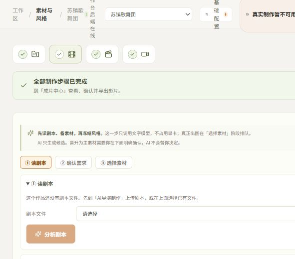

# 导演模式建设验收、缺陷与新增需求

- 日期：2026-11-05，北京时间。
- 本次基线：`main / 693751fe77c4d613dcd6aa160bb60e9dd078b1f7`。
- 方式：当前源码审查、隔离测试、真实页面只读检查、运行中 API 状态读取。
- 总体结论：**PARTIAL / NOT ACCEPTED**。已有图片执行基础，但完整导演旅程仍有缺陷；本轮新增的网格、单段重生成、长剧本分步生产尚需建设。
- 配套：[可直接交给本机 Agent 的收尾提示词](LOCAL_AGENT_DIRECTOR_CLOSEOUT_PROMPT_20261105.md)。

## 1. 验收范围及证据边界

本次没有修改业务代码，没有重新提交真实 LLM/Qwen/H3 任务，没有替用户晋升候选或冻结风格，没有重启当前服务或发布安装包。以下问题来自本次代码、测试或页面证据；前轮真实出图仅按已有报告引用，不算本次重新验收通过。

当前已有报告 `ACCEPTANCE_20261105_REAL_IMAGE_VALIDATION.md` 记录三类 Qwen 小样 run `8289c72e…` 成功、受管所有权和技术解码通过。该结果证明前轮小样路径，不能替代普通素材批次的真实编剧→出品人→选用→H3 全链路。候选的构图/美术仍待人工确认。

本次检查的页面为当前开发机 `http://127.0.0.1:5173`，API 为 `http://127.0.0.1:8000`，选中作品「苏镇歌舞团」。另发现 8133/5193 也在监听，未混用其状态、未关闭任何实例。端口监听本身不证明是哪套数据或代码，接手时需核对进程与数据目录。

## 2. 当前运行阻塞

本次 GET `/api/v1/setup/readiness` 返回：

- `L4_services_and_contracts=PENDING`，阻塞 `SERVICE_VALIDATION_STALE_CONFIGURATION`。
- `runtime_activation.status=INVALID_REQUIRES_REVIEW`。
- `runtime_activation.error=ACTIVE_RUNTIME_CONFIGURATION_CHANGED`。
- `render_provider=unavailable`，`services_verified=false`。
- `L5_real_inference=NOT_VERIFIED`（当前就绪度结论，不能据此抹去历史出片）。

GET `/api/v1/system/status` 返回 `worker_online=false`、`running_jobs=0`。这是采样时状态，不把它直接认定为代码缺陷；接手须核查 Worker 心跳、进程和数据目录。页面同时显示「工作台后端在线」「真实制作暂不可用」，与 API 区分一致。

因此本次没有条件在现有主栈直接开展无人值守真实生产验收。收尾应先恢复并重新验证当前配置与 Worker，保留未知请求和租约，不靠改 READY 标志解锁。

## 3. 已复现缺陷

### A01 [P0] 再次分析会重放结果未知的编剧请求

- 位置：`backend/shine/materialprep/scenes.py`，`_reusable_artifact` 只寻找 `SUCCEEDED`，`prepare_scenes` 对同输入的 `NEEDS_REVIEW/UNKNOWN` 没有阻止重放或原子认领。
- 本次隔离 HTTP 复现：将 mock responder 设置为抛出模拟响应丢失异常；对同文档连续调用 `/material-preparation/scenes/prepare` 两次。
- 实际结果：两次 HTTP 200；`provider_calls=2`，`unknown_tasks=2`。旧任务的 `automatic_replay=false` 字段不能阻止下一请求产生新外部调用。
- 影响：用户重试分析、刷新后再点分析会重复耗费模型调用，且破坏未知结果保留规则。并发重入也需一并验证。
- 修复要求：同项目/文档修订/场片段/工具与模型指纹的持久输入身份，原子认领与业务唯一约束；RUNNING/UNKNOWN 查询原任务，不重复调用。显式替代请求必须有单独语义和审计。
- 本次复现脚本保存在 `docs/evidence/director-acceptance-20261105/test_unknown_scene_replay_repro.py`。该脚本断言“缺陷存在”，**修复后应改为断言只调用一次**，不能原样当通过回归。

### A02 [P1] 剧本分段遗漏前言，长场引用不完整

- 位置：`backend/shine/materialprep/source_spans.py`。
- 复现一：输入「前言锁定事实：钥匙在阿德手里\n场景一：房间\n阿德：出发」，`segment_document` 的所有返回 scene.text 都不包含前言，`preamble_retained=False`。
- 复现二：场标题后加 210 行事件，正文包含 `事件209`，但引用 spans 不包含它，`body_contains_tail=True / tail_citable=False`。原因是达到 200 spans 后 `break`。
- 复现三：场标题后加 9000 字，返回单场长度 9007，没有遵守无标题路径采用的 4000 字拆分边界。
- 影响：人物设定/锁定事实可能遗漏，长段尾部无法合法引用，预算超限时只能拒绝，不能达到长剧本处理目标。
- 修复要求：前言纳入明确来源区；标题场与无标题场都支持 token 预算拆分；长单行、超过 200 行继续分片而非截断；保留全量来源偏移与稳定引用。

## 4. 源码确认的功能缺口

下列为当前代码行为确认，部分尚未用真实模型/真实资产操作复演。优先修复，再添加有针对性的测试。

### A03 [P1] 「确认使用所选素材」没有真正的选图过程

- `MaterialPreparationPanel.tsx` 候选只呈现版本文字标签，无 ``、缩略图、预览或选择控件。
- `promoteSelected` 自动选择 `runs.find(kind === 'production') ?? runs[0]`，再对每项执行 `find(!formal_asset_id)`。
- 用户无法决定批次、需求、版本或勾选集合；点击「所选」并不对应用户实际选择。
- 验收要求：图片网格 + 放大预览 + 按需求显式选择候选版本；晋升请求严格只包含本次用户选择，显示原始图片、身份、来源和版本。不把 validation 批次静默作为正式需求候选。

### A04 [P1] 已有主素材选择缺少资产选择器与状态恢复

- 素材来源下拉默认始终使用本地 `strategy[id] ?? 'generate'`，未回填后端 requirement.strategy。
- 已有主素材只可选择策略文字，页面没有 asset_id 选择器；确认时只回传原来的 `bound_asset_id`，新需求通常为 null。
- 影响：刷新后策略显示可能与已确认状态不一致；选择已有素材无法完成明确绑定；待确认上传容易被误当生成项。
- 修复要求：从权威快照初始化并保留未保存编辑，显式选择本项目素材与版本，显示待确认上传；旧响应不能覆盖新项目或新编辑。

### A05 [P1] 默认文字模型可就绪，但素材链没有远程文字授权路径

- `scenes/prepare` 后端支持 `allow_remote_text`，当前素材页面没有授权控件，也不发送该字段。
- 出品人 `brief.ensure_brief` 对所有非 loopback 的真实 profile 直接 `REMOTE_AGENT_CONSENT_REQUIRED`，没有消费已持久化授权的分支。
- 这是配置兼容缺口：本地文字服务可运行；使用远程文字 provider 的用户会在此阻塞。不能据本次小样通过认为这条链已验收。
- 修复要求：明确展示文字传输范围，保存项目/文档修订/角色与 provider 边界内的文字授权，Worker 验证后使用；不上传图片字节、不静默换本地模型、不删除同意门禁。

### A06 [P1] 恢复与再生成 API 已存在，导演页面只接了取消

- 后端已有 `resume/reconcile/regenerate` 路径；`MaterialPreparationPanel.tsx` 未调用这些操作。
- 用户看到失败或需要核对后缺乏就地处理；再生成版本也没有可用 UI。
- 修复要求：按服务端 allowed_actions 展示单项恢复、核对、修改描述再生成，UNKNOWN 只核对，保留历史版本。

### A07 [P1] 主素材完成判定可能忽略显式绑定

- `service.evaluate_materials` 先按 family/entity_id 找第一条资产，只在不存在身份匹配时才读取 bound_asset_id。
- 同身份存在多版时，该顺序可能与用户明确选中的主资产不同。本次为源码确认的版本选择风险，尚未用多版真实素材复演。
- 修复要求：bound_asset_id/版本/hash 优先且严格检查；未绑定时再给推荐，不用隐式第一条身份匹配代替人工选用。增加两个同身份不同版本的回归。

### A08 [P1] 前期编剧仍在一个 HTTP 请求内处理全剧所有场

- `api_material.prepare_material_scenes` 同步调用 `scenes.prepare_scenes`，逐场循环结束后才返回。已成功场可复用，但整个运行没有可轮询的持久批次与可选范围。
- 当前产物是 `ScriptPreparation`，并非全剧大纲，也不是用户可选择生产段落的正式分镜合同。
- 修复要求见新增需求 R3。不要把现有按场循环当成长剧本分步生产已经完成。

## 5. 当前页面检查

| 步骤 | 实际页面/行为 | 健康状态 |
| --- | --- | --- |
| 1 素材与风格 | 能打开素材准备、上传和风格区；已有素材可读 | 部分可用；选中旧作品暂无 ProjectDocument，不能在此直接复演新素材链 |
| 2 素材选择实现 | 候选只显示文字版本，源码无选图/预览 | 未满足人工选图和网格要求 |
| 3 成片中心 | 能显示历史成片；同 artifact 在自动交付和 delivery-list 又呈现一次 | 可预览历史合成片；缺分段网格、单段重生成；需按 artifact 去重 |
| 4 长剧本 | 当前按场素材分析，无总体大纲/生产范围 UI | 新需求未实现 |

本次窗口约 591 px 宽，顶部文字发生换行挤压。新增网格应覆盖宽屏与窄面板响应式，不能只在全屏截图验收。未开展完整键盘、读屏、对比度验收，不宣称无障碍合规。

本次截图仅供本机审查，不作为真实生成新素材的证据：

## 6. 新增需求（用户本轮明确提出）

### R1 素材网格

上传素材与 AI 候选都使用自适应网格卡片。卡片呈现缩略图、名称、角色/场景/道具类型、身份、版本、生成/QC/晋升状态及操作。宽屏容纳多列，窄屏自然减少；图片以 contain 展示避免截掉完整头部/道具。支持点击放大、逐项选择、同需求历史版本对照、失败重试与核对。大量卡片分页或按需加载，禁止全量解码原图。

「网状」解释为网格卡片布局，不新增拖拽排序；不要无依据改变素材/引用顺序。

### R2 第四步视频产出：先分段，再完整成片

- 当前导演末步为 `#d/deliver`。按实际 H3 工作流一次生成的 segment 展示 N 张有序视频卡片，再展示合成影片与历史版本。
- 一个 segment 可能包含多个 editorial cuts。不能把每个剪辑切点错当可独立 H3 重生成单元。
- 卡片显示范围、时长、当前 job/attempt 版本、状态、缩略图/播放器、下载与「重新生成此段」。播放器按需加载，不同时预加载 N 个视频。
- 单段重生成走新 job/attempt 或既有受控修订机制，保持同一冻结合同；旧通过版本与媒体保留、不覆盖，不因点击重跑其他独立段。
- 若用户修改提示意图，生成新的可审计 shot/spec/request 修订；不能修改冻结事实或直接提交自由文本 H3 prompt。
- 存在 last_frame 等真实依赖时，明确列出受影响后继并失效/复核，绝不为了“只重做一段”隐藏依赖。无依赖段必须可单独重做。
- 新版本通过所需门禁并被明确选为当前装配版本后，再产生新 delivery revision；老成片保留并标注来源版本，不静默拼接失败/未接受版本。
- 非终态、UNKNOWN、租约待对账时禁重发并显示可执行原因；重复点击幂等。

### R3 长剧本：总体大纲 → 生产段落 → 分批分镜

建立两个不同粒度：章节/场群的「生产段落」承载用户分步工作；H3「生成分段」承载一次 4–15 秒工作流输出。两者不能共用含糊的 segment ID。

1. 导入全文并固定原文/hash/偏移；分块局部摘要，再层级归并为全剧大纲，避免一次把数小时全文塞模型。
2. 大纲版本包含故事结构、人物身份/关系、时间线、锁定事实、章节/场群索引与每段来源、承接状态。摘要不能替代原文事实。
3. 生成可生产段落清单，显示顺序、剧情范围、预计时长、素材和阻塞；预计时长是估计，非 H3 实测承诺。
4. 用户先确认大纲，再选择一个或若干段落生成正式分镜；不自动生成全剧全部镜头。
5. 该段只读取相关原文、批准大纲、人物/资产/Style/Rule 合同、必要前后承接摘要；同段内部继续按 H3 限制确定性切片。
6. 所有大纲/段落/分镜任务后台持久化、可轮询/暂停/接续/取消；关闭页面、Worker 重启、重复点击不会丢失或重放未知请求。
7. 全局身份与段间连续性跨段保持；后段缺前序确认状态时明确阻塞或按允许的独立规划规则处理，不能虚构已通过前镜。
8. 原文/大纲/用户事实变化后精确失效受影响段与依赖，不重写已通过媒体；重新选择当前版本需明确审计。
9. 旧短剧本和现有正式项目兼容，不强制重做。

这是实质编排能力扩展，不能以 textarea 截断、按 4000 字循环或一次超长 HTTP 请求代替。

## 7. 本次测试结果

| 命令/检查 | 本次结果 |
| --- | --- |
| `uv run --project backend --locked pytest -c backend/pyproject.toml backend/tests/test_material_preparation.py backend/tests/test_material_image_jobs.py backend/tests/test_material_director_flow.py` | 67 passed，1 条 Starlette 弃用告警 |
| 同上执行 `test_material_scenes.py test_material_brief.py test_material_render_e2e.py test_material_render_ownership.py`（每个路径前缀为 backend/tests/） | 12 passed，1 条同类告警 |
| 隔离临时 HTTP 复现 UNKNOWN 重放 | 1 passed（断言缺陷存在，不计入产品合格测试） |
| `npm.cmd test`（frontend） | 18 文件、130 测试全部通过 |
| `npm.cmd run build`（frontend） | TypeScript/Vite 成功；JS chunk >500 kB 提示，非构建失败 |
| `uv run --project backend --locked ruff check backend/shine backend/alembic backend/tests` | All checks passed |
| 分段纯函数边界探针 | 前言丢失、200 行引用截断、9007 字场景未拆分均已复现 |
| 全量后端、Alembic、Windows 四入口、安装包、真实新 Qwen/H3 | 本次 NOT_RUN；历史报告不作为本次重新通过 |

首次专项命令曾引用方案中建议但实际不存在的 `test_material_agent_contracts.py`，收集失败、未运行测试；已改为当前真实测试文件后得到上述结果。接手勿照抄不存在的建议文件名。

现有单元测试通过只说明覆盖范围内行为稳定；人工选图、UNKNOWN 重放、长文本无损与新增功能需新增实质回归。

## 8. 收尾顺序

1. P0 未知请求重放、原文无损分段与来源范围校验。
2. 当前配置/Worker 对账恢复，补远程文字授权路径与真实正式素材批次。
3. 素材网格、真实选用/绑定、恢复/再生成 UI。
4. 视频分段网格、单段重生成与版本化装配。
5. 全剧大纲/生产段落的持久化编排、分步正式分镜。
6. 完整回归、真实 UI 全旅程、用户艺术评审、Windows 入口与安装包交付。

全部问题与新增需求闭环前维持 `PARTIAL / NOT ACCEPTED`。本次新增报告与提示词作为收尾输入，不改写前轮验收历史。
