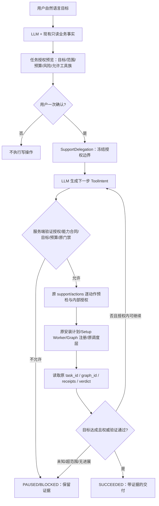

# Shine AI 管家 V3.1：任务级一次授权与开发者级后台执行契约

> 状态：设计方案 / 待开发，**不是**已合并代码、已完成测试或已验证用户机的声明。
>
> 远端审阅基线：`anjingdtl/shine-video-studio`，`main`，`ae3cd990f64b1b22d24657a79b41417d23831c2c`（2026-11-19 查询）。如开发时 `main` 已更新，必须先重做差异审计。
>
> 设计准绳：**一套事实、一个裁决、一个执行者；运行时 AI 对项目源码和受保护程序文件零修改；用户只点击一次任务授权。**

## 0. 产品目标、术语及不可妥协的边界

**目标**：用户用自然语言说明一个业务目标，例如「给我的 H3 配齐加速 LoRA、二次采样、RelayVSR X2，自动寻找缺失资源、安装可信节点、装配注册工作流并真实验收」。AI 先只读了解情况，向用户展示一次目标级授权；确认后，LLM 可以反复调用已经对接的 Shine 后台工具，动态发现缺失项、下载、注册、修改用户级配置、启停拥有控制权的进程、复核、修正，直至目标达成或明确阻滞。**授权范围内不得要求用户逐步二次点击。**

**边界含义**：允许 AI 写入 `WorkflowProfile` 等**用户业务数据与配置**、存放模型权重、经批准的整包节点、安装回执、资源登记记录；**禁止 AI 编写、覆写、打补丁、删除** Shine 源码、Git 跟踪的内置工作流/节点模板、用户已有的第三方节点源码及通用代码文件。受控安装固定版本的完整第三方节点**客观上会引入可执行代码**，其可执行性与来源必须由既有受控安装器审查，不能仅凭“未手工编辑源码”认定无风险。

“开发者级权限”指**使用 Shine 提供且经过审查的完整后台管理业务能力**，并非任意 Shell、任意 HTTP、管理员提权、绕过审批门禁或运行未知脚本。不能覆盖现有代码保护、供应链安全规则和生产业务确认门禁。

## 1. 远端真实基线：复用与缺口

| 模块/事实 | 现状（已核对） | V3.1 的唯一改造方向 |
|---|---|---|
| `backend/shine/support/models.py` | `SupportDelegation` 保存已授权计划、预算、状态，`SupportAction` 保存快照/目标指纹、预览哈希、原任务 ID | **扩充现有两类记录**承载一次授权和动态子动作关系，禁止另建 AI 安装/生产任务台账 |
| `support/delegation.py` | 仅对预览时固定 `approved_orders` 委托；默认为低风险自动步骤，GPU/付费受预算约束 | 从“固定步骤集合”扩展成“冻结授权边界 + 后续动态步骤”，不复制业务执行器 |
| `support/actions.py` | `preview_action()` 校验能力合同、参数和原目标；`approve_action()` 重读快照/目标指纹后派发；`refresh_action()` 从**原任务 ID**取结果 | 增加已认证的任务授权上下文与逐动作自动审批入口；**不得放宽任何合同、目标指纹或占用门禁** |
| `copilot/declarations.py` | 具备 `setup_repair`、`setup_reconcile`、`workflow_user_copy` 等；完整工作流图改写/新组件注册尚未对 AI 开放 | **扩充同一能力注册声明**及适配器，不新增第二份工具目录 |
| `comfyops/setup_preparation.py` | 单一 `setup-preparation-task` 持久任务，Worker 有租约、断点续跑、原安装链 | 复用其扫描/整备/核验/运行配置能力；不直接另起 AI Worker |
| `comfyops/installer.py` | `PackageSpec` 支持 `model/node/source/wheel`，文件 sha256、size、节点 commit 40 位锁定及受控下载 | 模型和节点均交现有**受控安装计划与本地安装器**；不允许 LLM 任意下载 URL 后直接运行 |
| `comfyops/deployment.py` | 已有版本化目录、依赖闭包、安装计划、审核风险 `THIRD_PARTY_CODE`、安装回执 | 为用户批准的新资源补充**数据型受审包声明**并进入原有注册/安装流程；禁止修改内置目录源码 |
| `api_comfy.py` / `comfy/workflow.py` | `POST /api/v1/workflow-profiles` 可登记 Graph、parameter_map 等；提供原节点验证接口 | AI 自动装配**用户级 Graph 数据**，调用原注册/验证接口；不可改内置模板 |
| `comfy/graph_compiler.py` | 存在镜头级动态 Graph 编译及原合法合同 | 新用户 Graph 必须与实际生产调用路径/变体/动态编译策略相容，不是只登记就算可用 |
| `llm/gateway.py` | LLMGateway 使用 `AgentRoute` + `ProviderProfile`，目前 `support_agent` 路由缺失会报未配置 | 默认复用现有项目文本 LLM；以可控多轮工具协议接入 |

注意：当前 `SupportAction` 预览含约 15 分钟有效期，审批对快照和目标指纹敏感；**V3.1 的任务级授权不能简单把一次动作预览哈希套到整个长任务**。任务边界冻结、每个子动作在执行前重新预检，二者必须分离。

## 2. 唯一总体工作线



这里“内部授权”仅是任务授权对经审核子动作的服务端代签校验，不代表跳过 `SupportAction` 的 `preview`、合同校验、`approve` 和审计；原执行者仍是原业务系统。

## 3. 任务级授权合同 `shine.copilot.task-grant.v1`

**合同存储**：优先为现有 `SupportDelegation` 增加一份不可变的 `payload.grant` 和 `grant_digest`，并保留关联的 `SupportAction` 行；必要的数据库列与索引在原表迁移，不创建第二套生产状态表。所有关键授权字段为服务端生成/签发，不信任浏览器或 LLM 自报。

**示例**（仅供开发合同校验，ID/预算/日期为示例，不能当成预填给真实用户的授权）：

```json
{
  "schema": "shine.copilot.task-grant.v1",
  "grant_id": "grant-example-001",
  "session_id": "support-session-id",
  "actor_id": "authenticated-local-operator",
  "objective": "为当前项目装配并验收 H3+加速 LoRA+二采+RelayVSR X2 工作流",
  "objective_digest": "sha256-of-normalized-objective",
  "scope": {
    "project_ids": ["explicit-project-id"],
    "installation_ids": ["explicit-instance-id"],
    "allowed_resource_roots": ["resolved-root-identity"],
    "allow_other_project_access": false,
    "allow_external_comfyui_mutation": false
  },
  "permissions": {
    "read_project": true,
    "deep_scan": true,
    "verify_existing_files": true,
    "download_models": true,
    "install_reviewed_node_packages": true,
    "manage_user_workflow_profiles": true,
    "configure_managed_runtime": true,
    "control_owned_processes": true,
    "run_test_inference": true,
    "delete_user_assets": false,
    "modify_source_code": false,
    "arbitrary_shell": false,
    "arbitrary_http": false
  },
  "supply_chain": {
    "approved_publishers": ["reviewed-publisher-id"],
    "approved_catalog_families": ["approved-h3", "approved-relayvsr"],
    "require_pinned_node_commit": true,
    "require_verified_sha256_and_size": true,
    "allow_unreviewed_executable_packages": false,
    "allow_install_scripts_from_llm": false
  },
  "limits": {
    "max_download_bytes": 300000000000,
    "max_disk_write_bytes": 400000000000,
    "max_installed_node_packages": 12,
    "max_new_workflow_profiles": 8,
    "max_test_inference_jobs": 4,
    "max_gpu_minutes": 120,
    "max_paid_api_cost_minor_units": 0,
    "max_llm_tool_calls": 100,
    "max_total_runtime_seconds": 86400
  },
  "validity": {
    "expires_at": "2026-11-20T00:00:00+08:00",
    "single_task_only": true,
    "revocable": true
  },
  "frozen_capability_contracts": {
    "setup_repair": "contract-digest",
    "workflow_graph_register": "contract-digest"
  },
  "grant_digest": "server-calculated-hash",
  "status": "AUTHORIZED"
}
```

### 3.1 授权对象的三层范围

1. **业务目标**：以人类可理解的目标描述及不可变摘要绑定，例如“为当前项目配置可生产的高级 H3 工作流”，不可偷换成“清空缓存/另一个项目/安装任意软件”。
2. **操作权限边界**：一次勾定允许的操作族，包括只读、扫描、模型下载、受审节点整包装入、用户级 Graph 操作、受管环境配置、按预算试运行、原任务控制等。权限**不是**绑定未来尚未发现的具体文件名清单。
3. **资源与成本边界**：项目/安装实例/允许目录/可信来源/下载体积/磁盘写入/GPU/外部付费/时效/工具轮次。若模型后续发现新节点，符合三层边界则无需再向用户授权；否则停在 `SCOPE_EXCEEDED`，**不得自动扩大授权**。

### 3.2 权限继承及安全红线

- 所有子动作权限 `effective_permissions = user_role ∩ task_grant ∩ capability_contract ∩ original_executor_policy`；任何一方拒绝即拒绝。
- 不允许持有一个“超级权限布尔值”直接绕过原服务的角色、配置绑定、生产门禁或供应链准入。
- `grant_id` 与服务端当前操作者绑定，禁止跨用户、跨本机安装身份、跨项目转用；前端不可提交自己签发的 grant 对象。
- 单次授权不等于永久授权；到期、撤销、工作目标切换、能力合同变更、实际安装实例漂移均需暂停。
- 对已授权范围内的**新发现动态文件/节点/图**，通过服务端实时计算影响（下载体积、目的目录、节点来源、依赖闭包），而不是因未知就放行。
- 包含执行第三方代码的受控节点安装，准入必须是可核验的受审组件；未审查的新未知节点不可仅凭一次宽泛授权部署。可在一次授权时预先限定“只允许可信仓库/发布者的经过审查且指纹锁定的版本”，后续不反复弹窗。
- 禁止任意 `pip install`、`git clone`、Shell、源代码补丁、节点源码覆盖、直接触达开发者账号凭据、绕过 Git 保护、任意 HTTP 调用或 LLM 自造执行器。

## 4. API 合同：一处对外授权，两处内部复用

> 推荐复用 `api_support.py` 和 `support/delegation.py`；以下为**拟新增/扩展接口**，不是仓库现有接口的声称。

### 4.1 授权预览 `POST /api/v1/support/task-grants/preview`

输入：`session_id`、`objective`、已选 `project_id`、现有 `installation_id`（可空）、`requested_capability_groups`、资源预算。服务端只读检查已配置 LLM、可用能力声明、任务涉及的安装身份和现有环境裁决；构建 `proposed_grant`、`grant_digest`、已知下载/执行成本、潜在第三方代码风险、预览截止时间和不可自动执行的边界。**预览本身不得创建生产任务或开始扫描/下载/安装。**

返回示意：

```json
{
  "preview_id": "grant-preview-id",
  "schema": "shine.copilot.task-grant.v1",
  "grant_digest": "frozen-scope-digest",
  "purpose": "...",
  "can_authorize": true,
  "summary": "将在本项目及本机受管 ComfyUI 内自动检查与修复",
  "limits": {"max_download_bytes": 300000000000, "max_paid_api_cost_minor_units": 0},
  "risks": ["THIRD_PARTY_CODE", "DISK_WRITE", "GPU_TEST"],
  "blocked_capabilities": [],
  "expires_at": "timestamp"
}
```

### 4.2 唯一用户点击 `POST /api/v1/support/task-grants/authorize`

输入：`preview_id`、`grant_digest`、`confirm:true`、服务端当前身份/会话凭据。原子验证预览未过期、操作者/项目/实例一致、授权范围未变化、能力合同可用，并创建/复用唯一 `SupportDelegation` grant 记录。返回 `grant_id`、`delegation_id`、`status`。重发同一授权请求必须返回同一 grant，不能重复生成安装任务。

**唯一用户动作在此结束。** 后续授权范围内的每项工具调用内部做能力准入，不再显示“请批准本步骤”。

### 4.3 动态子动作 `support/actions` 内部适配

新增内部 API/服务方法（名称示例）：

```python
execute_under_grant(
    *,
    db, settings, grant_id: str,
    capability_id: str,
    params: dict,
    expected_target: dict,
    tool_call_id: str,
    actor: str,
    app,
) -> ActionReceipt
```

执行顺序（**不可省略**）：

1. 数据库原子读取 `grant`，检查操作者、会话、状态、有效期、撤销、目标项目和实例。
2. 只从 `copilot/declarations.py` 和其封装的原有业务合同解析 `capability_id`，禁止直接输入内部 Python 函数名/任意 URL。
3. 以**服务端计算**的依赖闭包、目标根目录、费用及 GPU 预计消耗确认仍在授权范围内；预算预留必须原子化并可对账。
4. 调用原 `support.actions.preview_action()`；每个新子动作都现算目标指纹、快照、业务参数预检。
5. 对 `preview_action()` 得到的动作和当前有效 grant 建立不可更改的 `grant_id`、`tool_call_id`、目标摘要和合同摘要绑定。`tool_call_id` 在一个 grant 内唯一。
6. 由受控的**服务端内部授权**路径调用原 `approve_action()`，保留原合同/指纹/占用等校验。此内部方法不能暴露为给浏览器或 LLM 直接调用的“绕过按钮”接口。
7. 将 `SupportAction.original_task_id` / `installation_plan_id` / `workflow_profile_id` 与 grant 建立关联，原执行者接管；没有归属凭证不得报成功。
8. 从原任务 ledger/安装回执/Graph 验证/`setup/verdict` 读取结果，更新原 `SupportAction.verification` 和委托状态。

**核心校验公式**：`allow = authenticated_actor && valid_grant && permitted_capability && within_scope && within_budget && reviewed_contract && original_business_gate && executable_target_fingerprint`。

**不允许**仅依靠 `grant_id` 字符串或 LLM 的工具消息执行写操作。

### 4.4 状态与暂停 / 撤销

任务状态：`DRAFT → PREVIEWED → AUTHORIZED → RUNNING ↔ WAITING_EXECUTOR → VERIFYING → SUCCEEDED`；异常：`PAUSED_SCOPE`、`PAUSED_UNKNOWN`、`PAUSED_CONTRACT`、`PAUSED_USER_DECISION`、`FAILED`、`CANCELLED`、`EXPIRED`。仅授权状态允许发起新写动作。对于 Worker 已受理的任务，撤销授权只禁止新的 AI 动作；能否取消正在执行的原任务由原服务决定（安全取消点），不能伪称已撤销原任务。

下次打开页面仍显示同一个授权及已绑定的原任务。恢复到 `WAITING_EXECUTOR` 时仅回读，**严禁因为重启 LLM 而自动重提已发起动作**。

## 5. 动态工具调用与 LLM 协议

### 5.1 现有 LLM 自动继承

- 优先使用已显式分配的 `support_agent` 路由；否则读取项目现有 LLM 配置中明确的默认文本角色/模型；若没有全局默认项，采用可审核的确定性选择规则并展示实际选中的模型，**不要求用户重新填写 API Key**。
- 通过同一个 `LLMGateway`、`ProviderProfile`、`SecretStore` 发起请求；API Key 不进入 LLM 工具上下文或审计报告。
- 既有模型变更时，等待中的当前模型轮次按已固定模型结束；下一轮按明确的路由修订规则重新绑定，防止中途模型漂移。
- 实现原生 tool calling 适配（OpenAI 兼容 / Anthropic），无原生 tool-calls 的已配置模型用受校验的结构化 JSON 意图协议；所有工具响应由服务端消费，不从输出文字中 `eval`/`exec`。

### 5.2 `ToolIntent`（模型只输出意图，不输出权力）

```json
{
  "schema": "shine.copilot.tool-intent.v1",
  "grant_id": "grant-example-001",
  "tool_call_id": "unique-within-grant",
  "capability_id": "workflow_graph_register",
  "params": {"project_id": "explicit-project-id", "graph_draft_id": "server-stored-data-id"},
  "expected": {"installation_id": "explicit-instance-id"},
  "reason": "已由现有节点清单核实参数接口与模型文件"
}
```

`graph_draft_id` 必须指向服务端校验后保存的用户数据草稿；LLM 无权传入一条自由任意的程序执行脚本或修改项目源码的补丁。

每次工具输出统一：`{status, observed_facts, authority, receipt_id, original_task_id, resource_usage, next_available_actions, error_code}`。这里 `status` 是原执行者返回的状态，不允许 LLM 自行编造。

### 5.3 多轮自动推进条件

`LLM → ToolIntent → grant policy → existing action/executor → original ledger → LLM`。可配置大上下文预算及多轮工作单元；每轮仅加载与当前目标相关的快照、会话摘要、子动作回执和版本化证据，避免无限累积日志。每轮最多一个有限批次工具，具备整体轮次/成本/时间预算、重试上限、无进展检测和用户可暂停/撤销机制。执行结果 `UNKNOWN` 时停止自动重提，先读原回执或进入人工核对。

## 6. 安装模型权重的执行契约

**能力 ID**：`resource_discover`（只读）、`resource_resolve`（只读）、`resource_install_plan`（写入安装计划）、`resource_install_execute`（实际安装）、`resource_reconcile`（原文件核验登记）。名称为 V3.1 设计动作，具体绑定必须从最新 `copilot/declarations.py` 与原 API/Pydantic 合同生成。

1. 解析用户目标为现有 `GenerationStrategy`、变体/加速/超分配方，不准凭空推断“任意模型都兼容 H3”。
2. 读取原 `setup/summary`、现有资源索引、变体清单、已安装实例以及原 `resource_resolver`，**只复用既有事实**，不在 AI 建立第二个文件存在性标准。
3. 通过原资源计划/安装计划服务计算真实缺件、来源、体积、磁盘占用和依赖闭包。若已存在且原回执有效，优先复用；缺件必须按固定 `sha256`、`size`、可信 URL 来源下载。
4. 安装计划的真实体积 + 新组件闭包不得超过 grant 预算。磁盘不足、显卡不足、模型许可不符、变体 `BLOCKED` 时不能继续安装。
5. 使用**原本地 Installer + Worker**；回读原 `InstallationPlan`、安装 attempt、文件核验收据。资源下载完成不等于可生产，仍须通过原实例绑定、工作流和生产裁决。
6. 重复调用以原计划 identity/下载文件 hash/目标路径幂等，不重复下载；中断用既有 `.part` / 原断点续跑，不另外创建下载器。

**接口锚点**：`POST /api/v1/setup/resources/install-plan`、`POST /api/v1/setup/prepare/execute`、`comfyops.deployment.create_install_plan()`、`comfyops.installer.LocalInstaller` 和对应原执行计划接口。各能力的确切参数合同需在实施审计时绑定其真正 Pydantic Schema。

## 7. 新 ComfyUI 节点安装契约（第三方代码风险边界）

**能力 ID**：`node_inventory`、`node_package_resolve`、`node_install_plan`、`node_install_execute`、`node_contract_verify`。

- **“注册”不是 LLM 将任意包描述写入数据库就能运行**：先在**现有包管理/部署合同体系**里验证组件，来源必须符合初次授权允许的可信发布者范围和系统受审规则。
- 受审节点组件至少包括：`package_kind=node`、固定 40 位 commit `revision`、源仓库与 revision、分发文件 URL、sha256、size、license/usage、兼容的 Python/ComfyUI/torch/cuda 条件、依赖闭包、目的目录、原包管理器风险和回滚合同。
- 既有 `PackageSpec` 支持 `node`、SHA 校验、`NODE_COMMIT_REQUIRED`；复用它作为包级准入。若需允许项目内用户级动态登记可信组件，采用**数据目录中受审、版本锁定的组件清单**，由原 `register_catalog_packages` / `create_install_plan` / `LocalInstaller` 对同一类型合同消费；**不可直接修改 Git 跟踪的部署目录、节点源码或生成新的执行脚本**。
- 只允许安装到 Shine 有管理权的**受管隔离环境**。对于被收编的外部 ComfyUI，现有只读保护不因 AI 授权消失；若没有经原业务模块证明可管理、可隔离、可回滚的路径，标为 `EXTERNAL_INSTALLATION_READ_ONLY`，自动改选受管实例或暂停。
- 节点安装后必须通过原 ComfyUI 生命周期管理加载，再查真实 `object_info` 的节点类和输入参数；仅包下载成功不构成节点可用证明。禁止对运行中的生产实例强制热更新未验证节点。
- 防止任意代码执行：LLM 不能生成/执行 `setup.py`、`install.py`、postinstall、Shell、pip 命令；第三方包如在受控安装过程中需要执行代码，只能使用既有**经审查、固定构建链**，不得把任意包脚本“顺带执行”。
- 如果组件**不在受审来源/版本政策内**，结果是 `NODE_PACKAGE_NOT_REVIEWED`：出具原因与来源证据并暂停；不要隐蔽地从互联网拉未知节点绕过一次授权。节点包审查可以由开发维护的现有准入流程完成，但不由 LLM 自己自我批准。

## 8. AI 自动组装与注册工作流合同

**能力 ID**：`workflow_inventory`、`workflow_graph_draft`、`workflow_graph_validate`、`workflow_graph_register`、`workflow_managed_validate`、`workflow_test_inference`。

### 8.1 数据合同（示意）

```json
{
  "schema": "shine.copilot.workflow-draft.v1",
  "project_id": "explicit-project-id",
  "source_profile_ids": ["existing-template-id"],
  "target_installation_id": "explicit-instance-id",
  "mode": "registered-generation-mode",
  "graph": {"1": {"class_type": "proven-node-class", "inputs": {}}},
  "parameter_map": {"positive_prompt": "1.inputs.prompt", "duration": "2.inputs.duration"},
  "media_transfers": {},
  "required_nodes": ["proven-node-class"],
  "checkpoint_id": "registered-checkpoint-id",
  "graph_sha256": "server-computed",
  "validated_against": null,
  "origin": {"grant_id": "grant-example-001", "sources": ["template-id"]}
}
```

该 JSON 是**合同示例，节点图非真实有效 H3 工作流**；实际内容必须来自被审阅的模板和运行中的 `object_info`，严禁臆造节点名/输入/媒体映射。

### 8.2 实施顺序

1. LLM 只读获取可用 H3 配方、实际 `object_info`、已有 `WorkflowProfile` 及节点输入/输出合同，优先组装已验证的模板片段。
2. 形成用户级 API Graph 草稿（作为数据写入工作区，**不写 Python/内置模板**）。用户可看到图摘要、LoRA 插卡位置、二采/超分段和将写入的参数映射。
3. 调用既有 `validate_graph`、`validate_against_object_info`、`profile_metadata`，核对节点存在、端口/类型、模型标识、媒体来源、项目隔离、必需的 `positive_prompt`/`duration` 等原业务约束；校验失败则返回结构化错误供 LLM 修改草稿。
4. 通过 `api_comfy.create_workflow_profile()` 建立**用户级 `WorkflowProfile`**，原 `graph_hash` 和原审计事件生成；同名/同内容重复请求应返回复用证据或具名冲突，不创建无限副本。
5. 调用 `POST /api/v1/workflow-profiles/{id}/validate`、已有 `validate-managed` 或对应原服务检查节点合同与受管运行配置。
6. 使用原生产路由/动态编译器明确验证“这条新用户 Profile 实际会被本次 H3 生产选择并提交”，避免出现**登记成功但拍摄仍使用别的动态 Graph**；不新增第二个拍摄入口。
7. 在 grant 允许的 GPU 预算内用原调度层跑真实最小测试任务，回读原 `JobAttempt`、ComfyUI 历史、输出文件和质检回执。不能把 `validated_against` 非空简单当成真实推理通过。
8. 仅当原权威确认目标能力可以被选用且测试通过，状态才是 `READY_FOR_USE`；否则 `REGISTERED_NOT_EXECUTABLE` / `VALIDATION_FAILED` / `TEST_INFERENCE_FAILED`，LLM 可在授权范围内继续修正。

**对现有 `workflow_user_copy` 的要求**：保留它的用途；增加审查过的“新 Graph 草稿注册”动作到**同一能力目录**，不是为 AI 私建另一张 Profile 表，也不是通过复制能力假冒新图装配。

## 9. 三原则落地：权威位置与身份链

| 事实域 | 唯一权威/原记录 | AI 不得自行判断的事项 |
|---|---|---|
| 本机是否能真实生产 | `GET /api/v1/setup/verdict`，能力摘要 | 不因文件找到或下载成功宣布 READY |
| 已有文件与下载 | 原模型资源索引、安装计划/attempt、验证回执 | 不另造 sha、文件清单或下载完成标记 |
| ComfyUI 实例与控制权 | 原 instance resolution、managed process / supervisor | 不以端口猜实例所有权，不强停 adopted 外部实例 |
| 工作流合同 | `WorkflowProfile`、Graph hash、验证记录、原编译器 | 不以 LLM 声称节点兼容代替 live `object_info` |
| 实际运行和结果 | 原 production run、JobAttempt、QC、ComfyUI 历史 | 不以返回“成功”文本代替实际渲染回执 |
| AI 授权与协调 | `SupportDelegation`、`SupportAction` | 仅保存授权/子动作及其引用，不复制原业务生产事实 |

两个身份必须分开：

- **Grant Identity**：`grant_id + grant_digest + actor + project_ids + installation_ids + objective_digest`，代表允许做什么。
- **Execution Identity**：`action_id + tool_call_id + original_task_id / installation_plan_id / workflow_profile_id + target_fingerprint`，代表哪个原执行器已经做了什么。

`SupportDelegation` 中仅保存子动作引用与预算账本；状态和成功凭证仍来自原执行者。对于一个活体 Setup Worker，只绑定其真实 task ID；不同请求不能偷偷 supersede 用户正在执行的整备；如需切换工作目标，应先由原任务状态裁决并安全等待/取消。

## 10. 原子性、并发、预算、幂等和撤销

**预算采用原子预留 + 权威结算**：安装计划创建时先以原服务确认的预算占用，动作完成再按实际 `download_bytes` / GPU/付费回执结算。无原回执时保留预留并标 `UNKNOWN`，不得继续使用同一预算重复执行。下载大小增长超限则 `PAUSED_SCOPE`。

**每个子动作独立幂等键**：`sha256(grant_id | tool_call_id | action_kind | normalized_params | target_identity)`；唯一索引保证重复请求只找回既有动作。不允许模型简单重发新 UUID 绕过重复操作的语义去重；对于相同目标的安装/注册，还须复用原有业务级 request key/graph hash/plan target_key。

**并发**：所有可能写入同一安装目录或受管实例的操作，先经原安装锁、Worker claim、GPU 租约；并发 LLM 调用不得抢占同一独占资源。预算账本和 action claim 需数据库原子操作。

**撤销**：`POST /api/v1/support/task-grants/{id}/revoke`（拟新增）即时阻止后续 AI 写动作；已发出的原 task 仍遵循原取消/安全点规则。对用户明确展示“停止 AI 继续操作”与“终止正在运行的原任务”不是同一件事。

**恢复**：浏览器重启后重新载入授权、工具调用/原任务对应关系；处于 `WAITING_EXECUTOR` 时只读回执；原任务身份不明时进 `PAUSED_UNKNOWN`，不可通过新建安装计划掩盖未知结果。升级导致合同摘要变更时 `PAUSED_CONTRACT`，不自动用旧授权执行新代码合同。

## 11. 首次授权 UI：一次确认，尽可能少的工程语言

用户提出目标后，先展示简洁卡片：

- **目标**：准备并验证 H3 高级工作流。
- **可自动做的事**：扫描已有资源、下载缺失权重、安装符合受审条件的节点、创建/注册工作流、启动原有验证任务、必要的恢复操作。
- **适用范围**：指定影视项目与具名的 ComfyUI 实例；只写 Shine 用户数据/配置和受管软件安装目录。
- **资源上限**：最大下载体积、磁盘/GPU/付费调用上限；模型许可及第三方执行代码风险明确展示。
- **绝不执行**：修改源码、直接运行任意命令、删除素材、跳过生产门禁、控制无归属的外部实例。
- **主按钮**：`授权 AI 管家完成本次任务`（唯一点击）。

授权后只展示 `正在检查 → 正在准备资源 → 正在组装工作流 → 正在验证 → 完成/遇到阻滞`；允许展开技术细节、查看每个原任务的回执和撤销后续 AI 权限。若发现需要超范围操作，则直接说明“超出本次授权，已停止这一步”，不要偷偷弹出很多小确认框，也不假称已解决。

## 12. 推荐的代码改动清单（不新建第二链路）

**P0-A 既有模型网关**

- `llm/gateway.py`、Provider adapter：兼容 OpenAI/Anthropic tool calling、结构化降级、多轮上下文控制。
- `support/agent.py`：从一次性“诊断→LLM 描述”改为基于已声明工具的受控多轮工具使用；禁止通用命令/网络脚本。
- AI 管家 LLM 优先继承现有文本模型设置；不新建 ProviderProfile/SecretStore。

**P0-B 授权与动作**

- `support/models.py`：在 `SupportDelegation` 扩充 grant envelope/状态/摘要；必要时增加授权子调用唯一索引和原子预算字段，维持原表为唯一事实；新增迁移与历史记录兼容。
- `support/delegation.py`：扩展为可按 grant 新增子动作，保留现有固定计划委托兼容；增加内部 `execute_under_grant` 协调入口；不得借用前端绕过 `approve_action`。
- `support/actions.py`：绑定 grant、原合同、子动作 idempotency、原执行器及验证，保留目标快照/指纹二次校验。
- `copilot/declarations.py`、`copilot/contracts.py`、`copilot/params.py`：将高级后端操作纳入**唯一**声明及审阅机制，参数强类型、禁用未注册 dispatcher。
- `api_support.py`：新增 grant preview/authorize/status/revoke 接口；请求由当前本机已认证操作者发出。

**P0-C 受控资源和节点**

- 复用 `comfyops/deployment.py`、`installer.py`、安装计划/attempt worker、`setup_preparation.py`。
- 增加针对可信新组件的**数据型包清单入口**和原安装计划合同适配；不可创建一个 AI 专用下载器、节点编辑器、依赖安装命令。
- 确认 `PackageSpec`、实例控制权、组件 SHA/版本、许可、运行时兼容性、回滚和供应链准入能对动态资源都 fail-closed。

**P0-D Graph 装配和原验证**

- `api_comfy.py`、`comfy/workflow.py`、`comfy/graph_compiler.py`：新增用户级 Graph 草稿受控注册适配，复用现有 `validate_graph`、`validate_against_object_info`、注册 API、Graph SHA 和生产调度。
- 若旧 `workflow_user_copy` 只允许参数映射调整，则不改写其语义；单独在同一声明体系登记“创建新的用户级 Graph”的业务能力。
- 加入真实 `WorkflowProfile` 被生产选择、执行的身份关联验证。

**P1-E 前端与可观测性**

- `ShineCopilot.tsx` 和 `CopilotSettingsPage.tsx`：一张授权卡 + 单任务状态 + 原任务溯源 + 撤销；模型自动继承选项默认开启，覆盖选择仅在现有模型清单中操作。
- 报告包含 `build SHA、grant_id、action_id、original_task_id、组件 sha、graph sha、生产裁决、失败原因`；不得记录密钥和完整隐私路径。

## 13. 逐层验收矩阵（必须覆盖真实反例）

| ID | 场景 | 必须达到的结果 |
|---|---|---|
| GRANT-01 | 授权按钮连点、HTTP 重放 | 只建立一个 grant，一个语义相同的动作只由一个原任务处理 |
| GRANT-02 | LLM 授权后发现另一枚缺失权重 | 在来源/预算/目录范围内自动新增原安装步骤，无第二次用户确认 |
| GRANT-03 | LLM 发现缺少受审节点 | 自动生成原安装计划、装入锁定 commit 包、加载原服务并由 live object_info 证明 |
| GRANT-04 | LLM 发现不受审的随机节点包 | 停在 `NODE_PACKAGE_NOT_REVIEWED`，不执行节点代码，不借用授权自动放宽来源 |
| GRANT-05 | 新 Graph 含臆造 class_type/字段 | 原节点合同验证拒绝，AI 返回修正数据草稿，不进入真实生产 |
| GRANT-06 | Graph 已登记但生产实际上仍用动态编译另一张图 | 不得报告任务通过；必须验证执行图/目标 Profile 的调用关联 |
| GRANT-07 | 节点包下载成功但无法在原受管 ComfyUI 加载 | 返回节点未就绪，AI 继续在授权内排查或失败；不得“安装成功=可用” |
| GRANT-08 | 生产渲染任务占用 GPU | 尊重原资源租约，等待或安全暂停，绝不强行抢占 |
| GRANT-09 | 外部 adopted ComfyUI 只读实例 | 不修改/停止外部节点；仅在有受管路径与原授权控制权时执行 |
| GRANT-10 | 授权中途撤销或过期 | 不得新增写动作；已发出原任务按原安全点处理、状态如实显示 |
| GRANT-11 | Worker 或浏览器重启 | 复用原 task_id、预算、收据与已完成步骤，不生成第二个计划 |
| GRANT-12 | `UNKNOWN`、`SUPERSEDED`、记录丢失 | 标记结果不明/过期，不自动重提新任务、不冒用别的任务结果 |
| GRANT-13 | 预算耗尽/安装范围漂移/合同升级 | 当前动作拒绝；不能扩大范围或静默重新授权 |
| GRANT-14 | 试图修改 Git 跟踪源码或执行 Shell / pip / 未审查脚本 | 严格拒绝，必要时出工程报告，无任何源码写入 |
| GRANT-15 | 用户未单独设置 `support_agent` LLM | 自动使用项目现有已配置模型，不要求重复输入 API Key |
| GRANT-16 | 只登记成功、渲染失败、Setup verdict 仍阻滞 | 不宣布 READY；报告工作流/环境分别对应的权威状态 |
| GRANT-17 | 用户机 2026-11-18 `ACTIVE_RUNTIME_CONFIGURATION_CHANGED` | 一次授权下按原证据识别根因、精准修复、真实回读，确实缺源码修复才报告工程阻滞 |
| GRANT-18 | 用户已有完整 H3/LoRA/节点/工作流 | 只复用/对账，**0 额外下载，0 意外安装，0 额外工作流副本** |

额外要求：全量测试证明每个 grant 只与原 Worker/安装计划/Graph 注册关联，没有重复事实表、重复扫描程序、重复生产状态机。真机 GPU 出片只能在有设备的测试机做；不能将开发机通过等同于其他显卡用户机通过。所有未实测项应标注 `PARTIAL`。

## 14. 开发阶段与合并门禁

1. **Phase 0：只读调用图审计**。标记每项功能的真实 API、Pydantic 参数、既有权威、原执行器、风险、现有禁止规则；先写红灯反例；不得凭记忆直接改动。
2. **Phase 1：任务 grant 与 LLM 工具协议**。自动继承已有 LLM，完成服务端一次授权、动态工具意图、原 `SupportAction` 内部审批、原任务回读；只挂接现有 `setup_repair` 和 `workflow_user_copy` 验证机制。
3. **Phase 2：模型/节点安装的现有链路扩展**。受审组件声明、安装计划、Worker 执行、收据核验、外部实例保护与预算执行。
4. **Phase 3：工作流 Graph 构造、登记与真实验证**。用户级图、实际节点合同、真实生产路径关联、小样验收。
5. **Phase 4：单次授权 UX、报告和用户机反例验收**。测试一个用户点击一次授权完成动态多步骤；不同显卡/不同 ComfyUI 安装方式分层标记。

每个阶段交付代码、测试、调用图、删除的重复链路清单、迁移方案、验收结果。禁止宣称“全 PASS”而未跑相应测试或缺少真实用户机证据。

## 15. 不可妥协的最终通过条件

- **一次授权**：每个明确任务用户最多点击一次授权；以后在同一授权边界内发生的新发现步骤自动推进。
- **可实际完成**：模型权重、受审节点、用户级工作流配置、注册、原服务启动、验证与必要恢复真实可用，非仅说明文字。
- **三个唯一**：原资源事实、原生产/环境裁决、原安装/调度执行者不被任何 AI 组件替代。
- **源码零写入**：AI 不编辑 Shine 或第三方源码，不任意执行系统命令，Graph 和资源清单均属于受控用户数据/配置。
- **权限不外溢**：超范围、未审查供应链、预算不足、合同变化和原任务未知时自动暂停，绝不静默升级权限。
- **实证交付**：最终以原安装 receipts、Graph 身份、真实生产任务结果及 `setup/verdict` 为依据。

**一句话**：V3.1 的核心不是“让 LLM 获得无限系统权限”，而是“给 LLM 一次目标范围内的开发者级业务操作授权；它可以自主规划并组合一切已审查的 Shine 后台能力，但每一次真实写入仍由原业务执行器完成、由原裁决者证明”。

---

### 供本地/云端 Agent 开发的关键提示

> 基于当下远端 `main` 完整审计 `support/delegation.py`、`support/actions.py`、`support/models.py`、`copilot/declarations.py`、`llm/gateway.py`、`comfyops/{deployment,installer,setup_preparation}.py`、`api_comfy.py`、`comfy/graph_compiler.py`，按本方案实施。使用独立开发分支，不直接修改主仓，先给出差异与红灯测试。必须证明一次 grant 对动态子动作的约束在服务端执行，保留原 `SupportAction` 预检/指纹/幂等、原 Worker 任务身份、原受控安装器和原 Graph/生产裁决；不得新增第二套检查/下载/安装/生产链，且 AI 运行时禁止源码修改。每阶段提供测试结果与残留阻滞。不得以 LLM 文字或模拟对象冒充真实用户机出片 PASS。
