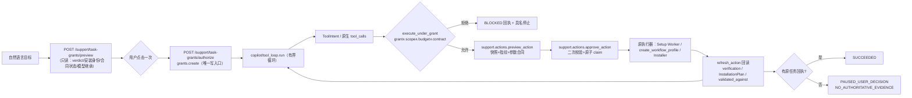

# Shine AI 管家 V3.1：本地 main 基线审计

> 审计对象：本地 `main`，基线 `ae3cd990f64b1b22d24657a79b41417d23831c2c`（与 `origin/main` 一致）。
> 方案来源：`docs/SHINE_AI_COPILOT_V31_TASK_AUTHORIZATION_CONTRACT.md`（文档提交 `c9bd2f7`，仅复制该文件，未合并文档分支）。
> 本文件是**只读调用图审计**，不是完成声明。实施结果见 `docs/SHINE_COPILOT_V31_ACCEPTANCE.md`。

## 1. 可以直接复用的既有能力

| 能力域 | 唯一权威（复用，不重建） | 复用方式 |
|---|---|---|
| 授权与子动作台账 | `support/models.py::SupportDelegation` / `SupportAction` | 在原表增加 `grant_id` / `grant_digest` / `expires_at` / `budget_version` 与 `grant_tool_key`，不建第二套任务表 |
| 计划走步与断点 | `support/delegation.py` | 保留 V2 计划委托；V3.1 新增 grant 分支，同一 `SupportDelegation` 行承载两种形态 |
| 预览→授权→执行→回读 | `support/actions.py::preview_action / approve_action / refresh_action` | 新入口 `execute_under_grant` **调用**这三个函数，不复制任何校验 |
| 能力目录与参数合同 | `copilot/declarations.py::WRITE_ACTIONS` + `copilot/params.py` | 新增能力只加声明；`ACTION_SPECS`/`ACTION_PARAMS` 由其派生 |
| 能力合同执行状态 | `support/contracts.py::execution_state / api_contract_state` | grant 冻结合同摘要，变更即 `PAUSED_CONTRACT` |
| 模型权重与节点包 | `comfyops/installer.py::PackageSpec`（`node` 强制 40 位 commit）、`LocalInstaller` | grant 只冻结计划，真实下载仍由原 Installer 执行 |
| 安装计划 | `comfyops/deployment.py::create_install_plan / register_catalog_packages` | 幂等、content-addressed；`CATALOG_COMPONENT_CHANGED` 拒绝漂移 |
| 整备执行者 | `comfyops/setup_preparation.py::enqueue`（`setup-preparation-task` 单例、租约、断点续跑） | `setup_repair` / `setup_reconcile` 原样调用 |
| 工作流注册与校验 | `api_comfy.py::create_workflow_profile`、`comfy/workflow.py::validate_graph / validate_against_object_info` | 新能力直接调用该函数；图哈希、`parameter_map` 强制字段、live `object_info` 全部沿用 |
| 环境裁决 | `GET /api/v1/setup/verdict` | AI 不自行宣布 READY |
| LLM 网关与密钥 | `llm/gateway.py::LLMGateway`、`ProviderProfile`、`SecretStore` | 原生/降级两条通道都走同一个网关与密钥库 |
| 上下文预算 | `llm/output_budget.py`、`support/memory/budget.py` | 工具循环复用 `completion_cap` 与既有预算机制 |

## 2. 缺失能力（V3.1 必须补齐）

1. **原生 Tool Calling 缺失**：`openai_compatible.py` / `anthropic.py` 的 `"tools"` 只是能力探测占位，`complete()` 无 `tools` 请求分支。
2. **模型继承缺失**：`LLMGateway.profile_for_role("support_agent")` 无路由即抛 `LLMNotConfigured`，用户必须单独给管家配模型与 Key。
3. **任务级一次授权缺失**：`delegation.create()` 只接受 `approved_orders`（预览时已固定的步骤集合），不能承载"授权后动态发现的子步骤"。
4. **AI 可用的 Graph 注册入口缺失**：只有 `workflow_user_copy`（复制既有合同 + 覆盖已映射参数），无法表达"新图"。
5. **显式冻结安装计划能力缺失**：`setup_repair` 是整备任务，缺少"先冻结计划、再执行、可对账"的细粒度能力。
6. **多轮工具循环缺失**：`support/agent.py::handle_message` 是"一次诊断 + 一次 LLM 解释"，模型无工具、无回执、无循环。

## 3. 必须收束、不得新增的重复链路

| 禁止新增 | 收束到 |
|---|---|
| AI 专用下载器 / 安装脚本执行器 | `comfyops.installer.LocalInstaller` + `setup_preparation` Worker |
| AI 专用节点源码编辑器 | 不存在；只允许受审完整包，`NODE_COMMIT_REQUIRED` |
| 第二套工作流 Profile 表 | `WorkflowProfile` + `graph_sha256` |
| 第二套授权/任务状态表 | `SupportDelegation`（加列）与 `SupportAction`（加列） |
| 第二套能力目录 | `copilot/declarations.py::WRITE_ACTIONS` |
| 第二套成功裁决 | `setup/verdict`、`workflow_profiles.validated_against`、`InstallationPlan.status`、`SupportAction.verification` |
| 第二个环境检查链 / 安装器 / 调度器 | 完全不建 |

实施中额外**删掉的重复定义**：`copilot/task_grant.py` 的能力→权限映射初稿里包含 `resource_install_execute`、`node_package_plan`、`node_package_execute`、`runtime_configure`、`test_inference`、`workflow_graph_validate` 六个**没有声明、没有执行器、没有合同**的名字。这些名字会让"授权预览"列出无法执行的假能力，已全部移除；节点安装由 `setup_repair`（`download_models` 权限）覆盖，不再另立能力。

## 4. 兼容风险与处理

| 风险 | 处理 |
|---|---|
| `ACTION_SPECS` 精确集合变化（14 → 16） | 更新 `tests/test_support_agent.py` 的集合断言，同时保留"无 shell / 无源码写入"断言 |
| `copilot_contracts.json` 的 `api_schema_digest` 因新增路由变化 | 用 `scripts/generate_shine_copilot_contracts.py` 重新生成；开发检出**不带** `--commit`（否则清单与产物互相引用永远不一致） |
| `params.py` 严格模式无法接受 JSON 字符串到 `StrEnum`（`mode: "Ref2VA"`） | `_coerce_enum` 只把标量转成枚举成员，形状校验仍严格，非法值仍是具名参数错误 |
| 既有 `FakeRemoteGateway` 只实现 `profile_for_role` | 管家侧用 `_copilot_profile()` 兼容两种网关，不强制所有替身实现新方法 |
| 前端新增入口按钮 | 仅在已有会话且输入 ≥4 字时出现，不影响原有问答与预览/授权流程 |

## 5. 只读调用图（V3.1 唯一工作线）

唯一事实、唯一裁决、唯一执行者：上图中 `preview_action` / `approve_action` / 原执行器 / `verification` 全部是既有代码，V3.1 未复制其中任何一步。
