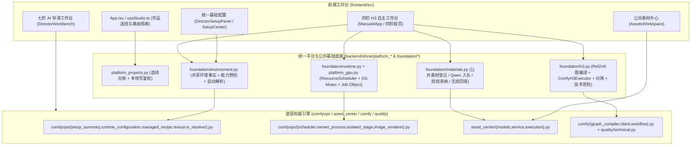

# Shine V2.0 双生产线统一基础底座边界与调用图

> 日期：2026-11-20  
> 基线提交：`main@c1c69941e4b8ae339da5a490944206ab4cfb78a0`  
> 收尾分支：`main`（P0 `650db6c` -> P1 `6834332` -> P2 `54f8f34` -> P3 `d823679` -> P4 `0fb933b` -> P5）  
> 依据方案：[SHINE_UNIFIED_FOUNDATIONS_DUAL_PIPELINES_CLOSEOUT_V2_20261120.md](file:///f:/ClaudeWorkSpace/projects/shine-video-studio/docs/SHINE_UNIFIED_FOUNDATIONS_DUAL_PIPELINES_CLOSEOUT_V2_20261120.md)

---

## 1. 最高架构边界（一套事实、一个裁决、一个执行者）

1. **统一平台外壳**：
   - `backend/shine/platform_projects.py`：作品创建与不可变选线（`director7` / `manual4`）、跨线写操作本地鉴权（`require_platform_local_action`）。
   - `backend/shine/platform_gpu.py`：单机单 GPU 跨线原子仲裁、OS 级命名互斥量（`Global\ShineGpuArbitrationMutex`）、`ResourceScheduler` 统一排队与 `physical-resource-epoch` 推进。
   - `backend/shine/foundation/`：双线共用公共能力门面（`environment.py`、`runtime.py`、`materials.py`、`h3.py`）。
2. **七阶段 AI 导演业务线（`director7`）**：
   - 保持既有表结构、API、UI 与生产主链完全兼容（小说/创意 -> 文学剧本 -> 导演风格与 AI 分镜 -> 自动素材需求与备料 -> AI 编译 H3 提示词 -> 导演包/排片 -> 生产、后期与交付）。
3. **四阶段 H3 自主制片业务线（`manual4`）**：
   - ① 人工分镜导入/编辑/冻结 -> ② 素材需求/公共素材中心生成与复用 -> ③ 手写 H3 提示词/批量排片/冻结 -> ④ 成片装配/返工/人工验收。
   - 仅通过正式平台门面（`shine.platform_*`、`shine.foundation.*`、`shine.config`）调用公共底座，由 `backend/tests/manual4/test_isolation_static.py` 强制静态 AST 检查，严禁直接导入七阶业务模块（`director*`、`literary`、`materialprep`、`production`、`services`、`worker`、`api_*` 等）。

---

## 2. 最终调用图（Unified Call Graph）

---

## 3. 模块责任矩阵与退役清单

| 域 | 唯一权威事实 / 裁决 / 执行者 | P0–P5 收敛完成情况 | 已退役/删除的重复模块 |
|---|---|---|---|
| **运行环境与配置** | `shine/foundation/environment.py` -> `comfyops/{setup_summary,runtime_configuration,managed_recipe,resource_resolver}.py` | `/api/v1/platform/environment` 与 `/api/v1/platform/capabilities/check` 输出唯一 `shine.environment.v1` 事实；修复 `resource_resolver.py` 多文件组件（双 VAE）文件名匹配缺陷；四阶直接复用已收编的 `F:\AIGC2026\ComfyUI_Mie_2026_V8.0_Base\ComfyUI` | 退役 `manual4/comfy/managed_instance.py` 内置独立目录探测与 `verify_model_file` 死代码 |
| **受管进程与 GPU 仲裁** | `shine/foundation/runtime.py` + `shine/platform_gpu.py` -> `comfyops/{scheduler,owned_process,isolated_stage,image_renderer}.py` | 双线统一经 `ResourceScheduler` + `Global\ShineGpuArbitrationMutex` 申请/续期/释放 GPU 租约并递增 `physical-resource-epoch`；启动四阶 ComfyUI 前安全退休空闲七阶出图渲染器；修复 `isolated_stage.py` 对 `Local\ShineM4Handoff-*` Job Object 命名校验 | **已删除** `backend/shine/manual4/comfy/owned_process.py` |
| **公共素材中心** | `shine/foundation/materials.py` -> `asset_center/{models,service,execution}.py` | 四阶上传、异步 Qwen-Image-2.1 生图（`LibraryRenderTask`）、晋升、跨线检索与采纳全部落入公共素材中心 `library_*` 台账；`api_asset_center.py` 拦截 `manual4` 项目误写七阶表（`409 PROJECT_IS_MANUAL4_NOT_DIRECTOR7`）；历史非 Mock 主素材无损回填 | 退役四阶 HTTP 请求内同步冷启 ComfyUI 生图路径 |
| **公共 H3 制片底座** | `shine/foundation/h3.py` -> `comfy/{graph_compiler,client,workflow}.py` + `quality/technical.py` | 唯一 `Ref2VA` 门禁、UTF-8 提示词 SHA 强校验、落盘 `prompt_graph_sha256` 后提交、`/history`（5 元组/字典双兼容）+ `/queue` 对账、跨集 `last_frame` 边界重置、Worker 事务外 I/O 与尾帧提取 | **已删除** `backend/shine/manual4/comfy/workflow.py`；`manual4/comfy/h3_adapter.py` 收敛为兼容薄包装 |

---

## 4. A01–A22 验收项对应代码入口索引

| 编号 | 验收主题 | 权威代码与测试入口 |
|---|---|---|
| **A01–A02** | 单一环境事实与按配方能力裁决 | `backend/shine/foundation/environment.py`、`backend/shine/comfyops/resource_resolver.py`、`backend/tests/manual4/test_p1_platform_routing_and_isolation.py` |
| **A03–A04** | 跨线单卡 GPU 互斥、续期、对账与受管进程守护 | `backend/shine/platform_gpu.py`、`backend/shine/foundation/runtime.py`、`backend/shine/comfyops/isolated_stage.py` |
| **A05–A08** | 公共素材中心统一入库、异步 Qwen 生图、晋升门禁与跨线隔离 | `backend/shine/foundation/materials.py`、`backend/shine/api_asset_center.py`、`backend/tests/manual4/test_p2_public_asset_center.py` |
| **A09–A10** | 分镜长文本分块 LLM 抽取、SSRF 环回校验与全字段修订失效 | `backend/shine/manual4/storyboard/service.py`、`backend/shine/manual4/prompts/service.py`、`backend/tests/manual4/test_p4_defects_and_readiness.py` |
| **A11–A18** | 公共 H3 Ref2VA 编译、提示词 SHA 校验、跨集连续性重置、事务外执行与崩溃对账 | `backend/shine/foundation/h3.py`、`backend/shine/manual4/production/service.py`、`backend/shine/manual4/worker.py`、`backend/tests/manual4/test_p3_unified_h3.py` |
| **A19** | 成片新鲜度优选、去重保留验收、组装后技术质检与播放 SHA 校验 | `backend/shine/manual4/delivery/service.py`、`backend/shine/manual4/api/delivery_routes.py`、`backend/tests/manual4/test_p4_defects_and_readiness.py` |
| **A20–A22** | 双线静态/动态隔离、前端防串线、全量回归与真实 RTX 5080 双产线出片 | `backend/tests/manual4/test_isolation_static.py`、`frontend/src/test/manual4Routing.test.tsx`、`docs/SHINE_FOUNDATION_DUAL_PIPELINE_FINAL_ACCEPTANCE.md` |
