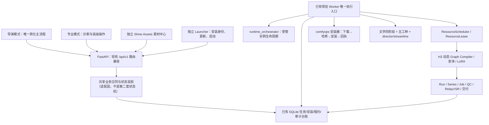

# Shine 视频工作台｜main 主线架构收束与真实生产闭环 V3.0 建设方案

> **方案性质**：基于远端真实代码的可实施工程改造方案；不是已完成验收报告。  
> **仓库**：`anjingdtl/shine-video-studio`  
> **审计基线**：`main@e4a3f198165aa16b54f515201976deeeb9f258d9`（2026-11-14，PR #22 合并点）。  
> **方案分支**：`docs/shine-mainline-convergence-v3-20261114`（只存方案）。  
> **执行方式**：本地 Windows RTX 5080 开发机独立 worktree / 实施分支开发、测试、审查，PR 合并 `main`；禁止直接修改/强推主线。  
> **优先级**：P0 真正阻断用户能力的缺陷和合同错误 > P1 主线收束 > P2 结构改善 > P3 不影响功能的清理。  
> **最终目标**：让普通用户从“导入小说—确认大纲与分集风格—自动拆镜—素材整备—启动 H3—逐集交付”，全程使用一条清晰、可恢复、可审计的主线；不能用增加第二套框架来解决已有框架的问题。

## 0. 执行摘要与事实边界

1. 不重建 Git 历史、不重置 main、不删除既有成功生产记录、不推倒后端；采取**最小增量修复、统一合同、逐模块收束、完整回归**。
2. main 当前有真实可复用的内核：`runtime_orchestrator` 控制操作，`comfyops/scheduler.py` GPU 租约，`worker.py` 常驻队列，`comfy/graph_compiler.py` 动态 H3 工作流，`director/streamline.py` 导演自动拆镜，`production/runner.py` 多集 Run，`media` 交付。**不新建第二套调度器/数据库/Worker/LLM Gateway/提示词编译器**。
3. 已核实具体 P0：`frontend/src/components/SetupCenter.tsx` 在第 468—471 行对固定四站点的全局 `blocked` 做一次性拒绝，尚未按本次选中能力与真正资源依赖判断。`canPrepare` 仍依赖 `selectedVariant`，即便不准备 H3。
4. 已核实具体 P0/P1：`SetupCenter` 在等待安装尝试结束后报告 `READY`，但底层安装尝试可能是 `FILES_VERIFIED_PENDING_RUNTIME`；文件就位不等于 ComfyUI 工作流/真实渲染就绪。`setupExecution.ts` 的终态机制必须与能力真实状态分离。
5. 已核实 P1：`SetupCenter`（导演设置）、`SetupPanel`（专业设置）、`RealProductionWizard`（引导弹窗）共存；`/setup/install-plan` 与 `/comfyops/install-plans` 为不同入口，虽然复用安装台账，仍需确认最终业务合同是否一致。**保留高级入口，统一背后的查询/计划/执行/状态投影**。
6. 已核实 P1：`worker.py` 4,542 行、`director/pipeline.py` 3,934 行、`api_preparation.py` 2,279 行、`frontend/src/api.ts` 1,974 行、`App.tsx` 1,488 行。体积只是风险信号，不允许为了行数拆分而制造第二套流程。
7. 已核实发行物漂移：`ShineLauncher-build-info.json` 仍写 `version: 0.1.0` / `source_commit: f41e609...`；Launcher V1.0 源码已通过 PR #17 合入，`ShineLauncher.exe` 不能视为最新版正式发行物。正式发行还受签名信任链和 Windows 真人验证限制。
8. 真实产出边界：PR #22 报告里真实 MiniMax 拆镜 ep-01 已落 17 镜，ep-02 遇到断连/UNKNOWN，恢复前的逐 beat 串行 A/B 至少慢 69.4%，最终第 12 节已裁定**恢复五工种整份合同调用**。`FULL_AUTOPILOT_PASS` 和真实双集 H3 出片仍未签署。绝不重新引入已回退的小调用主路径，也不以 Mock E2E 代替真实验收。
9. 基线 CI：`main@e4a3f198` 的 GitHub Actions run `43585070557` 在方案编写时 L1 quick、Frontend build、browser E2E 为 success；Linux/Windows L3 full 尚在进行；L2 在 main push 上按工作流配置跳过。Agent 开工前**必须重新查询最新结果**，不得把此快照当成长期结论。
10. `main` 虽 `protected=true`，远端读取到的 required status check enforcement 为 off；这是治理风险而非源码故障。权限允许时在 PR 交付建议中明确应启用的检查，**不能悄悄改仓库管理设置**。

本方案只记录实际观察、待核实假设和建设目标；凡未在真机/CI/真实供应商验证的项目，一律写明 `PENDING`。

### 审计依据

- PR #14（H3 每镜动态装配/二采/RelayVSR）、#15/#16（资源自整备）、#17（Launcher V1）、#18/#23/#24（新机与能力下载）、#19（E2E/监督重启）、#21（六主题 UI）、#22（小说多集自动成片）。
- `docs/SHINE_NOVEL_TO_MULTIEPISODE_AUTOPILOT_FINAL_ACCEPTANCE_20261114.md`；`docs/SHINE_NEW_MACHINE_ADOPTION_RUNTIME_V2_ACCEPTANCE.md`；`docs/ACCEPTANCE_20261114_P1_CAPABILITY_DECOUPLING.md`；`docs/SHINE_LAUNCHER_ENGINEERING_ACCEPTANCE_REPORT_20261114.md`；`AGENTS.md`。
- `backend/shine/comfyops/connectivity.py`、`backend/shine/api_setup.py`、`backend/shine/api_preparation.py`、`backend/shine/comfyops/installation*.py`、`frontend/src/components/{SetupCenter,SetupPanel,RealProductionWizard}.tsx`、`frontend/src/setupExecution.ts`、`backend/shine/worker.py`、`backend/shine/director/{streamline,journey,pipeline}.py`、`frontend/src/App.tsx`、`.github/workflows/ci.yml`。

## 1. 产品红线与建设禁止项

**必须保留：**

- Windows 本地 Web + SQLite + 独立常驻 Worker；MiniMax-H3/Ref2VA 是唯一正式视频生成核心；不同量化方案和附加 LoRA 由现有变体/策略/工作流清单组合，不篡改用户选择。
- 统一运行控制层、独占 GPU 租约、受管 ComfyUI 所有权、动态 H3 图编译器、二次采样与 RelayVSR X2 均复用现有实现。
- 用户确认的大纲、分集、Style Bible、资产主版本、同意/授权以及不可变 hash；资产中心可以生成**候选**，不可自动晋升/批准/替换角色、场景、道具、音色主资产。
- 五工种 `scriptwriter → director → cinematographer → continuity_supervisor → editor` 的原合同、文学四阶段/五维记忆、弹性预算与受控恢复；不增加一套文学引擎。
- 生产 `Run → Series → Job/Attempt → QC → Delivery` 真实状态链；按集隔离，已通过镜头/作品保持历史与可回滚。
- UNKNOWN 外部调用必须核对，不能静默重发。上传素材/远端 LLM 调用保留用户授权与审计，API 不对外放开，密钥不进入 Git/日志。
- 低显存候选/生产门禁、离线测试/Mock 与真实证明的区分；RTX 4070 非本地可用硬件，明确 `EXEMPT_HARDWARE_UNAVAILABLE`。
- 已合入的 6 组主题、深色文字可读性、独立 Shine Assets 与专业模式入口；可以改交互编排，不改变合法的权限边界。

**禁止：**

- `reset --hard`、强推 main、删除/修改用户真实数据库或产物、自动跑有损迁移、覆盖安装目录、重写生产主资产、为了跑通测试放宽 H3/内存/GPU/素材/审片准入。
- 大爆炸式重命名全部 API/DB；顺手引入新的状态机/新引擎/新下载器/新前端全局状态框架。
- 把 `FILES_VERIFIED_PENDING_RUNTIME` / mock 成功标记为“真实生产 READY”，把不确定 LLM 任务当失败后无限重试。
- 偷改 `AGENTS.md` 的 8 分片与签核要求；CI 配额不足时伪造成功或关闭失败测试。
- 删除专业模式的旧页面而不提供完整过渡/回归；删除已有兼容别名和前端旧深链。
- 随意更新根目录 EXE 并伪造 build-info / sha / 生产签名；任何私钥不得提交。

## 2. 目标架构与模块责任（不另建执行核心）



责任表：

| 责任 | 唯一权威/复用点 | UI/兼容接口做什么 | 不得做什么 |
|---|---|---|---|
| 安装资源清单、能力归属 | `comfyops/deployment.py`、`capability.py`、变体清单 | 按选项请求 plan、展示实际体积 | UI 私自合并不同能力权重 |
| 传输、重试、校验 | `comfyops/installer.py` + `installation_worker.py` / 台账 | 按 attempt_id 查看、暂停/继续/取消 | 另开下载线程或浏览器直下载 |
| 受管进程/连接恢复 | `runtime_orchestrator/*` + 现有 `comfyops` supervisor | 发 operation、读回执 | UI 自行抢端口/重复启动 ComfyUI |
| GPU 互斥 | `comfyops/scheduler.py` ResourceLease | 只读展示占用/恢复建议 | 另设 GPU 锁 |
| 文学/五工种 | `director/pipeline.py`、`literary/*`、`agents/film.py` | 简化主路径，专业入口调同一任务 | 新建第二套分镜 Agent |
| 导演自动拆镜 | `director/streamline.py` + `api_streamline.py` | 只保留必要用户确认 | 遇 UNKNOWN 静默重发 |
| H3 拍摄和质检 | `comfy/graph_compiler.py`、`worker.py`、`production/*` | 只读真实进度和下一步 | 绕开原有 worker / QC |
| 交付 | `media/delivery_engine.py`、`production/episode_delivery.py` | 已交付集可播放导出 | 用生成完成代替人工艺术认可 |
| 模式导航和主题 | `App.tsx`、`frontend/src/theme/*` | 导演7阶段 + 专业深链兼容 | 将历史工程入口再暴露给小白 |

**不要求原文件名立即更改**；“统一”指相同输入/状态/决策从同一服务事实推导，而非必须合并物理文件。

## 3. 已证实问题、待核查问题及优先级

| ID | 优先级 | 证据/位置 | 现象与判定 | 交付验收标准 |
|---|---|---|---|---|
| C-01 | P0 | `SetupCenter.tsx:468-471`；`connectivity.py:PROBES` | 固定四上游任一 BLOCKED 会阻挡所有能力。**已证实代码行为** | 只选图片时不因 H3-only 上游失联被拦；真正必需来源不可达仍被正确阻断/降级 |
| C-02 | P0 | `SetupCenter.tsx:441-442` | `selectedVariant` 作为所有能力共用启用条件。**已证实表达式** | H3 不选、图片/审片独立能力合法时可执行 |
| C-03 | P0 | `SetupCenter.tsx:490-499,566-574,614-624` + `setupExecution.ts:165-184` | 安装终态与能力 READY 可能混淆。**已证实逻辑风险** | 文件完成仅显示“文件已核验，运行待验证”，只有明确的服务/工作流/真实生成事实才升级 |
| C-04 | P1 | `SetupCenter`、`SetupPanel`、`RealProductionWizard`；两类 plan API | 多入口/错误语义漂移风险。**存在重复入口，需差分审计** | 三入口同一计划、确认、任务、状态语义，旧调用兼容 |
| C-05 | P1 | `worker.py`、`runtime_orchestrator/*`、`comfyops/scheduler.py` | 执行职责高度集中；不是已证实的双 Worker。**需按调用图审计** | 无重复 ComfyUI 启动、租约泄漏、饥饿、死锁；保持唯一执行控制 |
| C-06 | P1 | `director/streamline.py`、`director/pipeline.py`、`frontend/src/App.tsx`、`api_streamline.py` | 导演/专业两条交互容易状态不一致。**需状态转移矩阵验证** | 同一项目同一已确认源，跨入口展示同一下一步和落镜事实 |
| C-07 | P1 | PR #22 最终验收 `12` | 逐 beat 串行性能退化，已恢复整份合同。**明确历史事实** | 不反向恢复已撤销的逐项引擎；UNKNOWN/length 保留明确诊断与核对 |
| C-08 | P1 | `ShineLauncher-build-info.json` v0.1.0 | 根 EXE 与 V1 源码/签名发布链未对齐。**已证实版本漂移** | 不将旧原型冒充新版；发布源、标识、hash、信任锚一致或明显标注旧版/退出默认分发 |
| C-09 | P2 | 上述超大文件、`frontend/src/api.ts` | 改动易冲突/难维护。**质量风险，不等于缺陷** | 抽共享领域函数/类型，减少重复逻辑，测试不退化 |
| C-10 | 治理 | GitHub main protected 但 enforcement off | PR 合并检查未强制。**环境配置风险** | 给出建议 required checks、CODEOWNERS/PR checklist；需仓库管理员显式授权才修改设置 |

## 4. 实施工作包

### WP0｜冻结基线、映射调用图与建立可复现实验

**先做，不直接改业务行为。**

- 在本地独立 worktree 拉取**开工时最新** `origin/main`，记录 SHA、Git clean、所有待合并 PR、CI head 结果；对比本方案 `e4a3f198` 差异。若 main 已修复某问题，以最新代码为准，禁止重复实现。
- 汇总 API 路由→共享 service→安装/Run/Worker→SQLite 台账→前端三个入口的真实调用图。列出同名状态、错误码、version/hash/attempt_id 归属、事务边界。
- 生成 `docs/SHINE_MAINLINE_V3_BASELINE_AUDIT.md`：字段包括已证实缺陷、待复现假设、目标文件/测试、基线差异、风险与回滚点。用最小复现证据编号，不记录秘密或真实用户路径。
- 用隔离数据库和合成项目测试，禁止访问现有作品的 SQLite 数据库；测试真实本机 H3 之前检查是否有在跑的任务。
- 将调用关系和遗留接口形成可审计的 compatibility matrix；移除无调用者文件前要有全仓引用搜索 + 回归证据。

**通过条件**：产出可追溯的主线地图、基线测试结果，未更改 main/用户数据。

### WP1｜P0：安装/下载能力与真实状态彻底解耦

#### WP1-A 按计划真实依赖进行预检

- 变更重点：`backend/shine/comfyops/connectivity.py`、`backend/shine/api_setup.py`、`comfyops/deployment.py` / catalog、`frontend/src/components/SetupCenter.tsx`、`frontend/src/setupExecution.ts`。
- 先让服务端按**实际选中能力、清单的组件闭包、已验证本地缓存、source preference/镜像候选**生成计划；只对本次仍需下载的真实来源做必要预检。四站点全局健康度保留作为诊断视图，但**不得作为一刀切 download admission**。
- 每条来源返回 `required_for_plan`、`capability`、`component_id`、`host`、`status`、`reason_code`、`retryable`，注意不要把一次探测失败直接等同于永久不可下载，也不要泄漏带签名参数的 URL。
- 某来源不可达：相应组件显示“需换线路/重试/已缓存可复用”；其它不依赖它的合法能力继续。服务端安装器仍必须实施 URL 白名单、HTTPS/重定向安全、路径安全、固定 SHA/大小、缓存/断点续传校验；**不能通过前端绕过实际安全限制**。
- 将 `selectedVariant`、H3 port/资源资格等判断限定到**H3 相关操作**。只选 Qwen 图片/VLM/ASR 时不要被 H3 变体和 H3 生产资格卡死；若当前能力自身必须绑定 project/storage，则只检查其真实依赖。
- 规划、授权、执行与状态恢复维持 existing attempt id、SQLite 租约和已有 `approveAndExecuteSetupPlan`。不要再开发一个浏览器下载器。
- 兼容旧 `GET /setup/connectivity` 输出，新增字段/计划级 endpoint 优先采用向后兼容契约；同步更新受影响的两种 UI/安装向导，不能只修首页。

#### WP1-B 状态语义统一

- 将 `InstallationAttempt` 的 `terminal`、`stage` 与 `CapabilityReadiness` 投影分开，不改写历史行。定义最小可组合事实轴（建议内部结构，Agent 需核对现有字段再定稿）：

  | 事实轴 | 含义 | 不得冒充 |
  |---|---|---|
  | `plan_status` | 请求/授权/排队/下载是否完成 | 权重真的可用 |
  | `bytes_verified` | 清单全部必需文件固定哈希、大小合格 | 工作流可执行 |
  | `runtime_contract` | 实例/节点/工作流/模型适配校验通过 | 视频真实生成成功 |
  | `real_generation_evidence` | 本机 H3/Qwen 对应类型的实测任务、产物与验收回执 | 人工艺术认可 |

- 用户文案分四层：“正在下载 / 已核验文件 / 可尝试启动 / 真实生成已验证”。有硬件建议和生产拒绝时明确能力范围。所有“成功”必须带证据来源与时间戳。
- 不要单纯把 `terminal=true` 当 `READY`；`FILES_VERIFIED_PENDING_RUNTIME` 必须保留后续运行校验。由后台真实投影输出 UI 展示，不同入口引用同一函数/类型。
- 断电、刷新、浏览器重开、Worker 重启时用服务器台账 `attempt_id` 恢复；不可重复入队相同物理工作。`WAITING_FOR_TARGET` 保持可追踪，不把“等待”误判失败。
- 建议新增 `backend/tests/test_mainline_v3_capability_preflight.py` / `test_mainline_v3_readiness_projection.py`、`frontend/src/test/mainlineV3Setup.test.tsx`；先写能复现原行为的红例，再修复。

**P0 验收矩阵（必须全部工程通过）**：

1. 仅图片、H3 未选、H3 变体为空、H3 专属站点失联：图片仍可进入合法队列。
2. 仅 H3，其真实必需来源失联：只阻断 H3 该源/组件并给可恢复解释；无虚假成功。
3. 图片 + H3，H3 不合格但图片可用：各自独立结论；图片成功不提升 H3 状态。
4. 已有权重通过哈希：复用登记，不重复下载；未通过哈希的仅重整备有问题文件。
5. 多计划同一目录：`WAITING_FOR_TARGET` → 释放 → 自动领取，不发生并发写破坏。
6. 网络中断/HTTP 重定向/服务重启：有界重试与恢复，确认字节/偏移一致；拒绝非法重定向与哈希错误。
7. `FILES_VERIFIED_PENDING_RUNTIME` 只能显示文件就绪，不能显示 H3 实际可出片。
8. 独立能力正常时用户无须手工去删除报错、关安全门禁或重启多个 ComfyUI。

### WP2｜P1：安装三入口与 Launcher 的合同统一

- `SetupCenter` 是导演模式的**主用户入口**，只显示“检测→选能力→确认→整备→状态/修复”必要动作。
- `SetupPanel` 保留专业视图，专注详情、审计、镜像/代理、人工导入、回执对账，操作调用 WP1 的同一 service；`RealProductionWizard` 只做步骤导航/恢复，不保留第二套决定硬件准入、重试、安装成功的逻辑。
- 建立单一的前端 `setup domain client`/可组合 hooks（文件名按实际依赖取最小范围），统一可显示的 `CapabilityStatus`、`Plan/Attempt` 类型、错误码→中文说明；尽量在 `setupExecution.ts` 拓展，不新起全局 store。页面只管展示和交互，不自行推断某权重 READY。
- 后端两类路由可保留外部兼容，但 plan 创建和 status 来源应明确同一底层服务。审计二者有无授权绕过或作用域差异，发现差异先加测试再最小修复。
- Launcher 保持**独立于 Studio 版本更新**的设计。对照 `launcher/src/*`、`scripts/launcher_bridge.py`、`ShineLauncher-build-info.json` 与构建/发行 workflow 检查安装身份、双版本策略、签名校验、升级回滚；旧 `ShineLauncher.exe` 须能被明确识别为 0.1.0 原型。若能形成可核验的正式 Windows 发布流程，再更新根入口/元数据；不能在未有签名或真人验证时宣称 V1 正式交付。
- 发布者私钥由仓库管理员单独配置到安全 Secret，本轮**不生成或回写**任何凭据/伪签名。Launcher 兼容 `CMD/PowerShell 5.1` 编码、中文路径、非系统盘、自动下载和断点续传。

**验收**：同一请求在三入口返回相同分项结论；旧链接与已保存的安装 plan 不失效；Launcher/Studio 版本可分别更新，发行物身份与实际源码一致或明确标示 PENDING。

### WP3｜P1：导演从小说到多集交付只保留一条业务事实线

- 保留导演模式的七阶段导航（创意与剧本、剧本统筹、镜头拆解、拍摄素材准备、导演包、视频生产、后期成片），高级模式仅提供精细调试入口。
- 以 `director/journey.py` 的既有状态计算、`director/streamline.py` 的自动落镜和 `production/runner.py` 的生产状态为权威，检查 `frontend/src/App.tsx`、`StreamlinePanels.tsx`、`FourStagePanel.tsx`、`StoryboardPanel.tsx`、`api_streamline.py` 的字段/进度/手动按钮之间是否分叉。
- 保证已确认大纲/分集/style/binding 的版本与 SHA 贯穿每个下游任务；一集失败不能让已完成另一集丢失有效状态；标题段合并不能跨集边界；自动确认只能对具备完整落镜与范围证据的一集发生。
- 继续使用五工种原整份合同调用。`length`、schema、网络断连的诊断和有界预算升级以现有实现为准；`UNKNOWN` 不可自动重发，只通过显式核对/一次性授权。**不得再次默认启用串行逐 beat/逐镜小调用**（PR #22 已实测退化）。
- 素材不足只阻塞需要必需素材的镜头，可选素材提示不硬阻滞；Shine Assets 中生成的候选资产仍须人工授权成为主素材，不能为了自动出片绕过素材边界。
- “一次启动后台跑完全片”必须由已有 Worker 驱动生产，浏览器关闭后可恢复；保留逐集技术 QC、返工、RelayVSR、成片装配、审片与人工确认的分离。
- 检查端到端依赖图，明确 `script → plan → storyboard → material → package → run/series → delivery` 的唯一权威字段，必要时建立只读的 `JourneyProjection` 适配层，但**不要再建第二套导演队列**。
- 只在有真实证据的阻塞点做最小逻辑修复；禁止“顺手改写整个文学四阶段”。

**验收**：使用原创、无隐私的两集 fixture，断网/重启/切模式/跨项目条件下逐阶段显示正确；离线 Mock E2E 两集装配全绿；本地可在明确用户授权范围内做真实 MiniMax 分镜+5080 H3 验证，结果分级签署（详见 `6`）。

### WP4｜P1/P2：统一 Worker 控制边界与高冲突文件减肥

- 首先绘制 `worker.run_configured_once`、`_run_configured_once`、`_advance_text_preparation`、`advance_control_operations`、`run_pending_installation`、`run_pending_relay_items`、`run_pending_deliveries` 的调度次序与互斥表。
- 仅在有证据的重复逻辑处抽离纯函数/局部 helper；`runtime_orchestrator` 是生命周期/请求执行控制，`ResourceScheduler` 是 GPU 租约，二者协作但职责不互换。
- 重点验证：长 LLM 不饿死安装与 H3、H3 series 不饿死成片交付、后台反复重启不重复启动 ComfyUI、失联时 `operation_id` 与 `attempt_id` 能重连、僵死租约只允许安全核对，外部实例不会被误杀。
- 可将 `main.py`、`api_preparation.py`、`frontend/src/api.ts`、`App.tsx` 中重复的状态投影/格式化/路由适配拆出，但**不能为了减少文件行数改变对外合同、DB schema、视觉主题、旧深链**。
- 标记过时兼容调用并写迁移表；无测试覆盖/仍存在有效调用方的旧路径不删。任何涉及 `worker.py`、`services.py`、`preproduction.py` 修改，执行 `AGENTS.md` 对应真实生产/租约/审片附加验收。

**验收**：没有第二个 Worker 或安装执行器；停止/重启/租约回收无数据丢失；新业务逻辑净重复减少且调用者可追踪；没有大规模格式化造成无关 diff。

### WP5｜治理与发布收尾

- 新增 `docs/SHINE_MAINLINE_V3_IMPLEMENTATION_REPORT.md`（每工作包改动、提交、回滚、真实结果、未完成）、`docs/SHINE_MAINLINE_V3_ACCEPTANCE_MATRIX.md`（测试命令/结果/硬件边界/证据）及简短 `docs/SHINE_MAINLINE_V3_MODULE_OWNERSHIP.md`。
- 为高风险入口建立稳定的参数/响应/状态合同测试；PR 中有清晰变更范围与回滚办法，严禁只靠截图、README 或 mock 宣称真实 H3 PASS。
- CI：工作流已定义 L1、PR L2、main push L3 Windows/Linux、Browser E2E；PR 先取得 L1+L2+Frontend 成功，再以工作流手动 full 或本地等效证据核对 L3。若因 CI 额度/外部环境无法执行，标记未验证，不写“全绿”。
- 建议 GitHub 管理端在用户单独授权后启用 PR 必经 required checks、禁止直接推 main、设置 reviews；本轮只提交建议，不操作仓库规则。
- 若发现新 PR 同时改动相同核心文件，先同步 main 并复测差异；严禁带旧基线强行合并覆盖更晚改动。

## 5. 建设顺序、提交策略与范围约束

| 波次 | 工作内容 | 提交/产物 | 阻断后续条件 |
|---|---|---|---|
| W0 | 最新 main 同步、基线、风险矩阵 | 文档与可复现实验 | 未建立正确对照就禁止声称修复 |
| W1 | WP1 P0 网络准入/能力独立/状态诚实 | 小提交 + 红绿回归 | 任何能力错误被全局门禁误挡 |
| W2 | WP2 三入口合同/Launcher 发行身份核查 | 小提交 + 兼容测试 | 任一旧入口语义倒退或旧发布物冒充新版 |
| W3 | WP3 小说→多集状态归一化 | 小提交 + 两集离线 E2E | UNKNOWN 盲重发、冻结与资产授权被绕过 |
| W4 | WP4 Worker/模块结构局部收束 | 小提交 + 故障恢复 | 双调度、资源泄漏、GPU 非法接管 |
| W5 | WP5 全量回归、5080 实测、PR | 审计与签核报告、PR | 核心可复现回归未修复不得合并 |

**若 W3/W4 只发现“可能冗余”而无证据，不强制改代码**；避免架构收束反而制造风险。原则上**一个独立实施 worktree + 一条实施分支 + 一份集中 PR**；但所有阶段要有可单独回滚的提交。若实际改动超过合理审查规模，应拆成依赖有序的若干 PR（每个均 base main），不能把未验收的后续变更夹带入前一 PR。

## 6. 分级验收与具体测试矩阵

### 6.1 测试等级与签署条件

| 级别 | 必要证明 | 通过条件 |
|---|---|---|
| L0 Static | Ruff、类型/构建、差异审查、许可/密钥/迁移检查 | 代码、类型、清单与安全边界没有新增错误 |
| L1 Focused | 安装、下载、能力解耦、状态投影、导演分镜、Worker/租约定向测试 | 相关新旧测试 0 fail |
| L2 Integration | 端到端 API、前端事件、Fake ComfyUI、真实 FFmpeg 装配 | 受控数据库里两集完整离线交付，兼容接口 0 fail |
| L3 Full | 后端 `AGENTS.md` 规定的 **8 个测试文件分片并行** + 前端全量 + 浏览器 E2E + Alembic | 所有实际执行分片退出 0、无 FAILED/ERROR；跳过项如实列出 |
| L4 Windows / GPU | Win10/11 启动器可用性、5080 上真实 ComfyUI/Ref2VA/Qwen/单镜/两集 | 只对**实际跑过**的能力签真实 PASS，失败记录真实根因 |

注意：**ENGINEERING_PASS ≠ WINDOWS_INSTALL_PASS ≠ REAL_RENDER_PASS ≠ FULL_AUTOPILOT_PASS**。真机真实成片未执行不得在报告中用“已完成”代替。

### 6.2 重点必测文件（以实施当下实际存在为准）

- 安装/能力：`test_setup_capability_gates.py`、`test_new_machine_setup.py`、`test_installation_queue.py`、`test_installation_persistence.py`、`test_install_plan_qualification.py`、`test_existing_installation.py`、`test_installer_redirects.py`、`test_connectivity.py`、`test_resource_resolver_v2.py`、`test_runtime_dependencies.py`。
- 运行与恢复：`test_runtime_orchestrator.py`、`test_runtime_control_hardening.py`、`test_runtime_activation.py`、`test_renderer_supervisor.py`、`test_managed_process_release.py`、`test_managed_series.py`、`test_handoff_lease_transfer.py`。
- 导演链：`test_director_streamline.py`、`test_director_journey_closeout.py`、`test_director_worker_scheduling.py`、`test_story_unknown_resend.py`、`test_story_continuity.py`、`test_novel_multiepisode_autopilot.py`、`test_novel_to_two_episodes_e2e.py`、`test_film_crew.py`、`test_offline_e2e.py`、`test_graph_compiler.py`、`test_relay_upscale_stage.py`。
- 前端：`frontend/src/test/setupCapabilityGates.test.tsx`、`setupCenter.test.tsx`、`realWizard.test.tsx`、`setupEntry.test.tsx`、`directorRun.test.tsx`、`directorEntries.test.tsx`、`themeStore.test.ts`、`themeCss.test.ts`、`supervisorRestart.test.ts`，并添加本轮网络预检和就绪状态的反例。

**必须新增故障注入**：全局某无关域名断网、必需源断网、缓存命中、哈希错、3xx 恶意重定向、磁盘不足、相同物理目录两计划、客户端刷新/关闭、进程启动冲突/端口复用、外部 ComfyUI 存在、Worker 非正常退出、LLM 断连 UNKNOWN、两集一成功一阻塞、UI 模式切换。

### 6.3 运行规则和命令示例

在**实施 worktree** 内先读取 `AGENTS.md` 的最新测试规则。不得在真实用户数据库上运行迁移或清理。

```powershell
# 前端：先 cd frontend，按锁文件安装依赖
npm ci
npx vitest run --no-file-parallelism
npx tsc --noEmit
npm run build

# 后端：在仓库根目录执行（实际 Windows venv 路径由本机核实）
uv run --project backend ruff check backend
uv run --project backend python scripts/run_tests.py quick
uv run --project backend python scripts/run_tests.py integration

# 如触及 Launcher，另执行：进入 launcher 后
cargo fmt --all -- --check
cargo clippy --locked --all-targets -- -D warnings
cargo test --locked --lib
```

- 后端 full：**遵从 `AGENTS.md`：按测试文件均分 8 片并行；必须设置 `CODEBUDDY_SAFE_DELETE_ENABLED=0`，每片输出退出码与完整日志；不能用单进程串行替代，也不能因为偶发失败就删测试/降低断言。**检查 Windows PowerShell、Bash 环境差异，不复制不可执行的 POSIX 分片命令到原生 PowerShell。
- CI 最新配置 `scripts/run_tests.py` 支持 quick/integration/full；但**本地全量以 AGENTS.md 8 分片硬规则为准**，不要不经核实直接用脚本 full 当作等价的 8 片并行。
- Alembic：建立**临时隔离 SQLite**，执行 `alembic upgrade head` 和 `alembic check`，验证旧版快照升级与回滚策略；正式用户数据库不用于试跑。
- Windows 启动/连接：运行可用的 `scripts/verify_local_stack.ps1`、`scripts/verify_stack_operations.ps1` 与自检；合法停止后确认 PID/端口/GPU 租约全部释放，不杀不属于 Shine 的外部 ComfyUI。
- Launcher 若未触代码/发行链，不必为了本次收束强制重构原生 UI；若修发行物，就按其已提交的发布、签名、自检流程复验。
- 真实 5080 验收采用原创小型两集文本、明确授权的 LLM 配置和已许可素材；测最小单镜 H3 → 两集 → 技术 QC → 文件解码/哈希 → 交付。无需故意跑满长篇小说或修改模型量化策略。测试前核实当前设备空闲、足够磁盘/显存与数据隔离。

### 6.4 硬件与外部环境豁免

- RTX 4070 用户机不在开发机，**不作为本轮通过门槛**；代码用合成硬件事实覆盖 12GB/16GB、候选/生产门禁，真实 4070 只标记 `EXEMPT_HARDWARE_UNAVAILABLE`。
- 本地 RTX 5080 16GB / 32GB RAM 可承担真实 H3 测试，仍须遵守运行时权重实际条件与安全授权。若模型缺失、下载不可达或上游 API 不确定，不可伪造 PASS；记录 `BLOCKED` 与可复验步骤。
- 外部 Qwen/VLM/ASR 或 Launcher Windows 真人 GUI 验收不应误绑为本次核心后端工程 PASS，但若触及相关代码，必须提供相应实机或明确 PENDING。

## 7. 合并、回滚与“完成”的严格定义

### 7.1 合并门槛

1. 所有计划内 P0 复现用例由 RED → GREEN；必要的旧功能回归 0 新增 fail。
2. 每项行为改变都写清“原表现、根因、改动、风险、测试、提交 SHA”。不做跨模块无关格式化。
3. 后端 8 分片（含 `CODEBUDDY_SAFE_DELETE_ENABLED=0`）、前端全量、Ruff/构建、迁移、Windows 相关脚本与 PR CI 如实记录。任何 baseline fail 先在干净 main 独立 worktree 复现，绝不口头判定“既有失败”。
4. 真实生产安全门禁逐条保持；`UNKNOWN`、资产许可、Style 冻结、镜头版本、资源所有权、GPU 释放、更新签名链不得降级。
5. 生成 `docs/SHINE_MAINLINE_V3_IMPLEMENTATION_REPORT.md`、`docs/SHINE_MAINLINE_V3_ACCEPTANCE_MATRIX.md`，文档清楚列出未执行/豁免/阻塞项；PR description 链接到两个报告。
6. 主线前进后，实施分支基于最新 main 解决冲突，重跑受影响测试，PR 合并前复核当前 HEAD 与 CI；**只允许经 PR 合入 main，不准直接推 main 或强推任何分支**。
7. 若 GitHub required checks 未启用，不能因此忽略本地完整验证；PR 仍须有人核对改动、证据、结果与风险。
8. 如 L4 真机未完成，PR 可按“ENGINEERING_PASS / REAL_H3_PENDING”诚实合入已验证的工程收束（前提是无影响当前用户生产的未解决 P0 回归），但不得宣称完成“全自动真实成片”；用户若要求真实最终 PASS 则必须先完成 L4。

### 7.2 回滚策略

- 所有变化由独立提交/PR 承载；合入后若回归，优先 `git revert <merge_commit>` 走修复 PR，不重置 main。
- 涉及数据合同，使用向后兼容迁移/读写双兼容策略，先验证旧数据库快照，绝不直接删除旧表/历史凭据；`migrate` 只在隔离库演练。
- 发行/启动器有新旧版本身份与校验回执；不能无签名/无 hash 强制升级。
- 每轮 PR 记录变更文件、自动化证据、未决问题和恢复路径。

### 7.3 最终交付清单

1. `docs/SHINE_MAINLINE_V3_BASELINE_AUDIT.md` — 最新 main 基线、证据、接口和数据责任矩阵。
2. 关键代码与新增测试 — 按 WP1—WP4 完成，且不引入第二套底层能力。
3. `docs/SHINE_MAINLINE_V3_MODULE_OWNERSHIP.md` — 六条核心责任链、共享合同及前端入口调用图。
4. `docs/SHINE_MAINLINE_V3_IMPLEMENTATION_REPORT.md` — 工作包对应提交、修复证据、风险与未完成项。
5. `docs/SHINE_MAINLINE_V3_ACCEPTANCE_MATRIX.md` — 测试等级、具体命令、完整退出码、Windows/5080 真机证据和 RTX 4070 豁免。
6. 实施分支 GitHub PR（base=main）— diff 可审、回归可重放、兼容可验证。合并后报告对应的 main merge SHA，并检查无未提交本地更改。
7. 用户可见结果 — 导演模式开工路径显著简化，安装缺项真正独立自动处理，不会因为无关站点、H3 选项、旧缓存或“安装完成”误判而永久停摆。

## 8. 给本地 Agent 的运行授权边界

本地 Agent 可在**独立 worktree/实施分支**内自主读代码、修改、增加测试、提交、运行本地 Mock/隔离 DB、构建、审查、推送实施分支与创建 PR；可自行解决一般冲突并继续验收。禁止直接提交/推送 `main`、强推、删除现有数据库或媒体、无审批上传用户素材、修改 GitHub 管理/安全配置、将密钥提交仓库、放宽生产安全策略、伪造真实设备结果。若真实硬件执行涉及运行中用户任务，应先检查并避让，不对真实进程做破坏性停止。

**开工时若 main 已超过本基线，先做差分，不得照搬旧实现。** 完成后按真实验证结果选择“可合入 / 需修复 / L4 待复验”，不能仅因代码看上去完整就自动声称全量 PASS。

---

**方案判定**：V3.0 以“修复明确 P0 + 收束单一事实源 + 不重做已存在调度与文学引擎”为核心。即使最终修改的代码行数不多，只要能闭合用户实际阻断、消除虚假的就绪状态、保持小说到双集的可恢复生产链，并通过上述验收，就应视为有效收束。
