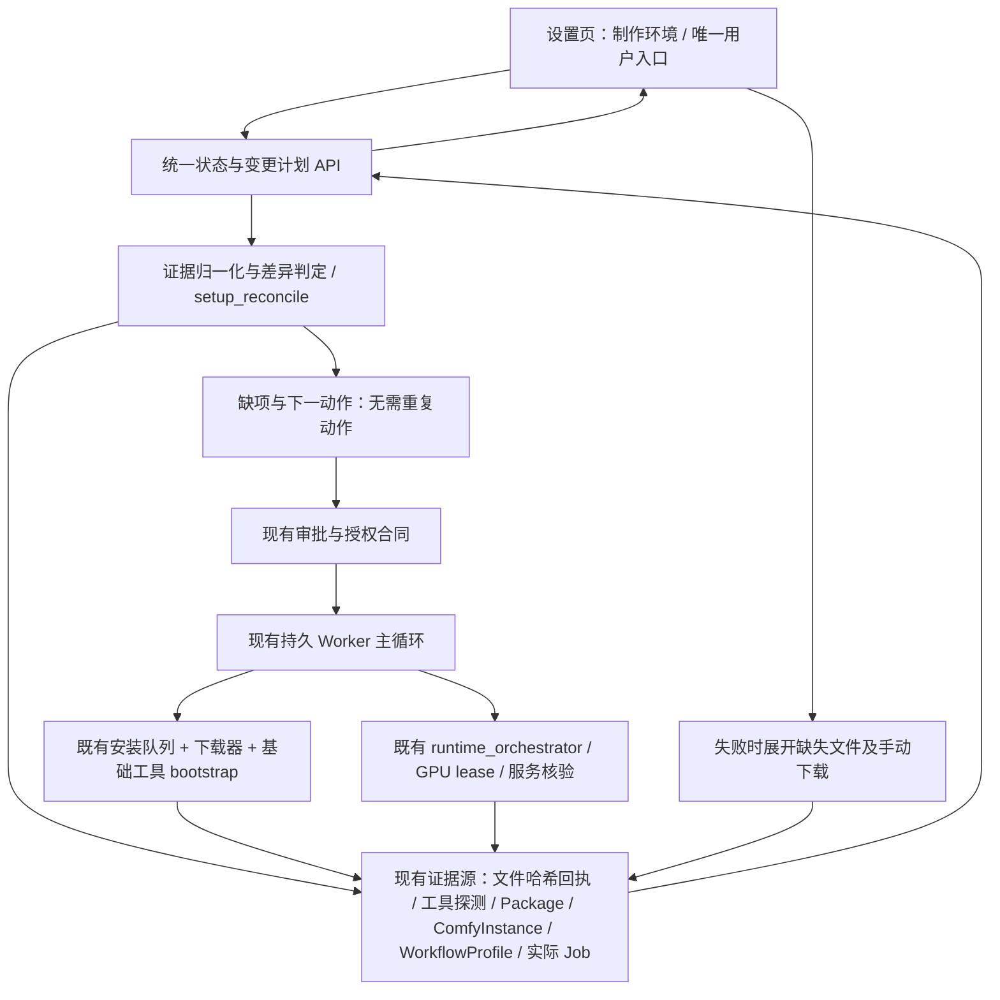

# Shine 视频工作台｜制作环境一体化闭环 V4.1 完整修订设计方案

> 初稿 2026-11-14；V4.1 修订：将「已有 ComfyUI / 受管渲染器 / Qwen 出图」统一纳入单一闭环。依据远端 `anjingdtl/shine-video-studio` 的 `main@8e3e1e07850549df57511e0f330eb9ea22543dc2` 静态代码审查。本文是**建设方案**，不是已实现功能，也不声明真实机测试通过。

## 0. 产品决策

**目标不是增加更多入口，而是取消不必要的人工登记。** 所有已能由系统客观证明的事实（本机存在、哈希一致、清单身份匹配、已安装、已绑定、运行合同验证完成）应由系统自动核对并持久化；需要用户授权的是下载/安装可执行代码、修改外部 ComfyUI、接管外部实例、选择候选 H3 变体、执行真实付费/耗资源试镜等**操作决定**，而非“帮系统点一下保存事实”。

用户日常只有一个设置页和一个主要操作：初次选好能力与安装位置后，点击「一键准备制作环境」，一次性审阅并授权变更，之后系统自动检测、复用、核验、登记、下载、安装、绑定、注册作品工作流、验证运行合同并记录结果。没有需要人判断的情况，不应要求用户点第二次“登记”。用户离开网页、重启电脑之后仍可继续；真实出片测试必须单独告知其资源成本并得到用户授权，不能假冒已通过。

## 1. `main` 事实与缺陷根因

| 真实模块 | 已有能力 | 当前主要断点 |
| --- | --- | --- |
| `frontend/src/components/SetupCenter.tsx` | 导演模式 `DirectorSetupPanel` 内的检测、安装、复用、登记方案、运行验证与激活 | `detect()` 需要用户主动触发；扫描时取 `existing.installations?.[0]`；下载和注册由浏览器 `prepare()` 长链串行驱动；用户离页可能停止继续推进；错误只能散落在多个页面 |
| `frontend/src/components/SetupPanel.tsx`、`DirectorSetupPanel.tsx`、`RealProductionWizard.tsx`、`App.tsx` | 设置与导演目前存在多套准备入口 | 设置页与导演页均可执行环境整备，并分别拉取多个状态接口；需要将核心整备 UI 搬至「设置 → 制作环境」，其他入口只展示同一摘要及跳转，专业设置保留诊断工具但不得独立判定成功 |
| `backend/shine/api_setup.py` | `/environment`、`/existing-installations/*`、`/install-plan`、`/next-instance-plan`、`/profiles`、`/configuration`、`/services/validate`、`/runtime/activate` | 各接口为局部动作，没有统一的按证据推进与下一步解释合同 |
| `backend/shine/comfyops/existing_installation.py` | `inspect()`、`verify_models()`、`register_verified_packages()` | “发现/核验”已可自动登记，但只在指定验证接口运行；发现不等于完整身份及可用性；采用外部实例另走严格流程 |
| `backend/shine/comfyops/adoption.py` | 证据约束的外部 ComfyUI 接管、模型路径/源码/节点/端口校验 | 需要用户确认的应是**外部实例使用权和将要改变什么**，而不是已核实的每个模型都再次手工登记 |
| `backend/shine/comfyops/verification_receipts.py` | SHA-256 与文件身份回执、目录/统计复核 | 文件证据存在，需使“检测到→登记→可消费”自动对账，不能凭文件名或注册行判定已完成 |
| `backend/shine/comfyops/variant_readiness.py` | 文件、核验、绑定、工作流、真实渲染分层状态 | 拥有事实计算逻辑，但欠缺后台自动修复闭环；旧快照与多层 UI 投影可能反复给出不同解释 |
| `backend/shine/comfyops/installation.py`、`installation_worker.py` | 持久安装 attempt、Worker 独占目标、暂停/续传/失败恢复 | 不应该重建；只需让设置页总任务绑定这些 attempt，使离页后可继续追踪 |
| `backend/shine/comfyops/storage.py` | 配置部署目录与 `isolated-packages/.cache` | 不能给用户写死开发机 F 盘；也不能把源码目录、模型绑定目录和缓存目录混淆 |
| `backend/shine/comfyops/connectivity.py` | V3.0 按计划预检 | 应按**实际缺失文件 + 真实下载候选**预检，官方站失联不得封死可用镜像/已缓存字节 |
| `scripts/bootstrap.ps1`、`environment_repair.py` | Windows 基础工具固定清单补装 | 基础工具自动补装与模型安装的手动导入须各自复用已有执行器，不可引入第二安装器 |

**关键事实**：`/setup/existing-installations/verify` 已经在成功核验后执行 `register_verified_packages()`；`SetupCenter.prepare()` 已经自动调用 `/setup/profiles` 和运行验证。用户感受到“反复要登记”，不是缺了写 DB 的代码，而是触发条件、扫描范围、步骤串联、持久化与用户指引没有统一。

### 1.1 新发现的 P0：出图绑定被认作「已配置」，却无法真实启动

用户截图中先后出现「还没有为本机生成受管运行配置……完成本机环境登记」及 `IMAGE_RENDERER_RECIPE_MISSING`；另一份提示把问题解释成“外部 ComfyUI 需用户选择 A（硬链接转受管）或 B（直接现有方案）”。**这种让非技术用户选择内部进程控制架构的交互必须删除。** 截图中提到本机 8188 和外部模式，但远端代码审查不能单凭截图确认该计算机的真实端口归属，需本地实机检测。

源代码已证实的分叉：

1. `backend/shine/api_material.py`：`POST /setup/image-runtime` 的 `bind_image_runtime()` 在缺少 `managed_recipe.json` 时捕获 `HTTPException` 并允许 `recipe=None`，依然写入 `image-runtime.json`；`GET /setup/image-readiness` 中的 `configured` 只基于图片 runtime 的 `base_url`/`instance_id`，**不证明可启动的 recipe、端口所有权或实例真正可控**。
2. `backend/shine/comfyops/image_renderer.py`：`load_image_recipe()` 强制要求 `<deployment_root>/setup/managed_recipe.json`；不存在直接抛 `409 IMAGE_RENDERER_RECIPE_MISSING`，从 `start_image_renderer()` 沿现有 Worker/统一调度路径传出。故“已配置”与“可真实出图”回答的是不同问题，却被 UI 混同。
3. `frontend/src/components/SetupCenter.tsx`：`testImage()` 先执行 `/setup/image-runtime/start`，但没有确保本机 H3/图片配置的一致性已完成；既有 `prepare()` 是浏览器串行链，离页、错误或采用外部安装可能打断前置步骤。
4. `SetupCenter.prepare()` 调用 `/setup/next-instance-plan` 会传 `port` 与所选 `variant_id`，但随后调用 `/setup/profiles` 和 `/setup/configuration` **未完整携带当前选择**。`ConfigurationRequest.port` 默认 8188、`variant_id` 默认 None；非默认端口或候选变体时存在实例与配方身份漂移风险。需要统一由服务器持久绑定的安装身份决定，不允许每一步各自假设默认值。
5. `backend/shine/comfyops/deployment.py::generate_configuration()` 已可为**满足严格身份条件的 adopted ComfyUI** 生成 recipe，且专门为 adopted 安装隔离运行数据目录。因此不存在“一律必须重新下载 / 硬链接变成受管”的必然要求；但是 `adoption.py` 的身份/节点/适配器/安装来源验证很严格，绝不能绕过。
6. `backend/shine/comfyops/image_renderer.py::start_image_renderer()` 对端口外部监听做明确拒绝，且验证 PID、进程出生身份、Windows Job Object、适配器及 GPU/任务租约；**不能为了让 8188 变绿而强行占用别人的进程、伪造所有权或终止其他软件的 ComfyUI**。

**工程判定**：这是“资源登记→实例绑定→recipe 生成→renderer ownership→Qwen 模型/graph 验证→真实小样”的跨模块契约缺口，不是让用户补一项设置能解决的问题。

## 2. 用户体验与页面结构

### 2.1 统一入口：设置 → 制作环境

**导航职责必须真的改变**：当前 `App.tsx` 在 `view=setup` 时使用 `SetupPanel`，而导演 `#d/setup` 使用 `DirectorSetupPanel → SetupCenter`，两处均有实质整备逻辑。V4 必须将**面向用户的唯一完整整备入口放在「设置 → 制作环境」**：可以把现有 `SetupCenter` 重用/搬入该页，将 `SetupPanel` 专业诊断折入“高级排查”；导演基础配置只展示由同一个 `/setup/summary` 得出的简短只读状态和「去设置处理」跳转，不再自行生成另一套安装计划或完成态。`RealProductionWizard` 只负责导航/恢复，不能另行驱动新安装器。无项目时也应能完成设备级检测、工具/权重整备与登记；需要绑定作品的 Profile 和真实 Job 在选中具体作品后补齐。

页面默认自动进行**只读轻量检测**。不必先点“检测本机”才能看到环境；提供「重新检查」以处理刚拷入文件或更换硬件。服务器结果为唯一事实来源；sessionStorage 仅用于避免空屏，不能用于资格判定。

首屏只展示：

1. **总状态**：尚未配置 / 正在检查 / 可自动准备 / 准备中 / 需要你做一件事 / 可以试镜 / 已验证可生产 / 出现需处理的异常。
2. **一条闭环进度**：检测 → 文件整备 → 自动登记 → 绑定与运行核对 → 真实试镜。五步只是 UI 投影，**不得产生第二套数据库状态机**。
3. **能力卡**：H3、素材出图、VLM 审片、ASR 语音核对分别显示文件、运行、真实测试事实。默认只展开缺项。
4. **唯一下一步动作**：例如「准备环境」「确认接管这套外部 ComfyUI」「打开缺失文件下载」「现在可以开始试镜」。相同故障不重复弹多框。
5. **展开的诊断与审计**：资源来源、SHA、硬件、许可证、实例身份、下载次数、Worker 状态、定位日志、代码错误仅在“查看详情”中。

“自动登记”不应有一个必须点击的按钮；可以在事件时间线展示「已核验并自动登记 3 个权重，已复用 2 个组件」。

### 2.2 一次授权原则

首次选定设备范围、部署位置、所需能力、H3 变体后，生成**一次清楚的变更预览**：本次需下载 N GiB、从哪些被批准来源获取、需要装哪些可执行依赖、是否需要新建受管实例、是否将更改现有 ComfyUI、是否启动 GPU 进行验证。用户确认后，持续执行同一授权范围内的剩余动作；计划/资源身份变化时重新获授权。

- 检测、只读哈希核验、客观资源事实落账、回执复核：自动，无需反复询问。
- 下载/安装固定软件、写入模型缓存、生成受管配置：在批准的计划范围内自动持续执行。
- 发现多个外部 ComfyUI 或目录归属不明：一次选择**真实要用的那个实例**并记住选择；后续只要身份未漂移不再反复询问。
- 接管、修改或停止外部 ComfyUI：需要明确授权；默认只读发现/核验，不擅自终止或覆盖。
- 候选量化 H3、许可证要求、硬件不满足：保持现有准入门禁，不能借“自动登记”绕过。
- 第一次真实 H3 试镜：展示显存/耗时/资源占用提醒并单独确认（允许以后在高级设置中选择自动试镜偏好），未跑则如实标记待验证。

## 3. 权威架构：一份事实账本、一个协调入口、复用既有 Worker

**不创建第二个安装调度器、第二个后台服务、第二个进度账本、第二个 ComfyUI 控制层。** 推荐在现有 `comfyops` 下增加薄层 `setup_reconcile.py`，职责仅为：读取真实事实、计算差异、幂等登记已证实事实、把批准的缺项交给原有安装 Worker 和运行控制链、聚合状态。所有长任务仍由现有 Worker 执行，API 不运行长时下载/哈希/启动任务。

### 3.1 全局安装身份 vs 作品配置

- **设备/安装级**：固定部署根目录、模型字节及 SHA、包身份、受管/外部实例、端口归属、运行时健康。不同影视项目共享，不能在每个作品重复下载/登记。
- **项目级**：选择 H3 方案、工作流 Profile 注册和验证证据、真实测试 Job、作品创建所需设置。切换作品只补项目级差异，不重新进行整机扫描/下载。
- **文件级**：内容身份为 `catalog_id/catalog_version/component_id/revision/file.relative_path/sha256/size`，对已有相同内容可按 SHA 去重，但安全许可与绑定身份不能借用另一个变体的生产资格。

### 3.2 统一事实分层（派生，不造第二状态机）

| 用户看到的结论 | 必须由什么证明 | 自动动作 | 禁止错误推广 |
| --- | --- | --- | --- |
| 发现已有资源 | 受限目录扫描、文件候选、来源与身份 | 自动识别并排队核验 | 不等于哈希正确 |
| 文件已核验 | 完整内容 SHA+大小+清单身份或可复核回执 | 自动写/补登记与审计 | 不能仅凭文件名、大小、历史注册行 |
| 资源已登记 | 已核验组件与 Package/Receipt 的幂等对账 | 自动 upsert，无需用户点击 | 不等于已装进运行时 |
| 已安装/实例可消费 | 受管包目录或已获授权的外部目录，实例绑定实际指向文件 | 在授权内修复绑定，或具名提示首次确认 | 已缓存不等于已绑定 |
| 工作流/运行合同已验证 | 当前实例、节点、Profile 与密封服务证据匹配 | 自动登记 Profile，空闲时调用原验证链 | 不能等于真实 H3 出片 |
| 真实试镜通过 | 当前 H3 变体、本机真实 ComfyUI Job 成功，技术质检合格，非 mock | 由用户授权触发一次低成本试镜 | 候选变体/硬件不合格仍不得“生产已通过” |
| 真实投产可用 | 以上事实 + H3 许可与变体准入 + 活跃实例状态一致 + 真实证据 | 自动根据当前证据显示结论 | 不是用户人工艺术验收 |

**主线硬规则：发现→核验→登记应尽量零确认；登记→绑定→执行受控动作必须在被批准的范围内；真实试镜通过不能虚构。**

### 3.3 自动对账算法（幂等、恢复、最小扰动）

1. **重新收集机器事实**：使用既有已登记 ComfyInstance、当前 runtime 身份、用户已配置的 `comfy_probe_roots`、部署路径、既有人工确认的外部目录。读取所有候选并排序，不再只取 `installations[0]`。不要无界扫描整个系统盘或网络共享。检测时只读。
2. **按归属识别候选**：优先正在使用/已确认实例；其次受管实例；其次经用户一次确认的外部实例。多个有效候选且影响运行时选择时，首次提示用户选一次并持久化选择。不能自动接管模糊的进程或端口。
3. **完成已证实文件的幂等记账**：后台限速哈希。既有 Receipt 仍有效就复用；缺 Receipt 但文件 SHA 正确就自动补 Receipt/Package 事实。所有登记操作记录来源、内容身份与可追溯审计；重复运行不创建重复行或重复文件。部分组件只标记“部分文件核验”，不得写“组件已完成”。
4. **差异计算**：按当前能力/选中变体计算 `已有且有效、已缓存待安装、已安装待绑定、缺失待下载、网络不可用可手动补、身份冲突需人选择、运行时待验证`。已完整的动作绝不重做。
5. **执行经授权计划**：依既有 `/setup/install-plan` 等唯一准入口创建计划，原有 attempt 驱动下载；允许复用/自动登记结束后持续推进而不依赖浏览器长轮询。遇到其他任务占用，显示“排队等待空闲”，不要求用户终止 Worker。
6. **导入后自动衔接**：从手动下载目录拿到 SHA 正确的文件，按现有缓存内容寻址规则安全导入，更新事实并复用原安装 Worker。无需再按“模型登记”“方案登记”“运行环境登记”等按钮。
7. **自动注册项目 Profile、实例绑定与合同校验**：复用现有 `/setup/profiles`、`next-instance-plan`、`configuration`、`services/validate`、`runtime/activate` 的业务核验，通过已有 Worker/统一运行时控制执行可授权动作；严格遵守闲置、租约与外部实例保护。已经验证的身份不重复启动或核验。
8. **按需动态资源**：H3 工作流加速 LoRA、RelayVSR X2、二次采样及分镜派生的资源需求应复用已有 `resource_resolver.py` 与 `/setup/resources/install-plan`、统一 Worker；只将当前被选工作流真正需要的缺项纳入准备计划，不因所有可选模块都存在就要求全量下载。后续项目触发的新资源需求也回流到同一个设置页的缺项和授权清单，不另开阻断页面。
9. **终态**：技术环境就绪与“真实试镜通过”分别展示；只有真实试镜证据才允许宣称真实可投产。环境漂移时自动降级并提供唯一恢复建议。

长时哈希和扫描应后台有界执行、限并发/CPU/IO，不能阻塞 FastAPI 主请求或长时间占据 SQLite 写事务；只对必要变化重新哈希，支持用户打开页面即得缓存快照、随后渐进更新。

### 3.4 统一 ComfyUI / H3 / Qwen Image 实例接入合同（V4.1 新增关键工作包）

**面向用户的唯一名称**：「本机视频与图片生成环境」。`受管/外部/recipe/instance_id/IMAGE_RENDERER_*` 仅存在于高级诊断。用户只关心：是否找到、能否复用、是否需要自己做一件事、可否真实生成。

#### 实例探测与选择（系统决策优先）

- 对所有**配置的受信任根目录**和 DB 中已登记实例进行有界发现；探测 8188、所选端口及已记录端口的监听身份、ComfyUI API `/system_stats` / `/object_info`、Python、节点、H3/Qwen 模型位置及只读校验证据；不得仅选发现列表首项。
- 若当前已绑定并经过证明的安装身份仍有效：**直接复用**，无需重新确认。若仅一套明显符合要求、不会触碰其他应用：自动完成只读资源登记和缺项计划。多个冲突候选或外部实例的**控制权将改变**时，首次才请求用户确认“使用本机检测到的这套 ComfyUI，并由 Shine 管理它的制作会话”；确认必须说明将执行的动作，不能笼统转交进程控制权。
- 如果现有 ComfyUI 正在由其他程序于 8188 运行：保留其进程与数据，绝不强杀、偷接管或声称 OWNED。优先评估**同目录已核验权重复用 + Shine 自己负责的可证明独立运行会话**，使用原有受信任安装与模型路径映射（例如配置认可的 extra_model_paths）、隔离 runtime 数据目录和原统一 GPU 租约；如进程/GPU 占用使此路径不可安全执行，则仅在设置页给用户**唯一明确动作**“请先关闭另一程序正在使用的 ComfyUI，已下载的文件不会丢失”，附进程/端口信息的可展开详情。不能自动终止不归 Shine 所有的进程，也不能双开抢显存。
- **不要把硬链接作为默认“转受管”技术方案**：硬链接不意味着进程所有权，不等于路径绑定，不保证可安全停止；先复用已有零复制绑定或经证据认可的只读模型路径。无法无损复用时，展示批准的具体变化及空间消耗，不允许暗中复制/覆盖几十 GB 权重。

#### 配方不再靠用户手工生成（受授权、后台执行）

- 将设备级 `installation_id`、所选 `variant_id`、实际监听端口、ComfyUI 根目录、Python、GPU UUID、模型家族绑定、工作流版本做成**唯一、可重算、不可由前端单独拼造的运行身份**，贯穿 `next-instance-plan`、`profiles`、`configuration`、图片 runtime 绑定、services validate、activation 和真实出图。
- 在**已经获得用户一次变更授权**且安装未被占用、实例满足所有权证据的前提下，原 Worker/统一调度入口自动生成或重建 `setup/managed_recipe.json`，同步生成或对齐 `image-runtime.json`；绑定/配方的 revision/port/instance ID 必须相同。已存在且证据有效则幂等复用，不能每次打开页面重建。
- 原来允许先保存 `image-runtime.json`、缺少 recipe 还返回 `configured=true` 的路径，必须修订成**事实分层**：`BINDING_SAVED_PENDING_RECIPE` 只能算「已发现/待完善」，不可算「出图可运行」。`IMAGE_RENDERER_RECIPE_MISSING` 触发受控自动恢复建议或在授权内自动补建，而非把用户送到另一个“基础配置”页。
- 配方生成只能由已有 `deployment.generate_configuration` / `runtime_configuration`/ `runtime_orchestrator` 和正确的 ComfyUI 生命周期合同完成；API 不开第二个 ComfyUI 启动器、定时器、端口轮询服务或 GPU 锁。`GET /setup/summary` 仅报告事实；耗时生成与验证通过受授权的 Worker 操作执行。

#### 一次性完成 H3 与图片两种能力

- 设备级资源先核验和自动登记；每个项目级 Profile 再按实际 H3 变体做幂等注册。Qwen Image 模型文件单独核对固定清单的大小/SHA、实际实例可消费路径和许可证；H3 完整不意味着 Qwen Image 自动就绪，Qwen 可单独准备也不能被 H3 硬件资格一票否决。
- **独立出图入口必须真实独立**：当前 `adoption.py::adopt_existing_installation()` 对既有实例采用的是完整 H3 文件与适配器准入合同，不能把它直接当成“只有 Qwen 权重、未安装 H3”的接入方案；必要时设计能力级的**图片运行时身份核验与受授权启动接入**，复用原进程所有权/租约/实例台账而非复制 H3 接管流程或取消 H3 门禁。不可为了让图片走通而强迫用户先下载全套 H3。
- 验证流程按顺序：**实例身份/端口可证明 → 配方存在且未漂移 → Qwen 权重可消费 → 真实 `/object_info` 节点/参数兼容 → 在原 GPU 排队规则内生成小样 → 真实 QC/证据回写**。H3 的真实镜头验收走它原来的 Job/质量证据，不得借用图片小样作为 H3 生产 PASS。
- 实时产出与任务排队由原 Worker 持久执行；「确认生成一次小样」可以是首次单独明确授权，用户离开页面仍继续，**无需先手工点“生成配置”“绑定渲染器”“登记环境”**。
- 端口由 8188 改成 8189、切换 W6A8 或不同 H3 变体、更换项目或采用已有实例时，系统以**同一身份快照**重算受影响的 recipe、图片绑定及工作流证据，失效则降级并自动排队补齐；不得拿旧项目/旧端口已成功的证据冒充当前可投产。

#### 单页问题呈现（直接用于文案验收）

| 内部事实 | 用户可见文案 | 默认自动动作 |
| --- | --- | --- |
| `image-runtime.json` 存在而 recipe 缺失 | “已经找到出图资源，正在完善本机运行配置” | 有授权且空闲则自动生成/登记；否则给唯一审批入口 |
| 已有文件、未登记 | “已找到模型，正在自动核验并登记” | 在原证据账本中幂等写回执 |
| 当前 8188 外部进程不可安全控制 | “这套 ComfyUI 正被其他程序使用；Shine 不会关闭它。需要空闲后才能开始制作” | 安全的零复制单独会话可用时自动准备，否则给一条人工操作 |
| 同一实例 H3 可运行、Qwen 缺权重/节点 | “视频环境已就绪；图片生成还缺 X 项，正在补齐” | 只处理图片能力缺项，不推翻 H3 状态 |
| 一切资源与 graph 已通过，但没有真实小样 | “图片制作环境已准备好，尚需生成一次验证样片” | 首次经授权排队真实生成并保存证据 |
| 实例身份不可信、被其他工具改动 | “检测到制作环境发生变化，已停止可能影响数据的操作” | 不重投 UNKNOWN、不覆盖外部进程；展示具体影响和一次授权动作 |

**结果标准**：普通用户不得再看到“选 A/B”“硬链接转受管”“手工生成 recipe”“请先到基础配置完成登记”“IMAGE_RENDERER_RECIPE_MISSING”的裸文案。可以在高级诊断保留原代码和安全边界，但默认提示是当前状况及系统下一动作。

## 4. 断点恢复与异常治理

- 浏览器关闭或切换页面：后台已批准流程继续，前端重连现有 attempt，不能取消、重投或丢进度。
- 电脑重启 / Worker 异常：按现有租约、attempt 和 UNKNOWN 原则恢复；确定成功才前进，不确定就显示“需核对”，禁止盲目重投。
- SHA/size 不匹配：文件保留且隔离，拒绝登记，不清理用户原件；详细错误只在展开层。
- 注册行存在而字节丢失：登记不能让状态维持绿，实时降级为缺失并自动给出下载/复用方案。
- 缓存存在但未安装：自动入“可复用缓存待安装”，不得冒称实例已绑定。
- 端口冲突：受管端口可安全重选、外部端口不强行接管；状态页具名指出。
- 资源繁忙：继续等待而不是提示用户自行关闭 ComfyUI、删除 lock 或清空数据库。
- 用户更换 H3 变体或更新资源清单：仅重做受影响项目，保留兼容字节缓存；已有批准计划内容变更必须重新确认。
- 多项目共享安装：下载/模型身份机器级去重，Profile、作品 Job 项目级隔离。

## 5. 自动下载 + 手动下载不是两个流程

自动下载仍复用 `comfyops/installer.py` 的官方/镜像候选、断点续传、固定 SHA 和缓存目录。

**下载预检**应从**实际尚缺文件**及每个文件真实的官方/镜像候选推导；`AUTO` 官方失败而镜像可达，必须继续尝试。一次诊断探测不可用不能永久取消真实传输或用户手动补档机会。

对未找到/失败的文件，设置页能力卡内展示「下载详情」：服务端固定清单 URL、经批准的镜像链接、精确文件名、字节大小、SHA-256（展开详情）、下载所需空间、保存目录及“打开链接/复制链接/复制目录/打开目录”。普通界面只显示缺失条目，数百 wheels 按能力折叠。

新增**尚不存在的**用户暂存目录：

`<deployment_root>\manual-downloads\<catalog>\<component_id>\<filename>`

- 用户保留下载原文件名，不手工改为 SHA-256。
- 后台在被授权的范围内自动发现此目录中新/已变更文件，并限速校验，或点击唯一「重新检查」；不再要求逐个点“登记”。
- 校验通过后，安全复制/导入现有 `<deployment_root>\isolated-packages\.cache\<sha256>`，保留原件、不复制重复字节，所有安装仍由原 Worker 消费该缓存。
- 服务端不接受浏览器任意绝对路径/URL 进行导入；路径限根、抗遍历/链接、单文件与目录大小上限，支持中文及 Windows 长路径；变更冲突和并发由原 target lease 约束。
- `scripts/bootstrap.ps1` 对 uv/Node/FFmpeg/PowerShell 的 ZIP 需要**单独增加固定哈希验证后的缓存复用桥**；模型缓存机制不能直接假设适用于基础工具。
- 模型、节点、工具、下载源身份必须来自原固定部署清单；无验证链接则如实提示。

## 6. 后端聚合 API 合同（建议而非必须固定路由名）

推荐新增少量 Facade API，**不替代底层原有 API**：

- `GET /setup/summary?project_id=...`：服务器聚合只读 `environment/installed/resources/receipts/bindings/profiles/real_render`；快速返回机器级+项目级事实及唯一下一步，不在 GET 内触发副作用；包含 `snapshot_version`, `installation_id`, `project_id`, `evidence_revision`, `phase`, `capabilities`, `action_required`, `progress`, `blockers`, `actions`。
- `POST /setup/reconcile`：本地授权请求，用于启动**只读检测+幂等事实登记**，返回同一物理目标的正在进行的 reconciler 作业，不能创建多个同目标并发任务；已有作业则返回其 ID。
- `POST /setup/prepare-plan`：对选定能力计算真正缺失/将更改内容的预览，含清单/身份/来源/磁盘和授权摘要；实际 H3 installation 一律调用既有安全 `/setup/install-plan`，不得创建第二准入口。
- `POST /setup/prepare/execute`：仅消费经批准的具体计划与哈希，复用已有 approval grant、安装 attempt 与 Worker；不在 API 同步做耗时操作。
- `GET /setup/missing-files`：显示可手动下载的真实缺失项，不向用户暴露签名/敏感链接。
- `POST /setup/manual-files/reconcile`：限定在受管理暂存目录，核验与内容寻址导入；与自动对账使用同一证据入账方法。

**安全与迁移**：优先复用现有 DB 表和 receipt 模型，不另造状态真相。仅当现有表不能持久表示用户的一次批准范围与对账尝试时，采用最小迁移记录指向现有 attempt IDs。迁移须可回退、可增量升级且不能破坏旧用户数据库。保留旧 `/setup/*`、SetupPanel、Wizard 的兼容入口，但不允许另行判定成功/失败。

## 7. 施工分期与验收

**WP0 真实基线**：核对 main/CI/所有 setup 入口、回执、运行时门禁及测试；新增端到端失败复现矩阵；输出调用图。

**WP1 单一事实视图**：聚合 `setup/summary`，解决第一个 ComfyUI 被误选、旧 sessionStorage 误导、多个项目重复检测；只展示服务器证据与可行动作。

**WP2 证据自动登记**：补充已核验文件→Package/Receipt/实例关系的后台幂等对账。零重复用户点击；保留外部实例首次授权，严格不误认缓存为已安装。

**WP3 一次授权持续整备及统一运行身份**：复用 Worker 与 approval，支持浏览器关闭/重启/占用等待；按差异完成工具补装、下载、安装、Profile 登记、实例绑定、recipe 自动生成、图片 runtime 对齐、节点与服务验证。全过程由同一个服务器端 installation/variant/port 身份贯穿，不允许一段调用选 8189、下一段又回退默认 8188。避免前端 `prepare()` 串行控制后台长链。

**WP4 下载兜底与缓存**：官方/镜像真实候选、只预检缺字节、手动链接及目录、后台自动识别与 SHA 导入、bootstrap ZIP 复用。

**WP5 UI 收束及渲染器接入**：只保留一页状态+唯一下一步+分组能力+按需展开详情；在设置页完整闭环处理 `IMAGE_RENDERER_RECIPE_MISSING`、采用外部 ComfyUI、已有实例端口占用、出图绑定与真实小样；用户不用选择 A/B 或手动跑“转受管”。深浅及六主题对比度测试；兼容 SetupPanel/RealProductionWizard 但不重复产生真相。

**WP6 真实验收与 PR**：8 分片全量测试、Ruff/tsc/build/vitest、Alembic 隔离 DB、Windows mock/安装恢复、5080 上可做的真实资源与最小 H3 验证。4070 真机豁免。未实际运行的 `REAL_H3_RENDER_PASS`、`FULL_AUTOPILOT_PASS` 必须为 PENDING。独立 worktree/分支开发，通过 PR 合入 main，不直接推 main。

### 7.1 主要验收场景（必须逐条有证据）

1. 新电脑：打开设置页自动检测；一次授权后全部后台推进，刷新/切页无影响。
2. 旧电脑：发现 2 个 ComfyUI，仅首次选一次目标；之后不会每次问同样问题。
3. 已有完整 H3 权重但未登记：自动 SHA 校验、自动写回执与包身份；无“登记”按钮。
4. 已登记而文件已删除/变化：状态立即降级，不用旧日志假装就绪。
5. 已缓存且哈希正确但未安装：跳过网络、继续原安装，不误标记实例绑定。
6. 无 H3 方案机器只选择 Qwen Image：能够独立准备，不被 H3 资格阻断。
7. 官方 Hugging Face 不通、镜像可达：自动尝试可信镜像；官方预检不一票否决。
8. 官方/镜像都不通：一页指出唯一原因、缺文件列表、真实手动链接与保存路径。
9. 手工拷入文件后离开页面再回来：自动发现、校验、导入缓存、继续安装；不用再手动“登记模型”。
10. 错误 SHA/size/同名异版本：拒绝导入和登记，保留原件。
11. 已安装全部工具/权重：不重复下载、不重复注册、不重启正在用的 ComfyUI。
12. 相同机器不同项目：只注册该项目缺失的 Profile，不重新下载设备资源。
13. 外部 ComfyUI：可读登记文件事实，但未经首次确认不改变实例所有权、端口、进程。
14. 受管 ComfyUI 忙于出片：等待、安全恢复，不抢 GPU 或破坏作业。
15. Worker/浏览器/电脑重启：重附着原 attempt，不重新创建并行任务。
16. 文件核验与资源登记成功、工作流验证未做：显示“待运行验证”，不得称“可投产”。
17. 本地真实服务验证成功但尚未真实 H3 出片：显示“可以试镜”，不得显示“真实投产 PASS”。
18. 候选量化模型：资源可在已获授权范围内准备和试镜，但不能自动提升 `SUPPORTED`。
19. Node/uv/FFmpeg 工具从手工 ZIP 核验后复用 bootstrap，而非重新联网。
19a. 用户选择二次采样、RelayVSR X2 或具体加速 LoRA 时，仅按实际工作流资源闭包准备缺项；调度时发现新增资源需求能返回设置页并在同一账本继续，不另建下载链。
20. 同一物理目标连续重复对账 3 次：无多余数据库行、重复下载/重复计划、重复审核弹框。
21. 分支回归时未知/离线/模拟失败不会变绿；所有状态都能解释最后一次真实证据及发生时间。
22. 各入口（主设置、专业设置、导演入口）展示同一个最终 `setup/summary` 的业务事实。
23. 先绑定 `image-runtime.json`、缺少 `managed_recipe.json`：系统只能显示「待完善」，不能显示“出图可用”；经合法授权自动生成配方再继续真实小样。
24. 原外部 ComfyUI 已在 8188 监听，PID 不属于 Shine：不能强行接管、终止或标为 owned；优先无损复用已验证的权重与安全独立会话，GPU 被占用时显示唯一可执行动作。
25. 已有 adopted 实例且满足源码、节点、Python、adapter、权重证据：不用重新下载安装权重，复用现有 `generate_configuration` 的 adopted 分支生成隔离配方；保持原用户 ComfyUI 数据不变。
26. H3 next-instance-plan 使用 8189 而配置接口默认 8188：不能产生错误 recipe 或 IMAGE_RENDERER_RECIPE_MISSING；所有环节消费同一个端口及 installation_id。
27. 选择候选低显存 H3 变体：`profiles`、`configuration`、图片 runtime、services validation 都依据真实选中 variant；不能回退默认 H3 模型/工作流；候选不凭小样自动升为正式 SUPPORTED。
28. 仅 Qwen Image 已安装、H3 尚未选择：独立图片出图整备、运行合同验证可继续，不依赖完整 H3 变体资源。
29. 真实 Qwen 小样完成并重启后：同一 runtime fingerprint 下复用验证证据，不重复启动/验证；修改 model hash、graph 或 instance identity 后自动失效。
30. 外部正在运行 H3 作业时请求图片真实样例：原 GPU/控制租约排队，不能重复开第二渲染器或造成不明提交。
31. 运行配方存在但绑定指向另一个 ComfyUI 或端口：不能强行覆盖；后台判定身份漂移并在安全空闲时重新配置与验证，必要时仅一次批准。
32. 错误码 `IMAGE_RENDERER_RECIPE_MISSING`、`EXTERNAL_INSTANCE_ON_PORT`、`IMAGE_RUNTIME_NOT_BOUND` 在普通设置页都有“现状 + 正在自动做什么 / 需要用户做什么”的明确中文说明，不能只显示裸码或让用户找专业页面。

### 7.2 成功度量

- 纯已核验现有安装：**0 次下载、0 次手动登记**。
- 普通新机：**1 次变更授权**（不计初次选择目录/能力），无其他非必要人工步骤。
- 同一设备重复打开设置页：**0 次不必要的完整模型重哈希、0 次重复安装**。
- 用户手动补齐文件后：在系统下次受控对账时自动发现并继续；无需打开“高级设置”或命令行。
- 所有 UI“可投产”标记必须追溯到最新、有效、符合资格的真实生成证据。

## 8. 严禁事项

- 不使用 `GET` 接口执行磁盘改动、启动模型或落账副作用。
- 不新建第二个 Worker、安装器、ComfyUI 端口管理器或 GPU 租约系统。
- 不把“看到了文件名”当“校验通过”，不把“注册成功”当“绑定成功”，不把“服务启动成功”当“真实出片成功”。
- 不因页面自动检测就执行未知可执行代码、接管外部 ComfyUI、自动真实 H3 出片。
- 不盲目扫描整个用户磁盘；不写入未获许可的外部安装目录。
- 不禁用现有批准 hash、candidate ack、许可证、H3 硬件资格、UNKNOWN 与回滚安全门禁。
- 不删除用户已有模型、不破坏已在运行的任务、不用缓存文件名代替实际哈希。
- 不将测试替身/模拟结果标为 `REAL_H3_RENDER_PASS`。

## 9. 本地 Agent 独立开发交付要求（含 V4.1 接入阻断）

从最新 `origin/main` 创建独立 worktree，建议分支 `feat/shine-setup-one-stop-v4-20261114`。按 WP0→WP6 逐项开发，且优先复现/修复 §1.1 与 §3.4 的出图配方分叉，每项必须附测试与异常恢复证据。提交：调用图、设计决策、状态/权限合同、实施报告、实测矩阵和用户指南。可以自主解决非破坏性工程问题，但不破坏其它分支或运行中 ComfyUI。若因权限、外部来源或真实硬件缺席无法完成，明确标 PENDING。仅在本地全量通过、代码审查及 PR CI 通过后，通过 PR 合并 main；不得直接推送 main。