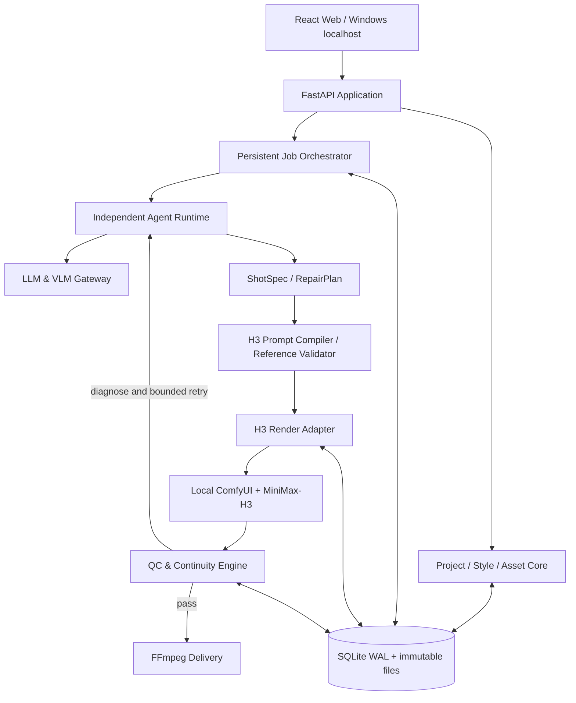

# Shine视频工作台（Shine Video Studio）V1.0 项目建设方案

> **状态**：首版建设基线（供云端 Codex Agent 开发）  
> **日期**：2026-10-20  
> **代码仓库建议名**：`shine-video-studio`  
> **部署目标**：Windows 单机、本地 Web 访问、本地 MiniMax-H3/ComfyUI 渲染  
> **关键原则**：独立 Agent Runtime；可自由配置 LLM/VLM API；仅使用人工提供的主资产；先预制并冻结全片风格；可恢复的无人值守渲染与质检闭环。

---

## 0. 执行摘要和版本定义

Shine 视频工作台定位为**以 MiniMax-H3 本地音视频生成模型为唯一正式视频生成引擎**的自动化短剧制片系统。用户导入项目书/剧本和人工制作或搜集的、具有使用权的角色、场景、道具与音色素材，在系统中完成影视风格预制、测试与冻结；之后由独立 Agent 自动拆解分镜、匹配资产、编译 H3 提示词、提交本地 ComfyUI、检查视听质量、诊断并有限返工、剪辑成片，并在困难问题处局部挂起而非阻断全项目。

首版不能只展示“工作流跑通”的演示，而必须具有一条可恢复、可观察、可验收的**最小自主生产闭环**。但不承诺任何模型能保证 100% 审片准确或最终 100% 自动合格；不在没有 Windows/GPU/H3 实测时宣称运行通过。

### 0.1 已冻结的产品决定

| 编号 | 决定 | 强制执行要求 |
| --- | --- | --- |
| P-01 | Windows 本地 Web 工作台 | 后端运行于 Windows，浏览器通过 localhost 访问；支持中文路径；可配置本地或局域网内 ComfyUI |
| P-02 | 速度与质量平衡 | 分 A/B/C 镜头质量等级，但角色身份/服装/对白/技术故障是各等级的硬性门禁 |
| P-03 | MiniMax-H3 核心 | 只有本地 H3 能进入正式生成路径；不自动静默切换至其它视频模型 |
| P-04 | 仅人工主资产 | Agent 禁止自动生成、替换、覆盖、自动批准角色/场景/道具/音色主资产 |
| P-05 | Agent 独立运行 | 系统运行不能依赖 Codex、Claude Code、OpenCode 或任意外部编程 Agent |
| P-06 | 任意兼容 LLM 接口 | 可配置 Base URL、API Key、Model ID；按能力检测接入 OpenAI-compatible、Anthropic 等原生接口、本地服务 |
| P-07 | 全片风格先批准后冻结 | 未冻结 Style Bible，正式生产线不得启动；冻结后 Agent 不能擅自改写 |
| P-08 | 无人值守优先 | 独立后台 Worker，持久化任务、断点续跑、失败诊断、限次返工、局部待处理 |
| P-09 | 逐镜可追溯 | 每次生成保存镜头版本、引用资产、输入哈希、Prompt、Seed、工作流/模型版本、外部任务 ID、QC 证据 |
| P-10 | 法律合规与隐私 | 用户资产不得未经明确同意上传第三方云服务；模型/插件/源码许可证分别核实 |

### 0.2 首版完成定义（避免一次性无限扩张）

本计划分 `M0 → M1 → M2 → M3 → M4`，各阶段必须可运行、可测试、可合并。**第一轮云端建设至少交付 M0+M1 的真实代码**，并搭建 M2 的接口与测试骨架；后续按验收推进。云端没有 H3 GPU 时仅能验证适配器、模拟任务与工作流结构，不能用 mock 测试冒充真实生成验收。

---

## 1. 开源技术基线和融合策略

### 1.1 强制阅读的上游项目

| 项目 | GitHub 地址 | Shine 中的用途 | 复用边界 |
| --- | --- | --- | --- |
| MiniMax-H3 官方 | https://github.com/MiniMax-AI/MiniMax-H3 | 生成模式、输入上限、提示词官方规则及 Skill | 权威规则源；采用官方许可说明；模型权重不进入仓库 |
| comfyui-auto-drama | https://github.com/qiukaihui/comfyui-auto-drama | H3 提交、守护进程、链式执行、失败码、FFmpeg 合成参考 | 优先挑选低耦合的可测试逻辑，不照搬全部 UI、数据库、资产生图功能 |
| ComfyUI-MiniMaxH3-Myang | https://github.com/civilcoco/ComfyUI-MiniMaxH3-Myang | 时序上下文、镜头衔接、音画缝合、恢复、媒体槽位校验 | **独立 ComfyUI 插件**经其公开节点/工作流接口集成；不得未经许可证审查复制 GPL 源码进入主程序 |
| Calliope | https://github.com/benjiyaya/Calliope | 独立多 Agent、LLM 端点设置、项目/分镜工作台设计参考 | 架构/UI 借鉴和许可证核对后选择性复用；Shine 不能依赖其运行时 |

**事实与限制**：`comfyui-auto-drama` README 自述为演示/教学项目，且包含自动生图能力——Shine 必须明确禁用/删除生图生产路径。`ComfyUI-MiniMaxH3-Myang` 的节点代码标为 GPL-3.0-only。`Calliope` 为独立 Agent 架构参考，不要求 Shine 引入其所有运行时。不能凭 README 声称第三方项目已经完成“整片语义审片与自主修复”。

### 1.2 源码复用审计门禁

1. 阅读上游 README、LICENSE、具体实现、测试、示例工作流、依赖树和主要接口。
2. 编制 `docs/upstream-audit.md`：仓库 URL、读取时 Commit SHA、源码目录、功能清单、许可证、实际复用文件、修改文件、风险及测试结果。
3. 必须比较**组件复用、独立适配、重写**的维护成本。优先保留功能，不保留重复主控：Shine 自己持有唯一任务状态、资产索引和生产授权。
4. 上游 GPL 组件保留为用户自行安装的独立 ComfyUI 节点插件。此方式不构成对许可证义务的法律保证；正式分发前还需按实际组合方式进行许可证审核。
5. 固定上游源码版本/工作流版本；禁止自动跟随 `main` 导致旧项目不可复现。
6. 首版禁止自动下载模型权重、上传用户素材到第三方、提交第三方演示素材或未经审计的大体积代码。

---

## 2. 创作流程与风格冻结门禁

### 2.1 作品完整生命周期

`DRAFT_PROJECT → SCRIPT_PARSED → ASSET_VALIDATED → STYLE_DRAFT → STYLE_PREVIEW(optional) → STYLE_APPROVED → STYLE_FROZEN → SHOT_PLAN_APPROVED(optional per mode) → PRODUCTION_RUNNING → QC/REPAIR → EPISODE_ASSEMBLY → DELIVERY_QC → COMPLETE / COMPLETE_WITH_BLOCKERS`

- `STYLE_FROZEN` 是正式排产的必备条件，不能由生产 Agent 自行设定。
- 允许在不新增主资产的情况下，从**已批准的用户素材**制作裁剪、转码、缩略图；允许从已生成且已批准的 H3 视频派生末帧和音画接缝上下文用于技术续接，必须存储 lineage，且**不得晋升为新主资产**。
- Agent 可建议改变镜头方案以适配已有资产，但不能改变用户锁定的关键剧情、对白、人物身份、服装、导演风格。
- 缺素材时生成 `WAITING_ASSET` 任务和缺失清单，继续运行不依赖该素材的其它任务。

### 2.2 Style Studio（影视风格预制中心）

首版应实现有结构化字段的风格设定表单、冻结/解冻审批及版本记录：

| 维度 | 字段例子 |
| --- | --- |
| 摄影语言 | 稳定/手持比例、机位高度、景别选择、推轨/摇移/跟拍原则、禁用无动机环绕 |
| 镜头调度 | 场面调度、运动轴线、正反打规则、人物走位、双人对话空间关系 |
| 色彩风格 | 主色/辅色、冷暖分离、饱和度、肤色保护、跨镜色彩容差 |
| 影调与灯光 | 高低调、反差、黑位、阴影细节、主光方向、轮廓光 |
| 镜头质感 | 模拟胶片、焦段偏好、景深、颗粒、柔光、光晕、锐化/塑料肤质限制 |
| 剪辑与节奏 | 平均镜头时长区间、对话停顿、动作快切规则、段间 CUT/可选其它转场 |
| 声音表演 | 语言、语速、多人对白响应、音色引用、音乐与环境音策略 |

**三级约束**：L1 全片 Style Bible（不可自动修改）；L2 已经批准的分场景例外（限幅）；L3 单镜头创作自由（在 L1/L2 允许范围内）。

`style_versions` 中记录 JSON 快照、hash、批准人标记/时间、参考来源、允许的例外、已审核测试镜头；生产镜头必须引用 `style_version_id`。风格修改后生成新版本并计算影响范围，不能原地覆盖旧版本。

**预演**：允许用人工资产生成 2–3 个代表性 H3 测试镜头，供用户批准。首次 MVP 可将预演设为可跳过，但**必须用户明确批准跳过并冻结风格**；绝不能 Agent 默许通过。预演视频属于测试渲染物，不可直接自动加入正片。

### 2.3 项目规格

项目创建时：影片名称、项目书/剧本、集数、每集预计时长、画幅、叙事语言、片型、风格、预期成片规格、生产策略、返工预算；集数和每集时长为排产目标而非强行拉长镜头。镜头拆分依据本地 H3 模型已验证的能力范围；剧本对白与每段时长须做可说完性估计，并在审片中以 ASR 校验实际语音。

---

## 3. 系统架构（模块化单体 + 独立 Worker）



推荐技术栈：Python 3.12、FastAPI、Pydantic v2、SQLAlchemy + Alembic、SQLite WAL、Python 后台 Worker、React + TypeScript + Vite、FFmpeg/FFprobe、pytest/Playwright。具体版本经兼容性审计后锁文件固定。前期不引入 Redis、Kafka、Kubernetes、微服务或复杂多数据库。

### 3.1 唯一性原则（硬约束）

- **唯一项目真相**：`Project Core` 与 SQLite；不允许上游每个控制台维护第二套可修改的项目库。
- **唯一任务控制器**：`Job Orchestrator` 写任务状态；ComfyUI 和 Agent 仅通过接口回报/请求状态变更。
- **唯一资产主索引**：`Asset Registry`；各种 Picture/Video/Audio 是一次任务内部临时别名。
- **唯一 H3 提示词输出**：`H3 Prompt Compiler`；LLM 只输出结构化镜头意图，不能直接拼接任意最终指令进行提交。
- **唯一风格有效版本**：已冻结 `style_version_id`；所有执行尝试携带不可变 hash。
- **唯一媒体归档机制**：`Artifact Store` 将临时文件校验、原子入库并写 lineage。

### 3.2 模块边界/接口

| 模块 | 输入 | 输出 | 不允许负责 |
| --- | --- | --- | --- |
| Project Core | 文档、工程参数、审批事件 | Project/Scene/Episode/Shot IDs | 直接调用 ComfyUI |
| Style Studio/Registry | 用户风格、参考图、审批 | 冻结 StyleBible | 自行决定用户批准 |
| Asset Registry | 用户上传主资产、派生文件 | 版本、权限、哈希、绑定 | 自动创建新主资产 |
| Agent Runtime | 已批准项目、风格、资产、质检问题 | ShotSpec/RepairPlan | 任意读写 DB、绕过规则 |
| LLM Gateway | Provider Profile、请求、能力 | 结构化模型响应 | 存储明文密钥到日志 |
| H3 Compiler | ShotSpec、StyleBible、绑定、能力表 | Prompt + Workflow Job Payload | 擅自创造资产 |
| Render Adapter | 编译后的可执行作业 | provider_job_id、进度、Artifact | 认定镜头“艺术合格” |
| Orchestrator | 状态机、依赖、资源限制 | 任务租约/调度/重试 | 编写剧情 |
| QC Engine | 视频、音轨、资产、ShotSpec | QCReport + reason_code | 静默修改锁定资产/风格 |
| Delivery | 通过质检的镜头序列 | MP4、字幕、报告 | 为完成时长补造剧情 |

---

## 4. 独立 Agent / LLM Gateway

- 采用 **单一中央制片 Agent + 按需调用的专业角色能力**；避免多个常驻聊天 Agent 相互修改状态和互相覆盖。
- 专业能力：`ScriptPlanner`、`StoryDirector`、`AssetSelector`、`H3Director`、`QCReviewer`、`RepairPlanner`、`DeliveryDirector`。
- Provider：OpenAI-compatible（自定义 Base URL、Key、Model）、Anthropic 原生可选适配器、Ollama/LM Studio（兼容协议）；按需扩展其它厂商原生协议。
- 初始能力探测：可用性、结构化 JSON、工具调用能力、图像理解、上下文窗口/输出长度；不支持能力时阻止分配或使用显式替代路径。
- LLM 输出一律 Pydantic/JSON Schema 校验；每条生产决策记录模型、输入版本、输出摘要、Token/费用估算、错误和重试次数。
- 模型降级只能在用户预先批准的 Provider/Profile 白名单中执行，禁止将本地/敏感素材在不知情时发送云 VLM。
- 工具层实施白名单与参数校验：Agent 不获得任意 Python 执行、Shell、任意磁盘路径访问、数据库直写、未知 HTTP 终端权限。
- **Codex 仅用于开发 Shine，不是运行 Shine 的前置条件。** `pip install` / 启动 Shine 时不依赖 Codex 账号或 SDK。

---

## 5. 素材系统和引用安全

### 5.1 分类与权限

主资产（用户上传并人工批准）：人物脸部定妆照、全身/三视图、服装、场景、道具、演员音色与用户提供的风格参考。派生资产（自动）：缩放/裁剪/格式转换、生成结果的视频末帧、经批准镜头的接缝上下文、QC 抽帧、ASR 转写和合成工程。派生物必须关联父 Artifact、生成动作和来源 Hash；不能升级为主身份/角色标准。

每个主资产至少记录：`id`, `entity_id`, `type`, `path`, `sha256`, `version`, `source=user_upload`, `approved`, `locked`, `allowed_uses`, `metadata`, `created_at`。

### 5.2 一次渲染中的引用映射

- 全局 `asset_id` 如 `CHAR_HANKUI_FACE_001` **不能**直接当成 `<Picture N>` 的 N。
- 按每次 H3 Job 创建稳定、不可变的 `reference_manifest`，记录角色 ID、全局资产版本和哈希、局部引用编号、文件读取路径、最终 Prompt 用途。
- 若镜头出现两个人，需显式逐角色关联其身份和服装；未在该镜头登场者的身份图不要混入引用。
- 若无法满足引用数限制，先按照引用优先级裁剪**非关键引用**并由规则校验器复查；不能自动丢弃人物身份锁定资产。
- 剧本动作/音色/角色 ID 与声音说话人 ID 区分，并校验每段对白实际可说完。
- 防止用户文件路径穿越、扩展名伪装、同名覆盖；资产入库采用安全目录映射和 hash。

### 5.3 H3 参考限制（当前官方基线）

- 官方 H3 视频生成片段时长 4–15 秒，24 FPS；默认本地 H3-Base 为 768 短边级别，其他分辨率依本地部署能力检测结果决定。
- FL2VA 模型支持 0/1/2 张关键帧（分别兼容 T2VA、首帧/末帧、首尾帧）。
- Ref2VA：最多 9 图、3 视频、3 音频；视频/音频参考各最多 15 秒总时长，每个输入片段 2–15 秒；**所有输入文件总数最多 12**。
- 工作流实际可用模式按 ComfyUI 节点与已安装 checkpoint **运行时探测**，不能仅凭 README 推断插件具备所有模式。
- 官方本地 H3-Base 不等于完整的官方托管 H3-Context-IR + H3-Regenerate-2K；不得在 V1 宣称全本地官方 2K 再生成，后期分辨率放大应单独标明。

### 5.4 H3 Prompt Compiler

以 https://github.com/MiniMax-AI/MiniMax-H3/tree/main/skills/h3-prompt-writing 的 `SKILL.md` 和 `references/base-en.txt` / `references/ref-en.txt` 为规则源；固定已验证的文件版本和 Hash。基础模式遵循 `integrated_multimodal_description`、`overall_soundscape`、`non_diegetic_music`；Ref2VA 遵循官方六段结构、标签和顺序。不得自行造出未经校验的“万能尾缀”来取代官方格式。

编译步骤：`ShotSpec → 引用资产选择 → 模式能力检查 → 风格 L1/L2 合并 → 镜头时间码/对白校验 → H3 字段与标签生成 → 结构检查 → immutable RenderRequest`。

---

## 6. 必须实现的数据契约

推荐新增 `schemas/` 并输出 `docs/contracts.md`、JSON Schema 与 Pydantic 模型。重要实体：

`projects`, `project_documents`, `episodes`, `scenes`, `shots`, `shot_revisions`, `style_versions`, `style_approvals`, `characters`, `assets`, `asset_bindings`, `provider_profiles`, `workflow_profiles`, `jobs`, `job_dependencies`, `job_attempts`, `external_job_reconciliations`, `media_artifacts`, `qc_reports`, `repair_plans`, `deliveries`, `audit_events`。

### 6.1 ShotSpec（样例，仅为 Shine 内部中间表示）

```json
{
  "schema_version": "1.0",
  "shot_id": "E01-S02-SH07",
  "episode_id": "E01",
  "scene_id": "S02",
  "story_beat": "韩魁追问证据去向，阿德当面回应",
  "duration_target_s": 7.0,
  "shot_priority": "A",
  "style_version_id": "STYLE-SUZHEN-V1",
  "camera": {"shot_size": "medium_two_shot", "movement": "slow_push", "axis_rule": "preserve"},
  "characters": ["CHAR_HANKUI", "CHAR_ADE"],
  "required_asset_ids": ["HANKUI_FACE_V1", "ADE_FACE_V1", "S02_LOCATION_V1"],
  "dialogue": [
    {"speaker_id": "CHAR_HANKUI", "text": "账册到底在哪儿？", "start_s": 0.4, "end_s": 2.4},
    {"speaker_id": "CHAR_ADE", "text": "杜万山带上钟楼了。", "start_s": 3.0, "end_s": 5.8}
  ],
  "sound": {"environment": "night_courtyard", "music_policy": "low_or_none"},
  "continuity": {"previous_shot_id": null, "hard_cut_default": true},
  "locked_story_facts": ["账册已由杜万山带往钟楼"]
}
```

场景是测试样例，不是 Shine 的强制题材设定。编译器应拒绝对白超时、风格版本不存在、资产未批准、角色与绑定冲突等请求。

### 6.2 RenderRequest / JobAttempt

`RenderRequest` 存：`idempotency_key`, `shot_revision_id`, `style_hash`, `prompt_skill_hash`, `workflow_profile_hash`, `model_checkpoint_id`, `reference_manifest`, `prompt`, `seed`, `expected_duration`, `local_output_target`。

`JobAttempt` 存：`attempt_no`, `submit_intent_at`, `provider_job_id`, `submit_ack_at`, `lease_owner`, `lease_expires_at`, `heartbeat_at`, `progress`, `result_path`, `content_hash`, `failure_code`, `retry_reason`。

### 6.3 QCReport / RepairPlan

```json
{
  "shot_id": "E01-S02-SH07",
  "attempt_no": 1,
  "result": "FAILED",
  "hard_failures": [
    {"code": "IDENTITY_MISMATCH", "character_id": "CHAR_HANKUI", "evidence_time_s": 3.2, "evidence_artifact_id": "FRAME_007"}
  ],
  "soft_scores": {"style_consistency": 0.83, "camera_compliance": 0.79},
  "review_confidence": 0.72,
  "repair_plan": {"action": "REBUILD_REFERENCE_BINDINGS", "max_additional_attempts": 2},
  "human_review_required": false
}
```

失败类型与动作建议应是**类型化枚举 + 证据**，不能只是自由文本“生成不对”。高风险误判须引入 `UNCERTAIN_REVIEW`，不可无限返工，也不可伪造 `PASSED`。

---

## 7. 持久化队列与崩溃恢复

### 7.1 任务依赖图

- 非依赖镜头可并行规划与质检；初期同一 GPU 默认最多 1 个 H3 渲染任务。
- 需要前一镜头合格末帧/音画上下文的镜头，必须显式 `depends_on(PASSED predecessor)`。
- 只有用户批准的镜头素材、冻结 Style 版本和通过编译的 RenderRequest，才允许入渲染队列。
- 前镜重做后，对所有引用旧版本末帧的后继任务标记失效并请求重做或复核；已通过的无关镜头不得重复渲染。

### 7.2 状态机

`PLANNED → WAITING_ASSET | READY → QUEUED → SUBMITTING → RUNNING → QC_PENDING → PASSED | REPAIR_PENDING | NEEDS_REVIEW | FAILED`

`REPAIR_PENDING → READY(new attempt)`；`PASSED → DELIVERY_READY → DELIVERED`。使用明确合法状态转换、事务、事件日志与审计记录。

### 7.3 可靠交付规则

1. SQLite WAL、事务性抢租约、Worker 心跳、可续租租约；避免数据库长期写锁。
2. 提交外部 H3 前先持久化 `SUBMIT_INTENT`、请求指纹；提交成功后写入 `provider_job_id`。
3. `SUBMITTING` 崩溃恢复时先向 ComfyUI 历史/队列核对，查不到也必须保留“不确定已提交”状态，避免盲目重复占 GPU。
4. 模拟器必须覆盖重复提交、HTTP 超时、外部任务未找到、输出文件下载中断、Shine 重启、ComfyUI 重启、磁盘空间不足、并发抢锁。
5. 下载输出到 `.partial`，FFprobe 解码与大小校验后 `atomic rename` 入库；数据库提交与文件归档通过可重放的中间状态协调。
6. 资源治理：GPU 槽位限制、内存/磁盘门限、用户 API 调用预算、每镜最多 N 次返工、任务超时和异常级别。
7. 关闭 Web 浏览器不影响任务；Windows 后台进程可自动启动/恢复；不能保证 Windows 休眠或断电期间继续实际 GPU 渲染。

---

## 8. QC 与自动返工（核心产品价值）

### 8.1 多级 QC

| 门禁 | 确定性/概率性 | 判据 | 错误示例 |
| --- | --- | --- | --- |
| Preflight | 确定性 | H3 模式、参考数、资源、Style hash、对白时间码 | INVALID_REF_TAG / ASSET_NOT_APPROVED |
| Technical QC | 确定性 | 文件存在、解码、时长、fps、音轨、尺寸、末帧有效 | CORRUPT_VIDEO / AUDIO_MISSING |
| Dialogue QC | 混合 | ASR 对白是否出现、说话人、时序、明显口型偏离 | WRONG_LINE / SPEAKER_MISMATCH |
| Character QC | 概率性 | 角色身份、服装、道具、镜头出场人物 | IDENTITY_MISMATCH / COSTUME_DRIFT |
| Film Style QC | 混合 | 冻结色调、影调、肤色、构图、运动、剪辑原则 | STYLE_DRIFT |
| Continuity QC | 概率性 | 时间地点、走位、动作、人物位置、衣服/道具状态、音画接缝 | CONTINUITY_BREAK |
| Delivery QC | 确定性 + 复核 | 镜头完整、时序、字幕、音量、成片编码、阻滞说明 | DELIVERY_INCOMPLETE |

输出必须带 evidence timestamp、抽帧 ID、失败类型、可信度和可能修复动作。若使用第三方 VLM 上传抽帧，需明确用户授权；支持“只运行本地质检/跳过云 VLM”策略且如实反映 QC 覆盖范围。

### 8.2 速度质量平衡默认

- A（面部特写、关键对白、剧情转折）更严格语义 QC；B 常规故事镜头；C 空镜/过场降低审美检查成本。
- **所有等级**均不放行：错误角色、用户锁定服装变化、关键对白不符、损坏、资产越权、Style Bible 硬约束违反。
- 默认首次生成 + 最多 2 次**语义返工**；可配置总预算/单镜上限。网络临时故障的基础设施重试与语义返工分别计数。
- 重做前进行 root-cause classification；`REFERENCE_WRONG` 优先修正绑定，`VOICE_WRONG` 修复音色/发言人映射，`ACTION_WRONG` 调整镜头意图/模式，`STYLE_DRIFT` 修复固定风格编译，不能只换 Seed 盲抽。
- QC 置信度不够、连续失败或确需用户新增素材 → `NEEDS_REVIEW` / `WAITING_ASSET`，其它独立镜头继续运行。
- 必须保存“首次通过率、自动返工挽救率、人工介入事件、GPU 消耗、VLM 误判反馈”。

---

## 9. Web 界面首版

建议 React/TypeScript，中文优先，桌面 16:9，暗/亮主题按需。V1 页面：

1. **项目管理**：新建项目、导入剧本文档、集数/时长/画幅/对白与预算配置。
2. **资产库**：上传、标签、角色/场景关联、人工批准与冻结、缺失引用报告。
3. **风格预制中心**：七维摄影/色彩/影调/节奏设置、镜头测试、冻结版本、风格差异审计。
4. **分镜工作区**：集→场→镜，镜头 ShotSpec、对白时间码、角色/资产绑定、状态与版本、锁定。
5. **生产监控**：GPU 队列、实时任务、合格率、返工次数、局部阻滞、暂停/恢复/跳过（授权操作）。
6. **质检与修复**：失败证据帧、Reason Code、模型结论、重试版本比较、人工接受/拒绝。
7. **成片与导出**：片段序列、字幕、音频检查、MP4 与工程 JSON/报告下载。
8. **系统设置**：LLM/VLM Profile、API 能力探测、ComfyUI 连接/工作流检测、FFmpeg/磁盘检查、隐私开关。

首版不做完整 NLE 专业多轨剪辑器，也不要求云端在线预览 GPU 视频生成；工程结构必须允许后续添加时间轴剪辑。

---

## 10. 本地安全、隐私、性能与升级

- 默认服务监听 `127.0.0.1`。开放 LAN 必须显式开关、身份验证与 CSRF/CORS 控制。
- API Key 不进入 Git、前端 bundle、日志；Windows 可用 DPAPI 或操作系统凭据安全存储；`.env.example` 仅占位。
- 上传的文件大小、类型、解码和路径必须校验；不得允许 Agent 通过任意自定义 URL 读取本地内网服务。
- 全部模型调用按可观察的日志分层记录，但 Prompt 中可能包含私有剧本和人员资料，默认脱敏并允许用户关闭完整 Prompt 日志。
- 本地视频生成与“全离线”是不同概念：如用户选择云 LLM/VLM，请显示素材/文字传输边界和授权，默认不得把原始角色资产发送给云服务。
- 通过 `workflow_profiles` 固定 ComfyUI 节点版本/模型校验信息；只支持能力探测通过的组合。
- Windows 支持 UTF-8、中文/空格路径；桌面启动 `start_shine.bat` 与 `check_environment.ps1`；日志轮转，数据库备份与项目导出/导入。

---

## 11. 交付里程碑与验收

### M0：源码审计、架构与项目骨架

交付：`README.md`, `AGENTS.md`, `docs/architecture.md`, `docs/upstream-audit.md`, `docs/contracts.md`, `docs/adr/`, `.gitignore`, `LICENSE`（根据实复用代码审定）, `config/*.example`, CI、开发启动脚本。基础后端/前端代码可运行，SQLite migration 可执行。

验收：启动 `/health`，Web 能加载；pytest、类型/格式检查、前端构建、基础安全检查通过；网络断开仍可使用 mock Provider 跑基本健康检查。

### M1：任务、资产、风格闭环（本轮必须实际开发）

交付：Project/Asset/Style 的真实 CRUD 与版本保存；资产只可上传批准；风格审批冻结与生产门禁；Job DAG/leases/state transitions；Mock ComfyUI Provider（模拟延迟/成功/失败/不确定提交）；基础 UI。

验收：**没有 Style Freeze 不得正式生产**；Agent 不得生成主资产；10 个 mock 任务含依赖、暂停、重启恢复、失败及去重；不同任务不会混用素材。

### M2：真实 H3 执行与独立 Agent

交付：ComfyUI API 模式适配器、工作流 Profile 选择、官方 H3 提示词编译和强校验、LLM Gateway（至少 OpenAI-compatible + mock）、分镜 JSON 生成、语音时序基础约束、FFprobe 媒体入库、端到端 API 演练。

验收：在实际 Windows/ComfyUI/H3 机器上成功运行 T2VA 和至少一种参考生成模式；云端 CI 的模拟测试不得冒充真实 GPU 验收。

### M3：智能 QC 与限次返工

交付：技术 QC、人工 QC 测试集、可插拔 VLM/ASR 质检、RepairPlan、分级规则、有限重试、Evidence Viewer、指标统计。

验收：人为制造“引用错误、错误对白、坏视频、风格越界、缺少资产”的案例，逐项验证阻断/返工/局部挂起及上限控制。

### M4：无人值守短剧成片

交付：多场景排产、前后镜依赖、基础成片拼接、字幕和音频一致性、MP4+分镜/Prompt/QC 报告、Windows 一键安装/启动和恢复说明。

验收：用**人工提供**的一个约 60 秒、包含至少 2 人对白的真实场景，在本地 H3 上从冻结风格、生成分镜直到导出视频；记录人工介入次数、镜头合格率、返工率和总 GPU 耗时。最终对外声明使用真实结果，不隐瞒人工修复与阻滞。

### 阶段门禁

- 未通过 M1 不推进花哨 UI 或多集高度自动化。
- M2 不能仅有 Mock Provider；须留待用户本机实测并按清单关闭差异。
- M3 不能只依据单个 VLM “好看/不好看”评分判定合格。
- M4 无法修复的镜头不能硬标记 PASSED；可交付 `COMPLETE_WITH_BLOCKERS` 的报告，但不能冒充合格完整成片。

---

## 12. 建议目录结构

```text
shine-video-studio/
├── AGENTS.md
├── README.md
├── LICENSE
├── docs/
│   ├── Shine视频工作台_V1.0_项目建设方案.md
│   ├── architecture.md
│   ├── contracts.md
│   ├── upstream-audit.md
│   ├── local-h3-acceptance.md
│   └── adr/
├── backend/
│   ├── pyproject.toml
│   ├── alembic/
│   ├── shine/
│   │   ├── api/
│   │   ├── core/
│   │   ├── domain/
│   │   ├── agents/
│   │   ├── llm/
│   │   ├── assets/
│   │   ├── style/
│   │   ├── h3/
│   │   ├── orchestration/
│   │   ├── quality/
│   │   ├── delivery/
│   │   └── persistence/
│   └── tests/
├── frontend/
│   ├── package.json
│   └── src/
├── workflows/                 # 自有模板/adapter profiles；第三方 GPL 节点不进入源码树
├── examples/                  # 人工编写的合成测试文本和无侵权模拟引用
├── scripts/                   # Windows 启动、环境检查
├── config/                    # 仅 example，无密钥
└── .github/workflows/
```

---

## 13. 开发阶段防失控机制

- **先契约和真实代码再界面修饰**；不引入不必要的基础设施。
- 每个模块有唯一 owner、接口、Schema、错误码、测试与性能边界。
- 编排状态由唯一 Orchestrator 修改；数据库迁移显式版本化，不允许 `create_all` 代替长期迁移。
- 凡不能在云端验证的 Windows/GPU/H3 特性，标注 `PENDING_LOCAL_VALIDATION` 并输出精确复现步骤与需要用户提供的机器信息。
- README 不得出现虚假的“全部完成、全面无人值守”宣传。
- 对外上游说明、模型许可证、用户素材授权、GPL 插件集成均纳入 `NOTICE` 与风险表。
- GitHub CI 不需要 GPU、真实用户资产或 LLM Key 即可运行。
- 使用特性开关隔离未开发完成的自动修复/高级续接/云 VLM，关闭时必须有清晰 UI 提示。

---

## 14. 关键指标

**北极星指标**：每分钟合格成片所需人工操作分钟数，包含审核返工、处理阻滞、最终复核，不包含用户在系统外制作主素材的时间。

辅助指标：人工介入次数/分钟成片、无人值守成功镜头率、首次 QC 通过率、返工挽救率、硬错误漏检率、单分钟成片 GPU 时间、失败恢复正确率、误重试次数、总 LLM/VLM API 费用。

目标以**试生产实测基线**制定，不在无法验证的情况下编造成功率。

---

## 15. 参考来源（开发时重新审计 Commit）

1. 官方 H3：<https://github.com/MiniMax-AI/MiniMax-H3>
2. 官方 H3 Prompt Skill：<https://github.com/MiniMax-AI/MiniMax-H3/tree/main/skills/h3-prompt-writing>
3. H3 自动短剧：<https://github.com/qiukaihui/comfyui-auto-drama>
4. H3 沐阳节点：<https://github.com/civilcoco/ComfyUI-MiniMaxH3-Myang>
5. Calliope：<https://github.com/benjiyaya/Calliope>
6. Codex Cloud 文档：<https://help.openai.com/en/articles/20001545-using-codex-cloud>

**声明**：本文件为设计要求与拟建设方案，不等同于已经完成的代码/本地 H3 验证报告。正式实施中的源代码与模型能力以当时具体版本、工作流测试和许可证核查结果为准。