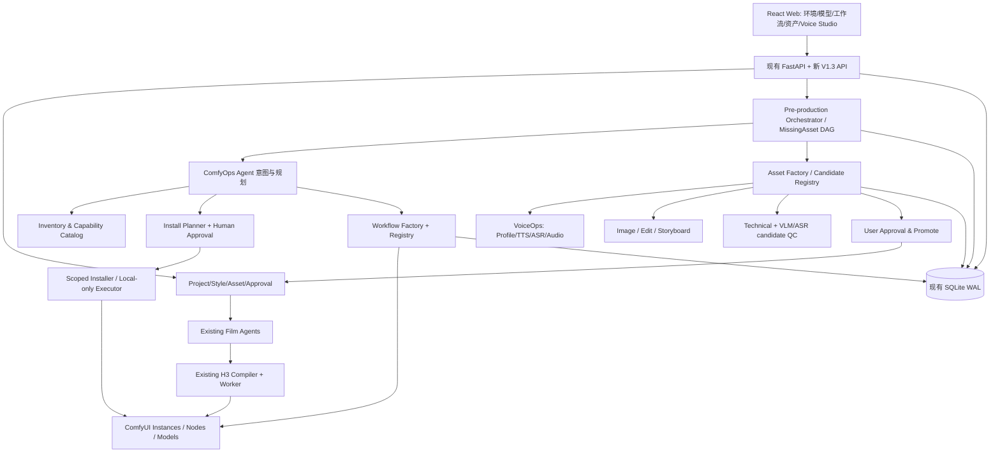

# Shine 视频工作台 V1.3 建设方案：ComfyOps 与全资产预制作系统

> **版本**：V1.3 产品与技术建设基线 / 2026-10-22  
> **仓库**：https://github.com/anjingdtl/shine-video-studio  
> **基线**：`main` @ `4f403e6ce48c6af12bb24f296c747a2eeca66950`（V1.2.1）；如开始开发时 HEAD 已前进，应以实际 HEAD 和现有契约为准。  
> **状态**：**需求与架构方案，不代表功能已实现**。  
> **目标环境**：Windows、本地 Web、RTX 5080 16GB VRAM、32GB RAM、用户已有 ComfyUI 与 MiniMax-H3 Ref2VA INT8 ConvRot 工作流。  
> **工作划分**：云端 Codex 实现全部可离线验证的软件工程、Mock/Fake HTTP 和 Windows CI；实际安装/下载/本机 GPU 推理/模型适配与电影质量验收另由本地 Agent 在用户授权下执行。

---

## 0. 决策摘要：从“可调度导演台”到“可准备制片环境的本地 AI 制片系统”

V1.2.1 已具备七类影视专业 Agent、H3 官方规则、镜头级资产引用、ComfyUI 适配器、Worker 持久化、逐项人工审片、技术/语义质量门和返工恢复能力。但如果用户提供一份新剧本，Shine 仍不能自动判断哪些素材与模型缺失、怎样安全准备 ComfyUI、如何创建人物/场景/道具/音色、如何发布适合导演使用的工作流。

**V1.3 新增一个面向本机制作能力的 ComfyOps Agent、一个多模态资产工厂和 VoiceOps 音色配音能力，并将“制片准备”变成可以恢复、可审计的前置 DAG。**

端到端期望：

```text
项目书/剧本 + 用户制作意图
  → 预制作需求分析（角色、服装、场景、道具、音色、台词、音乐、动作、字幕等）
  → 本机 ComfyUI / 模型 / 节点 / 工作流 / GPU 环境发现
  → 对照资产库与能力目录，形成缺口清单和有风险说明的安装计划
  → [用户授权] → 隔离安装/下载/节点配置/回滚点
  → 本地模型或用户导入 → 统一候选资产库 → 自动 QC
  → [用户人工批准] → 版本锁定的正式主资产
  → 资源/风格/声音/工作流开机前门禁
  → 现有导演/摄影/声音/剪辑 Agent + H3 Compiler + Worker 正式生产
  → H3 视频生成 → QC/返工 → 剪辑与字幕/混音 → 交付
```

### 0.1 不可改变的既有基线

1. **只有本地 MiniMax-H3 可以作为正式视频生成引擎**；Qwen-Image、TTS、ASR、VLM、音效/配乐模型可作为其他阶段的本地工具，但不得替代正式 H3 视频生成。
2. **现有唯一 SQLite 项目数据库、Job/Attempt/QC/Audit/Artifact 账本和 Worker 调度权不被取代**。新增资产预制、安装与工作流任务可建立子类型/独立租约，但不能出现两套项目主账本。
3. **现有 H3 Prompt Compiler、官方规则包冻结、Style Bible、镜头参考隔离、连续性能力门、当前 Attempt 人工审批协议、质量门不被绕过**。
4. **主资产的正式批准权仍在用户**。V1.0 的“只许人工提供素材”修改为：系统可自动生成、加工、导入**候选资产**，但候选资产只有经用户正式批准、锁定后才可成为生产主资产。所有历史人工主资产继续原样有效，迁移不得偷偷改审批标记。
5. **Codex/Claude Code 不进入运行时依赖**；正式 Agent Runtime 仍为用户可配置 LLM Gateway。
6. **没有模型/节点/声音的使用授权，就不得自动生产或商业分发**；未授权的真实人声克隆不得执行。

### 0.2 V1.3 是否完成的判断

**软件工程验收（云端可以完成）**：环境检测协议、模型与节点目录、安装计划/审批状态机、工作流注册/验证/匹配、候选资产和 Voice Profile、预制作 DAG、算力租约、API/Web、伪本地设备和 Fake ComfyUI/Voice Server 的集成测试、迁移与 CI 全部通过。

**本地真实验收（云端不能代替）**：真实 Windows 设备扫描、多个 ComfyUI 实例发现、节点安全安装、模型真实下载及完整性、Qwen 图像与音色真实生成、H3 各版本适配、实际 16GB VRAM 峰值与吞吐、PDD8/超分工作流发布、真实声音/画质/接续/完整成片。必须分别标为 `PENDING_LOCAL_ENV` / `PENDING_LOCAL_GPU`，禁止宣称云端 Mock 已证明。

---

## 1. 用户场景与制片前资产完整覆盖

**每一种可数字化的影视预制作资产都必须有统一的导入入口**；本地自动生成属于有能力时可选的生产策略，不保证每一类资源必然有合格/可商用本地模型。没有可用生成器时保持 `IMPORT_ONLY` 或 `CAPABILITY_MISSING`，不得假造素材。

| 资产族 | 细类及最小信息 | 本地生成/处理路径（示例，需注册与核验） | 用户导入路径 | 开机前门禁 |
| --- | --- | --- | --- | --- |
| 文本规划 | 项目书、剧本、剧集/幕/场、人物小传、对白与镜头表 | 现有编剧 LLM /结构化规划 | TXT、MD、PDF、DOCX、JSON | 结构化剧本与锁定剧情 |
| 人物身份 | 正脸、胸上、全身、正侧背三视、表情、年龄/外形特征 | Qwen-Image-2.1 或已授权的本地图像工作流 | 本地图片、拍摄/绘制作品 | 角色 ID、身份一致性、人工锁定 |
| 服装化妆 | 每套服装、场次搭配、妆发/饰品、细节和使用状态 | 参考编辑/蒙版与局部重绘 | 设计图、服饰照片 | character + outfit ID 明确绑定 |
| 场景 | 外景/内景、日夜/天气、空镜、方位与轴线参考 | 图像生成及编辑、景别变体 | 场景图、照片、3D 渲染 | scene ID、连续性说明 |
| 道具与交通工具 | 武器道具、账册、车船、标识、特写及使用状态 | 图像/多参考编辑 | 图片、CAD 截图、摄影图 | prop ID、尺寸/年代/状态 |
| 动作参考 | 姿态、走位、动作板、预演参考视频 | 仅经验证的本地动作/关键帧/参考工作流 | 用户视频、图片序列、动作捕捉 | 时间码、人物/镜头归属 |
| 分镜图与关键帧 | Storyboard、first/last frame、参考镜头 | 构图生成、裁剪、已审核成片派生 | 图片或视频 | 与 ShotSpec/Style 版本一致 |
| **角色音色** | **Voice Profile、样音、语种、音高、质感、克隆/设计来源** | **Qwen3-TTS VoiceDesign/Clone 等授权模型** | **WAV/MP3/FLAC/录音** | **独立音色批准/冻结** |
| 配音对白 | 逐句台词、角色、情绪、语速、分句音频、替代版本 | TTS + 角色 Voice Profile | 真人配音/声演文件 | 汉字原文、说话人、时码可验证 |
| 环境/拟音 | 雨、风、脚步、交通、门响、动作、环境底噪 | 可插拔本地生成器、音效编辑或混音 | 录制/商用授权音效 | 来源/许可、时间点 |
| 配乐/主题曲 | 音乐情绪、段落、循环、BGM 与母带 | 合法安装且验证的本地音乐模型；不指定强制提供商 | 音乐文件 | 音乐使用许可与混音计划 |
| 字幕 | ASR 转写、字词级对齐、SRT/ASS、样式 | Qwen3-ASR + ForcedAligner 或兼容替代 | 用户字幕与校对文本 | 字词准确率、语言/时码 |
| 画面/音频质检 | 角色/服装/画面语义、音色、口型证据、技术指标 | VLM/ASR/FFmpeg 本地分析 | 审片批注/报告 | 通过真实 QC 与必要人工确认 |
| 片头包装/品牌 | 片名、图标、海报、字卡、LOGO | 图像/文本/合成工作流 | 设计图、字体/LOGO | 版权、商标、字体授权 |
| 摄制配置 | 模型/节点/工作流/LoRA、质量等级、镜头预设 | ComfyOps 注册/验证/编排 | API Workflow JSON、配置清单 | Workflow Capability 已验证 |

**生成链条不等于正式批准链条**：创建候选资产 → 技术校验/自动相似度筛选 → `PENDING_HUMAN_APPROVAL` → 人工核验 → 晋升为现有正式资产 → 锁定 → 可绑定镜头。AI 工具不能调用现有正式资产 approve/lock 特权接口。

---

## 2. Agent 权限与协调

V1.3 **新增第八类专业能力 ComfyOps**，与 V1.1 七类影视工种并列，但其模型只能提出意图，不拥有任意 shell、Python、数据库、下载和网络操作权限。声音导演继续是专业决策者，**VoiceOps 是其受控制作工具域**，而不是绕开中心编排器的第二套自主决策体系。

| 角色 | 允许做什么 | 禁止做什么 |
| --- | --- | --- |
| Producer/制片 Agent | 跨部门计划、资产需求清单、资源/预算优先级、提出准备任务 | 直接批准下载、声音克隆、生产主资产 |
| Director/导演 | 结构化镜头请求、确定风格及画面/动作需求 | 任意执行 ComfyUI 节点/安装脚本 |
| Cinematographer/摄影 | 依据能力目录选择 H3 模式、工作流版本与参数 | 静默换 H3 模型、跳过参考限制 |
| Sound Director/声音 | 提出音色、配音、混音、字幕需求；调用 VoiceOps | 克隆未经授权第三人的声音、伪造人工试听 |
| **ComfyOps** | 环境盘点、依赖分析、生成安装计划、检索/构造/验证工作流、资源预约 | 未经用户授权执行改变环境的操作、任意脚本、访问非授权目录 |
| Asset Agent（专业工具角色） | 制图、修图、资产描述、候选入库、溯源和技术 QC | 晋升正式人物/音色主资产 |
| Continuity/场记 | 标记一致性/资产/软硬接续风险 | 将软参考宣称为硬锚定通过 |
| QC/Editor | 素材检验、字幕同步、EDL/拼接请求 | 借用旧 Attempt 的 QC 或越权批准 |

Agent Tools 必须使用有限枚举的类型化参数，如 `inspect_environment`、`propose_install_plan`、`search_capabilities`、`build_workflow_draft`、`create_candidate_asset`、`request_voice_preview`、`assess_project_readiness`。**安装执行、目录写入、服务启停和正式资产批准由后端经用户授权的执行服务完成**，LLM 不直接操作系统。

---

## 3. 模块架构与职责边界



建议代码目录（可依已有项目实际分层优化，但契约不能丢）：

```text
backend/shine/
  comfyops/
    agent.py                 # 受控 ComfyOps Agent 计划器
    inventory.py             # Read-only probe、实例/模型/节点/GPU 清单
    providers.py             # Windows/Comfy/Fake 探针协议
    instance_manager.py      # 创建隔离实例、启动停止、健康
    model_catalog.py         # 模型族/来源/许可/manifest/存储
    node_catalog.py          # 节点/依赖/版本/许可
    plan.py                  # 缺口计算、安装事务与资源预检
    installer.py             # 只允许批准的命令模板的受控执行器接口
    workflow_factory.py      # 可配置参数映射、图编排、契约校验
    registry.py              # 分类、版本、匹配、发布与回滚
    scheduler.py             # GPU/VRAM 预算、互斥与优先级
  assets/
    candidate.py             # 候选主资产、派生、晋升与索引
    factory.py               # 多模态资产生成请求/批量任务
    readiness.py             # 剧本 → 资产需求 → 可拍摄性报告
  voiceops/
    profiles.py              # 音色档案和冻结
    tts.py                   # 本地 TTS/VoiceDesign/Clone 可插拔适配
    asr.py                   # 字幕/对齐能力
    quality.py               # 音频/音色/文本一致性评审
  api_comfyops.py
  api_assets_v13.py
  api_voiceops.py
  api_preproduction.py
frontend/src/components/
  ComfyOpsPanel.tsx
  ModelAndNodeCenter.tsx
  WorkflowRegistryPanel.tsx
  CandidateAssetPanel.tsx
  VoiceStudioPanel.tsx
  PreProductionPanel.tsx
backend/tests/
  test_comfyops_*.py
  test_v13_assets_*.py
  test_voiceops_*.py
  test_preproduction_*.py
```

实现上继续采用单体 + 分离 Worker；不引入第二套数据库、Redis/Kafka、常驻不受控 Shell Agent。生产任务、安装任务、语音任务需要独立权限、优先级和租约，避免 GPU 被部署任务抢占。

---

## 4. ComfyOps 环境盘点（只读优先）

### 4.1 自动识别范围

- Windows 版本、路径与权限；CPU、物理内存/可用内存、NVIDIA 驱动、GPU 名称、总 VRAM/空闲 VRAM、CUDA 可用性（若探针可运行）；磁盘目录、剩余空间、网络策略。
- 通过**用户允许的路径/端口**发现便携、源码、桌面版 ComfyUI；可配置多实例，例如历史 8188/8189，但不能假定当前在线。
- Python 解释器、虚拟环境与包版本、PyTorch/CUDA 安装状态、ComfyUI Git SHA/发行版、启动命令模板、日志和节点目录。
- HTTP `/system_stats`、`/object_info`、`/queue`、`/history` 的可用性与时间；节点 ClassType、必要输入及自增端口；状态探测不等于模型已可用。
- 通过用户允许的模型根目录与 `extra_model_paths.yaml` 记录模型位置、文件大小、扩展名、可选 SHA-256（大文件按需后台计算）、checkpoint/LoRA/VAE/Text Encoder/ASR/TTS/VLM 类型、重复存储和占用。
- workflow JSON（UI/API 格式识别）、节点/模型依赖、工作流哈希、正式/草案状态、过去成功执行证据。

禁止自动扫描整个系统盘、递归读取个人文件夹或推断可访问路径即获授权；使用显式配置/选择器与安全范围。云端默认只运行 Fake Windows/ComfyUI Inventory，不触碰真实机器。

### 4.2 输出

`EnvironmentSnapshot`（含采集时间、来源、健康状态、模型清单、节点版本、GPU 能力、空间预算），`CapabilityGapReport`（缺失/版本不符/许可证未批准/硬件不足/工作流缺映射/状态不确定），可按时间比较快照。只读操作必须可重放、失败可理解，不改变 ComfyUI。

---

## 5. 安装与下载：先计划再批准，再隔离执行

### 5.1 全生命周期

`REQUESTED → DISCOVERED → PLAN_DRAFT → PREFLIGHT_OK → AWAITING_APPROVAL → APPROVED → STAGING → INSTALLING → VERIFYING → AVAILABLE / ROLLED_BACK / BLOCKED / FAILED`

- 计划需列出实际来源 URL/仓库 commit、许可证、文件清单、每件文件估计大小/总下载量、剩余空间预算、可复用缓存、网络目标、依赖版本、可能执行的安装脚本、重启影响、隔离/回滚方式、预计 GPU 占用等级。
- 每次安装有固定 `plan_hash`，人工批准的是该哈希及限定作用域。修改来源、版本、命令、模型或目录后必须重新审批；只读/模拟时不用假装批准。
- 全部下载到暂存路径；使用 allowlisted HTTPS、断点续传、实际大小与 SHA-256/发布者 manifest 对比，校验通过后原子晋升。不可验证 checksum 时明确 `UNVERIFIED_ORIGIN` 并拒绝生产可用级别。
- 已存在相同摘要模型优先链接/共享路径或复用，严禁为“全版本”不经预算直接下载大量权重。
- 自定义节点 Python 安装脚本属于**可执行第三方代码**，即便来自节点管理器也先审计/展示变更，优先在新的隔离 ComfyUI 实例试装；避免污染已有能跑的 H3/ComfyUI 与 Python 环境。
- ComfyUI-Manager 快照/恢复可作为辅助工具，但它不保证完整恢复所有外部自定义节点、环境或模型；Shine 须另行记录自身的变更清单、可恢复目录与 hash，不能声称零风险回滚。
- 禁止 LLM 输出原始 Shell 命令让后端执行；只允许固定安装器适配器的参数化命令构造。**云端须实现可在未来本地执行的生产级受控 Windows LocalExecutor、可恢复 HttpDownloader、ComfyCLI/Manager Adapter、沙箱/临时目录晋升、启动/停止/快照回滚驱动及其可注入 CommandRunner/HTTPTransport 接口**；每条实际命令需 argv 参数化（禁用任意 shell 字符串）、白名单、路径保护、最小权限和审批哈希校验。**仅禁止云端实际执行**下载、pip、git clone、节点安装和系统进程启停；在云端通过 DryRun/FakeExecutor、伪命令执行器、假 HTTP 和失败注入来测试真实适配实现，不能只交付抽象接口或 TODO。
- 手工导入模型/节点 ZIP、离线权重与本地工作流也须走来源/许可/hash/风险校验。

### 5.2 操作分级

| 等级 | 操作 | 执行门 |
| --- | --- | --- |
| L0 | 查状态、验证 JSON、列缺失项 | 只读、允许自动 |
| L1 | 生成计划、预估依赖/资源、写应用内部草案 | 允许自动，标记非生效 |
| L2 | 导入用户指定文件、安装新模型/节点、创建隔离实例 | 需用户批准具体 hash/路径/来源 |
| L3 | 修改已有实例、升级共享依赖、重启运行服务、变更正式工作流 | 需更高风险确认、备份/回滚点、运行队列检查 |
| L4 | 未经测试的真人音色克隆、含隐私素材外传、真实 GPU H3 生产 | 额外明确授权、身份/许可/项目门禁；禁止与普通安装审批混用 |

安装任务和影视任务采用分离的执行队列；已有任务正在运行时不自动升级或停止对应实例。

---

## 6. Model Catalog 与版权/资源规则

模型目录采用能力声明，不把品牌名等同于能运行；每个 `ModelPackage` 必须包含 `family`、`capabilities`、`source`、`release/ref`、`weight SHA-256`、`precision/quantization`、`model files`、`runtime/dependencies`、`license`、`permitted usage`、`known hardware compatibility`、`tested state`、`storage footprint`、`trust provenance`。

| 能力 | 首批模型/框架候选 | 约束 |
| --- | --- | --- |
| 正式视频生成 | MiniMax-H3 本地 Base/Ref2VA/FL2VA 与经确认的量化/加速组合 | **正式视频唯一生成族**；版本/权重/插件 license 逐项验证；未经真实 Workflow 证明不得发布 |
| 资产生图/编辑 | Qwen-Image-2.1、其明确授权且硬件兼容的 Comfy 权重/量化 | 已有 ComfyUI 原生路径；**官方 Qwen Research License 为非商用研究/评估授权，商业使用需另行许可**；quant 版本不能自动继承合规性结论 |
| 声音设计与 TTS | Qwen3-TTS VoiceDesign/Base/CustomVoice；其他经注册的本地 TTS | 记录具体 checkpoint 能力；克隆与原创音色不同；不暗示每一款 checkpoint 都支持每项功能 |
| 语音识别/对齐 | Qwen3-ASR 0.6B/1.7B、Qwen3-ForcedAligner 0.6B 等 | ASR ≠ 字幕自动正确；强制对齐结果仍需置信度/QC |
| VLM 画面审查 | Qwen3-VL 等兼容视觉模型服务（尺寸/精度由本地适配决定） | 不提供无根据的 16GB 运行保证；低置信度转人工 |
| 音效/音乐 | 按许可证/显存与质量验证后注册的本地生成器或用户导入 | 无默认捆绑的强制模型，商用许可证单独检查 |
| 修复/超分/插帧 | 原有经批准的 PDD/超分/FFmpeg/插帧能力 | 和 H3 原始生成阶段分开登记；不可将 1.5× 放大视作模型原生 2K |

模型下载需支持版本选择、预览依赖、缓存复用及主动释放资源。资源估算必须分为 `KNOWN / ESTIMATED / UNKNOWN`，未知估算不得允许“确保 16GB 可运行”表述。

**重要历史参考**：V1.2.1 已有 H3 Ref2VA INT8 ConvRot 工作流，另有本机 PDD8+1.5× 超分样本的测试报告，但此新工作流尚未被证明已在 Shine Registry 中正式发布；V1.3 应首先识别和复用，不能重新安装覆盖。

---

## 7. Workflow Factory + Workflow Registry

### 7.1 作为“能力”注册而非只保存 JSON

`WorkflowCapability` 基础字段：`capability_key`、`categories`、`input_schema`、`output_schema`、`supported_model_packages`、`node_dependencies`、`parameter_map`、`media_transfers`、`reference_limits`、`generation_modes`、`aspect_ratios`、`duration_ranges`、`resource_profile`、`style/rule pin`、`source workflow hash`、`graph hash`、`version`、`owner`、`verification_evidence` 和生命周期状态。

分类至少覆盖：`IMAGE_GENERATION`、`IMAGE_EDIT`、`CHARACTER_SHEET`、`OUTFIT_DESIGN`、`SCENE_CONCEPT`、`PROP_DESIGN`、`STORYBOARD`、`VOICE_DESIGN`、`VOICE_CLONE`、`TTS_DIALOGUE`、`ASR`、`FORCED_ALIGNMENT`、`SFX`、`MUSIC`、`VLM_REVIEW`、`H3_REF2VA`、`H3_FL2VA`、`H3_T2VA`、`VIDEO_UPSCALE`、`FRAME_INTERPOLATION`、`ASSEMBLY`。

生命周期：`DRAFT → STATIC_VALIDATED → FAKE_EXECUTED → LOCAL_VALIDATED → REAL_TESTED → PRODUCTION_APPROVED → DEPRECATED`。只能由具名授权操作员使工作流达到生产可用级别；状态低的工作流可用于预览/模拟，但生产调用必须 fail-closed。

### 7.2 工厂策略

1. 根据 `ProductionRequirement` 查询目录中的匹配工作流；先复用已实测模板，必要时推荐已有工作流的安全参数变体。
2. 无匹配时可以基于固定、审计过的节点组件模板组装**草案**；不能让 LLM 随意发明节点 class、输入键、autogrow 上限或 H3 功能。
3. 对工作流执行 API/UI 格式检测，图连通性/循环/输入类型/参数映射/依赖版本、节点类别、参考音频与视频传输、许可及资源 preflight。
4. Live `/object_info` 兼容性检查属于本地阶段；云端通过 Fake ComfyUI 对可配置节点图和静态契约进行断言。
5. 注册需保存完整 hash、模式、用户批准、兼容 ComfyUI 实例、模型文件、参数范围、上游工作流和差异；不得静默更换现有正式 H3 工作流。
6. 导演/摄影/声音 Agent 只调用 `find_workflows(capability, constraints)` / `request_capability(...)`，返回候选和不满足的原因；不得直接提交未受控的 API JSON。

保留 V1.2.1 的软参考/硬锚定/视频参考语义：后两者在真实能力未验证前继续拒绝，绝不能以图结构存在替代实测。

---

## 8. 多模态统一资产库与候选晋升

### 8.1 三层模型

- **AssetRequirement**：从剧本推导出的需求（项目/场/镜头/实体/期望类型/用途/依赖/必要性/审核标准）；需求是可比对清单，不等于已存在资产。
- **CandidateAsset**：用户上传或 Agent 制作的候选，包含原始文件 hash、标签、媒介元数据、生成模型/工作流/Prompt/Seed、来源/许可/用户授权、父资产 lineage、QC 覆盖、创建人/Agent task；状态 `GENERATING / GENERATED / IMPORTED / QC_FAILED / READY_FOR_REVIEW / REJECTED / APPROVED_FOR_PROMOTION`。
- **Formal Asset（复用现有 Asset）**：需人类批准/锁定。晋升是**事务性受权 API**：检验候选来源、内容哈希、QC、审批人、原样复用媒体字节；不覆盖旧资产、不复用旧版本批准、保存 candidate_id/lineage。

AI 创建的 `CandidateAsset` 绝不能直接把现有 `assets.approved`、`assets.locked` 改成 true；用户导入可以作为候选或按既有人工上传/审批路径成为正式资产。角色视觉、角色音色、服装、场景、道具独立版本；每个镜头绑定明确的 Entity/Outfit/Voice ID 和已批准的媒体 ID。

### 8.2 质量检查

技术：格式/损坏/时长/分辨率/音轨/哈希、字词时码与可解码；语义：身份/服装/场景/道具/音色一致性、强约束剧情/对白核对。LLM/VLM/ASR 的分数带模型和置信度，不能假装 100% 准确。用户审批后才成为可信主资产。

---

## 9. VoiceOps：音色设计、声音克隆、配音与字幕

### 9.1 Voice Profile 与角色身份

新增 `VoiceProfile`：`voice_id`、`project_id`、`character_id`、`name`、`language`（默认普通话）、`voice_description`、`source_type`（ORIGINAL_DESIGN / AUTHORIZED_CLONE / USER_IMPORT）、`rights_record_id`、`approved_reference_asset_id`、`voice_model_package_id`、`voice_conditioning_hash`、`reference_text`、`audio_properties`、`approved_by/at`、`frozen_version`、`status`。已批准 Voice Profile 的更新产生新版本，不改已有镜头引用。

**具体模型能力**：
- `VoiceDesign`：基于文本描述创建原创音色试听，重复生成候选供用户选定；
- `VoiceClone`：仅在提供有效声音使用权/同意记录时，从用户上传参考音频提取说话人条件；验证格式、时长和权限；
- `CustomVoice/Base TTS`：给已批准声音画像生产新的台词音频；如果模型不支持目标输入能力则返回 `CAPABILITY_UNSUPPORTED`；
- `VoiceConversion`（可选）需要单独注册和授权，不能被自动当作 TTS。

声音样本、speaker 条件与文本 Prompt 分开存，锁定 reference hash；每个角色多情绪/语速/音量预设，普通话台词保留汉字原文和说话人标记。

### 9.2 对白与音频工艺

1. 声音导演传入台词行（speaker、文本、起止范围、情绪、音色版本）；VoiceOps 生成或导入候选 WAV。
2. 正规化采样率/声道/峰值，技术 QC、ASR 与 ForcedAligner 对齐，保存字符/词时间戳、文字差异、语速及置信度。
3. 校验同角色跨镜头 speaker 一致性、角色与实际声音段绑定；低置信度、错误文本转人工审听。
4. 正式对白可由 H3 原生生成、固定音色参考驱动或后期独立配音；三模式必须在 `AudioProductionMode` 明确选择。
5. H3 参考音频需依已验证 Workflow Profile 约束切片，按申请工作流的格式/长度/数量/映射上传；“已存在音频文件”不能代替真实口型同步证明。
6. 音效、BGM、对白分别形成 Stem，混音政策和版权溯源进入最终剪辑；导出 SRT/ASS 及词级时间轴。
7. **不得声称 ASR 识别无错误或音色相似度已通过**，除非有真实测评与人工批准；未试听不能自动通过 `audio` 门。

### 9.3 声音安全

未经有效授权不得克隆或模仿可识别真人/名人声音；用户同意必须与具体用途/音色版本绑定，支持撤回和禁止复用标记。原始录音、speaker embedding 和音频片段按隐私资产管理；跨项目不共享，远端服务需要与文字、图片、VLM 审片分别授权。禁止通过普通 Agent 自动审批声音。

---

## 10. 预制作需求分析与开机门禁

新增 `PreProductionPlan` 与 `AssetRequirement` DAG，Producer 对结构化剧本生成“需要什么、已有多少、能本地做多少、需用户导入哪些、需额外模型/节点哪些、许可证/算力是否足够”，不能凭文本臆测实际文件存在。

状态建议：`SCRIPT_READY → REQUIREMENTS_ANALYZED → ENVIRONMENT_AUDITED → DEPENDENCIES_READY → CANDIDATES_READY → APPROVALS_PENDING → ASSETS_FROZEN → SHOOT_READY / BLOCKED`。

- 可复用现有已批准素材、Voice Profile、已实测的工作流优先；缺项建议生成或导入策略，并给出含费用/下载量/显存/时间（估计值标估计）的计划。
- 每个 Requirement 有 `required_asset_type`、`entity_id`、`critical`、`shot_ids`、`satisfaction_links`、`blocked_reasons`、`generation_candidates`。
- 根据依赖设置 DAG：角色形象 → 服装设计 → 场景搭配 → 分镜首帧；音色批准 → 对白生成 → 字词校验 → H3 参考音频绑定。独立资产并行、GPU 阶段互斥。
- 冻结 `PreProductionManifest`（资产/Voice/Style/RulePack/Workflow/Model/License/Consent 哈希），正式 Job 创建必须对比当前快照；不符则 `PREPRODUCTION_OUTDATED` 并重新预检。
- “拍摄准备完毕”只能表示依赖满足、资源与批准齐全，不代表后续生成质量必定达标。
- 预制作失败仅阻断相关镜头/项目阶段，不妨碍不依赖的任务继续推进。

---

## 11. VRAM 与多实例调度

目标 RTX 5080 16GB + 32GB RAM，不假设 Qwen 图像 2.1、H3 Ref2VA、TTS 和 VLM 能同时驻留。设计 `ResourceProfile`（预计 VRAM、显存峰值未知、RAM、磁盘、加载/卸载、优先级、实例隔离、独占 GPU 标记），真实数值由本地设备实测回填。

- 生产 H3 独占 GPU 默认优先；素材生图、VoiceOps、VLM/ASR 按任务队列交错运行。
- 实例可按 `capability group` 隔离，如现有 H3 实例与专门的 image/voice instance；不要无授权变更 8188/8189 的运行环境。
- 调度前看队列、lease、模型加载与缓存，避免杀掉工作流中的服务；OOM 触发安全失败与受限降级建议，不自动改模型/精度/画质。
- 云端开发 Fake GPU 驱动，验证独占锁、超预算拒绝、饥饿避免、异常释放、重启后恢复；本地真实 VRAM/速度待测。

---

## 12. 数据模型（建议增量 Alembic；保留历史）

新表建议（名字允许遵循既有 SQLAlchemy 命名，但不能重复主实体）：

| 表 | 主要字段 / 关系 |
| --- | --- |
| `comfy_instances` | ID、地址/本地路径引用、类型、隔离环境 ID、owner、版本 SHA、允许范围、健康、最后探测 |
| `environment_snapshots` | instance ID、采集时间、硬件/节点/模型摘要、hash、source/probe coverage |
| `model_packages` | model ID、family、capabilities、revision、files+hash、license/usage、precision、quant、资源声明、验证级别 |
| `node_packages` | Registry/Git ID、version/commit、entry points、requirements、license、trust/verification |
| `installation_plans` | project/instance、步骤、下载大小、风险、计划 hash、状态、批准人/时间、执行快照 |
| `installation_attempts` | plan ID、step、stage、job/lease、result、manifest hash、简化脱敏日志、回滚状态 |
| `workflow_capabilities` | registry key、category、model/node refs、schema、graph hash、参数映射、媒体传输、资源预算、质量级别、状态 |
| `workflow_revisions` | capability ID、immutable graph/input/output contracts、source/hash、changes、审批、验证证据 |
| `candidate_assets` | project、family、type、source/import、storage key/hash、generation metadata、rights、QC、parent、status |
| `asset_requirements` | preproduction_plan、scene/shot/character、type、critical、status、satisfied_by refs |
| `preproduction_plans` | project、剧本/资产/Style/Rule hash、snapshot、DAG、status、readiness result |
| `voice_profiles` | project/character、source type、rights、参考音频/conditioning、语言/风格、freeze version、status |
| `voice_renders` | VoiceProfile 版本、对白/情绪/时间码、输出/ASR 对齐/QC、attempt 关联 |
| `resource_leases` | GPU/instance、owner job、token、priority、budget、TTL、heartbeat |
| `rights_records` | scope、license identity、consent kind、用途、可撤回状态、审核证据引用 |

新表关联现有 `projects/assets/agent_task_records/jobs/qc_reports/audit_events`；外键、状态和唯一索引明确；可存大型媒体的本地文件系统而不是 BLOB。所有迁移采用新的 Alembic revision，测试空库/现有 `f121a0010001` 升级/迁移副本数据保持，不修改当前真实生产库；原有批准、QC、工作流身份和提交历史必须不变。

---

## 13. API 合同（均在现有 /api/v1）

建议初期 API：

```text
GET    /comfyops/inventory
POST   /comfyops/inventory/refresh                  # 离线 Fake 或经用户允许的本机 ReadOnlyProbe
GET    /comfyops/instances
POST   /comfyops/instances/discover
GET    /comfyops/models
GET    /comfyops/nodes
POST   /comfyops/install-plans                       # dry-run、无副作用
GET    /comfyops/install-plans/{plan_id}
POST   /comfyops/install-plans/{plan_id}/approve      # 需服务器验证的操作员令牌 + hash
POST   /comfyops/install-plans/{plan_id}/execute      # 云端返回 LOCAL_EXECUTOR_UNAVAILABLE
GET    /comfyops/install-attempts/{id}
GET    /workflow-capabilities
POST   /workflow-capabilities/drafts
POST   /workflow-capabilities/{id}/validate
POST   /workflow-capabilities/{id}/publish            # 生产需人工授权与 REAL_TESTED
POST   /workflow-capabilities/match
GET    /projects/{id}/candidate-assets
POST   /projects/{id}/candidate-assets/import
POST   /projects/{id}/candidate-assets/generate       # 云端可模拟候选产物
POST   /candidate-assets/{id}/qc
POST   /candidate-assets/{id}/promote                  # 人工专属、复用既有正式资产批准机制
GET    /projects/{id}/voice-profiles
POST   /projects/{id}/voice-profiles/design
POST   /projects/{id}/voice-profiles/import
POST   /projects/{id}/voice-profiles/clone             # 需独立声音权利凭据
POST   /voice-profiles/{id}/preview
POST   /voice-profiles/{id}/approve-and-freeze         # 人工专属
POST   /voice-profiles/{id}/dialogue
POST   /projects/{id}/preproduction/analyze
GET    /projects/{id}/preproduction/requirements
POST   /projects/{id}/preproduction/readiness
POST   /projects/{id}/preproduction/freeze             # 人工认可清单与 hash
GET    /comfyops/resource-status
```

具体命名可优化，但必须有 OpenAPI、Pydantic schema、版本向后兼容和严格错误码。典型错误：`CAPABILITY_MISSING`、`INSTALL_APPROVAL_REQUIRED`、`PLAN_HASH_CHANGED`、`INSUFFICIENT_DISK`、`UNTRUSTED_NODE`、`LICENSE_NOT_APPROVED`、`LOCAL_EXECUTOR_UNAVAILABLE`、`MODEL_NOT_VERIFIED`、`PENDING_WORKFLOW_MAPPING`、`VOICE_CONSENT_REQUIRED`、`CANDIDATE_NOT_APPROVED`、`PREPRODUCTION_NOT_READY`、`VRAM_BUDGET_EXCEEDED`。Web 必须显示真正的阻滞原因。

**安全认证**：V1.2 只对人工审片具有专用凭据；V1.3 安装、节点执行、声纹、资产晋升属于额外高风险权限。必须实现服务器端操作员身份验证、一次性批准令牌/过期时间、同源/CSRF 保护、并发重放保护；不能把“本机 127.0.0.1”视为任意用户具备管理员授权。

---

## 14. Web 设计

新增“**制片准备**”一级工作区，包含：

1. **环境中心**：多个 ComfyUI、GPU/显存/磁盘、已装模型/节点、扫描时间及证据质量；按钮“只读重新检测”。
2. **模型与节点中心**：已安装/可下载、依赖冲突、许可证、资源预算、安装计划/审批/执行日志，默认仅 Dry Run。
3. **工作流能力中心**：按能力/模型/状态检索、草案图、参数和参考槽位、节点缺失与生产批准级别；为导演输出可用能力列表。
4. **全资产工厂**：项目需求树、用户导入与本地生成、候选对比、技术/语义 QC、来源和授权、人工晋升。
5. **Voice Studio**：角色 → Voice Profile → 原创设计/授权克隆/用户导入 → 试听 → 冻结 → 多轮对白/字幕生成；显示同角色声音版本/音轨/ASR 文本差异。
6. **开机前预检**：资产覆盖率、剩余阻断项、模型/节点/工作流能力满足度、许可证与磁盘/显存预算、不可用原因、冻结清单、可继续生产的镜头。

所有表单必须接真实 API；云端 Mock/Fake 内容显著标记，不能展示假的“已安装 ComfyUI”或“已生成真实 TTS”。

---

## 15. 安全与法律合规

- **最小权限**：环境扫描路径白名单；未授权不遍历系统磁盘、不拷贝私人模型/素材、不读取密钥。
- **安装防护**：节点来源的执行脚本默认高危；远端 URL 要做 HTTPS/allowlist/重定向核验、防 SSRF、文件下载限速/大小上限、路径穿越和 ZIP slip 阻断；哈希不匹配必须失败且清理暂存。
- **许可门禁**：代码、节点、模型权重、生成内容的授权分层记录；**Qwen-Image-2.1 官方 Research License 非商用**，商业作品必须另有许可/可证明合规替代；MiniMax-H3 Community License 与各权重/LoRA/插件要按当前原文核查；不能因 GitHub 开源误认权重可商用。
- **真人音色保护**：明确授权、用途/项目范围、可撤回；禁止未经授权的可识别第三方声音克隆和欺骗性声音伪装，不能将声纹/录音交给未授权云供应商。
- **身份权限**：具有副作用的安装、模型下载、服务重启、商业模式许可确认、候选晋升、风格冻结和正式音色审批全部交给有权限的人类操作员；Agent 只能建议并等待授权。
- **数据与审计**：密钥 DPAPI/受限文件；存储本地内容寻址；人工批准事件由服务器验证操作员和状态哈希；公开仓库不得包含私有参考图、语音、模型权重、DB、令牌、真实运行日志。
- **既有环境防损坏**：默认不停止/升级 8188/8189 或当前用户正在运行的 ComfyUI；不修改现有真实 Workflow JSON 和 checkpoint；新工作流先隔离副本调试。
- **诚实状态**：模拟成功不等于真实模型测试成功；云端无安装执行能力必须明确拒绝，不能“成功”地假装安装/合成。

---

## 16. 云端 Codex 实施边界和交付阶段

### 云端必须完成（所有无需实接 ComfyUI 的软件工程）

**C0 — 基线与技术门**：阅读 `AGENTS.md`、V1.1/V1.2 契约、迁移、现有测试；建立分支；保持现有 254+ 测试/CI 基线不退化。用最小 ADR 明确 V1.0 人工主资产规则如何与候选生成协调。

**C1 — 目录与环境 Mock**：完成 Inventory/Instance/Model/Node/Hardware 的类型/持久化/服务/API/UI；Fake ComfyUI、Fake Win Host、Fake GPU、零副作用 Discovery；license/provenance 校验和缺口分析。

**C2 — 安装规划与隔离执行契约**：实现模型/节点来源目录、依赖求解/版本 pin、大小/磁盘/网络预算、hash 批准、审计/状态机、DryRunExecutor、FakeInstaller、重试/回滚对账，**以及真正可供未来 Windows 本机调用的受控安装/下载/ComfyUI CLI 执行器代码**（固定 argv 命令模板、路径/权限检查、暂存、哈希、恢复、回滚、状态探测与完整错误处理）；以注入的假执行器和 Fake HTTP 测试这些真实执行路径。云端不可真实安装 ComfyUI/模型/节点，但不能因此仅交付协议、占位实现或 Mock。

**C3 — Workflow Registry/Factory**：分类、Schema/graph/parameter_map/media_transfers 校验、版本与能力匹配/评分、兼容检查、发布与废弃、H3 能力/软硬连续性门禁、对接旧 WorkflowProfile 和 Fake ComfyUI。

**C4 — 候选资产库与生成管线**：资产需求/生成/导入/溯源/QC/候选晋升；Mock Image/Audio/SFX 等可插拔器协议；真实用户审核机制与权限隔离，不准自动批准。

**C5 — VoiceOps**：固定 VoiceProfile、VoiceDesign/Clone/TTS/ASR/ForcedAligner 的可插拔接口、导入录音、合法授权、试听候选/声线元数据、按角色多镜头绑定与时间码；FakeVoiceServer/FakeASR 端到端闭环，真实模型调用以 `PENDING_LOCAL_TTS` 标记。

**C6 — 预制作 DAG 与算力调度**：剧本需求分析、资产缺口清单、预制任务依赖、ResourceLease、GPU 独占/预算、开机前 Preflight 与冻结 manifest；导演/摄影/声音通过工具查询，不直接越权。

**C7 — 前端、回归、迁移、完整报告**：Web 所有页面接真实新 API、完成新/旧数据库迁移测试、Fake ComfyUI/Voice/Image/ModelCatalog 全链 E2E、Windows CI 及安全负向测试，编写 `docs/V1.3_CLOUD_IMPLEMENTATION_REPORT.md` 和 `docs/V1.3_LOCAL_INTEGRATION_CHECKLIST.md`。

### 云端明确不能做

- 不下载或切换 H3、Qwen-Image-2.1、Qwen3-TTS/ASR、VLM 权重。
- 不安装或修改现有 ComfyUI、Node、Python、CUDA、驱动、真实 Windows 服务。
- 不进行 RTX 5080 GPU 推理、音色试听、真实图像/视频生成或计时。
- 不创建假成功的本地部署证据，不授予人工审批，不修改用户原生产数据。
- 不把云端本地 Mock 状态写为 `REAL_TESTED` 或 `PRODUCTION_APPROVED`。
- 不主动变更已实测 V1.2 H3 工作流哈希/节点链、H3 Prompt/RulePack/QualityGate/Operator Review 协议，除非确有兼容性修复并留回归证据。
- 不扩展为任意模型均可正式生成视频。

### 交接给本地 Agent 的未完成清单

真实 Windows 环境盘点与 ComfyUI 实例核对；隔离新实例创建与节点安装；按用户选择下载合法权重；GPU/VRAM 真值回填；发布 H3 PDD8 超分的真实 Workflow Profile；Qwen 图像和 VoiceDesign/TTS/ASR/VLM 的真实生成；音色人工定稿；从候选资产到 H3 三段生产、字幕混音、逐项真实 QC 和成片验收。

---

## 17. 云端测试矩阵及严格通过标准

1. **已有测试**：所有既有 backend/frontend 测试保留；CI Linux + Windows + frontend 全绿；迁移到新 head；禁止仅因新增功能删除旧断言。
2. **环境**：多个实例离线/在线、错误节点版本、路径范围限制、无显卡/VRAM 缺失、中文路径、硬盘空间不足、完整可重复快照。
3. **安装**：无授权阻止下载；plan hash 变化阻止执行；模型重复哈希复用；下载损坏、部分文件、未知来源/许可、ZIP 路径穿越；插件脚本风险；模拟安装事务失败后恢复，不能假装真实安装成功。
4. **工作流**：无节点、版本不符、参数路径错误、视频/音频槽位漏配、静态/动态槽位越界、硬锚定/视频参考未验证时阻断、已批准工作流锁定不可被 LLM 修改、旧 Profile 仍可查。
5. **资产**：AI 生图候选/用户导入同库，资产签名与 hash 不符阻断；跨项目引用阻断；未经人类批准不能生成正式资产；升级新版本不覆盖已批准 V1.2 资产。
6. **VoiceOps**：不同角色音色不串扰；无克隆授权直接拒绝；设计音色 + 试听候选 + 人工固定 + 新对白 Fake TTS + Fake ASR 字词对齐全链；语言/说话人/时间码错误阻断；声纹不外传。
7. **预制作**：真实存在的资产被复用；缺角色/音色/场景/工作流会产生可执行的缺口清单；并发需求去重；批准后重新评估；冻住 Style/Voice/Asset/Rule/Workflow 哈希；过期后暂停相关生产。
8. **资源**：RTX 5080 假环境 16GB 模拟，H3 独占，图片/TTS/VLM 顺序执行；过量 VRAM 拒绝；失联/租约到期后正确恢复，不杀真实进程。
9. **端到端**：Fake 图像生成 → 候选人物/场景/道具 → Fake VoiceDesign/TTS/ASR → 人工模拟审批 API（显式 test operator）→ PreProduction SHOOT_READY → 导演查询能力 → 原有 H3 Compiler → Fake ComfyUI → QC 与再修复；证据显式 MOCK_VERIFIED。
10. **安全**：SSRF、路径穿越、恶意模型 URL、密钥泄漏、未授权资产晋升、安装脚本注入、令牌复用/跨项目访问、Agent 工具越权、并发审批、历史版本串用。

建议每个新增能力至少 1 正向 + 2 负向测试；新增完整 E2E、迁移和 Windows 启动测试。若环境不允许安装测试工具，记录 `BLOCKED`，不得虚报通过。

**云端交付通过门**：全部计划中的非 GPU 模块源码真实存在、主 API 可调用、界面可操作、CI 通过、测试证据可信、合法安装仍处于模拟/待本地状态、现有 V1.2 正式制片链无退化。

---

## 18. 优先级、风险与非目标

| 优先级 | 事项 | 关键理由 |
| --- | --- | --- |
| P0 | 环境/能力目录、统一候选资产 + 人工晋升、Voice Profile、工作流注册/匹配、预制作门禁、用户授权安全执行协议 | 构成真正可制片的骨架 |
| P0 | 现有 H3 规则、视频唯一模型与实际 operator 审批、质量门兼容 | 不可回退的生产安全基线 |
| P1 | 安装器隔离/模型仓库、智能依赖建议、GPU 调度、工作流自动合成与回滚 | 自动化深度和资源可靠性 |
| P1 | 声音设计/克隆/TTS/ASR/字幕候选闭环、图像生成与编辑候选闭环 | 全资产准备的实际生产价值 |
| P2 | 商业模型许可证支持、复杂音乐模型、视频动作预演、多实例分布式算力、自适应模型量化 | 依赖许可/本机资源与后续实测 |

明确非目标：云端实际部署 ComfyUI/下载大模型；擅自修改正在生产的 Windows/Comfy 环境；自动替代用户批准；保证所有资产无需人工即可达到电影标准；自动把 Qwen-Image-2.1 研究许可证解释为商用；引入新的视频生成模型替代 H3。

---

## 19. 样板验收场景：从一份新短剧剧本开机

用户需求：“根据《苏镇：最后一夜》的新场景，补齐人物和服装定妆、雨夜主街、账册道具、阿德与叶倾城的普通话音色、脚步雨声、镜头首帧；我也可以自行导入某些素材。”

1. Producer/Preproduction 解析剧本，列人物/服装/场景/道具/Voice/对白/动作/工作流需求，并与现有已批准资产、音色、工作流做差异比对。
2. ComfyOps 只读盘点已注册 ComfyUI/模型/节点、GPU/磁盘；若缺 Qwen 图像/TTS，提出可复用、来源清楚、许可证提示、下载大小的安装计划。**不执行未获批准的安装**。
3. 用户选择本地生图或导入定妆/场景；生成器输出含 model/workflow/seed/Prompt/hash 的候选，资产 QC 后等人工定稿。
4. VoiceOps 从用户拥有授权的声样/原创设计创建候选 Voice Profile，生成不同普通话对白试音，核验文本/音色一致性后交用户定稿。
5. 资产正式批准后，按已冻结 Style、RulePack、Voice、人物和工作流构建 `PreProductionManifest`；缺任何关键主资产、音色或许可便报告 blocker。
6. 导演 Agent 仅能从 `PRODUCTION_APPROVED` 的 H3 能力中选择方案；Worker 严守当前运行时的 Profile/媒体传输/软硬接续限制。
7. 新镜头通过 Fake/真实 H3（依环境分级）生成，走既有质量门。云端只能证明 MOCK_VERIFIED；本地实际审片仍由授权操作员提交正式结论。

---

## 20. 上游官方参考与持续核查

实现之前必须根据模型/节点下载时的真实版本和许可证重新核验、存储来源/发布版本/hash；以下地址是起始参考，不代表任何用户已经安装：

- ComfyUI：https://github.com/comfyanonymous/ComfyUI
- comfy-cli：https://github.com/Comfy-Org/comfy-cli
- ComfyUI-Manager：https://github.com/Comfy-Org/ComfyUI-Manager
- MiniMax-H3：https://github.com/MiniMax-AI/MiniMax-H3
- Qwen-Image-2.1：https://github.com/QwenLM/Qwen-Image-2.1 （官方 Research License，先核商用范围）
- Qwen3-TTS：https://github.com/QwenLM/Qwen3-TTS （VoiceDesign/Clone/CustomVoice 能力随 checkpoint 不同）
- Qwen3-ASR：https://github.com/QwenLM/Qwen3-ASR
- Qwen3-VL：https://github.com/QwenLM/Qwen3-VL
- 已有 Shine V1.2.1 真实 H3 和 ComfyUI 工作流验收：`docs/H3_REF2VA_V1.2.1_FINAL_CLOSEOUT.md`、`docs/H3_REF2VA_V4_LOCAL_TEST_20261021.md`。

**本版本成功的最终含义**：不仅能够调度已有 H3 镜头，还能够从剧本预测全部关键预制作需求、管理本机制作能力、按授权生成/导入和冻结人物/场景/服装/道具/音色/字幕等资产，并将具备证据的工作流交付导演执行。**云端完成的是这一系统的软件与模拟闭环；真实机型、模型下载、画质/音色与作品交付需要本地另行验收。**
