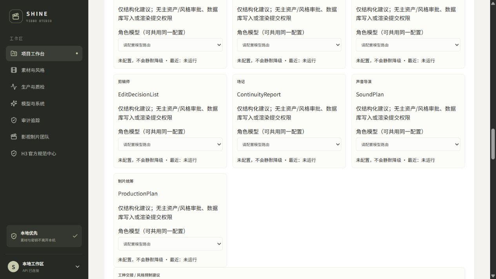
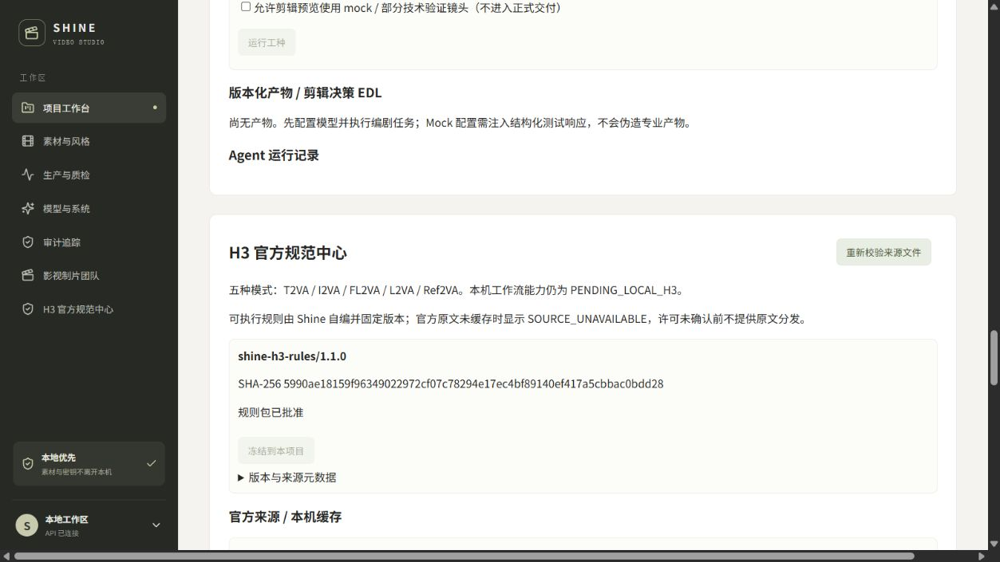

# Shine 视频工作台 V1.1 实现与离线验收报告

日期：2026-10-21（Asia/Shanghai）。本报告区分实际代码、离线模拟验证和真实模型验收。

## 交付身份

- 私有仓库：[anjingdtl/shine-video-studio](https://github.com/anjingdtl/shine-video-studio)。
- 需求基线：[Draft PR #2](https://github.com/anjingdtl/shine-video-studio/pull/2)，
  `8bdefe8d0e394b48a3c8611ca42650e70a944040`；完整文档已包含在本实现分支中。
- 既有 M1/M2/M3 基线：`e54e35eb2ed188f9c1812aa4e51da4454fa4ccf6`。
- 开发分支：`codex/v1.1-film-crew-rulebook`。
- 实现提交：`2a799186a1bddbc52d9f1a94d278d15449216fc8`。
- 实现 PR：[Draft PR #3](https://github.com/anjingdtl/shine-video-studio/pull/3)，base 为 `main`。
- 本报告提交的父提交为上面的实现提交；本次报告提交同时收口单次远端文本授权及其测试。
  最终交付 SHA 以 PR #3 的实际 head 和本轮回报为准，避免伪造自引用 SHA。
- 未修改、合并或强推 `main`；原需求 PR #2 保留。

## 实际实现

| 项目 | 结果和边界 |
| --- | --- |
| 四大工种 | 编剧 ScriptBreakdown、导演 DirectorialPlan、摄影 CameraPlan、剪辑 EDL 均为真实 Pydantic 契约与 API |
| 协同扩展 | 场记 ContinuityReport、声音 SoundPlan、制片 ProductionPlan；与四大工种共用 Registry/Gateway，不创建新队列 |
| 工种交接 | 上游版本 ID、SHA、资产清单、风格版本及规则包身份校验；未知/失效/跨项目输入拒绝；旧产物保留 |
| 权限 | 工种只有结构化建议；无 Shell、任意 HTTP、文件操作、批准素材、冻结风格或提交 ComfyUI 的工具 |
| 人工应用 | 摄影方案需对应场记报告及确定性预检，事务化创建原系统 Shot/Bindings；重复应用返回同一组镜头 |
| 风格预制 | 四大工种可提出 StyleProposal，用户应用仅更新草案；原人工冻结接口继续生效 |
| 人工主资产 | 导演只能绑定已批准锁定资产；有名角色需对应 approved character master；声音资产不能伪造 |
| Gateway | 复用原 ProviderProfile/AgentRoute；支持所有角色共享一份 profile 或分别路由；没有静默 provider 降级 |
| 远端文本授权 | 每次发送剧本/风格/资产元数据前需显式 allow_remote_text；不复用 VLM 审片同意；页面每次操作后清除此选项 |
| 运行记录 | 单库新增 AgentTaskRecord / AgentArtifact，调用前保存 intent，保存模型、输入输出摘要、Token/延时、错误码和来源状态 |
| 官方规范中心 | 四份固定官方来源的 URL/commit/blob SHA/SHA-256、缓存状态、许可边界、机器规则检索和重校验 |
| 版本锁 | 候选元数据版本产生 diff，经人工批准后才可冻结到新项目；已有项目 rulepack ID/hash 不可原地修改 |
| 规则更新 | 当前代码未支持的新官方 commit 或机器规则拒绝批准执行；必须开发、测试和审查，不能远程注入可执行规则 |
| 确定性门禁 | 重算唯一 H3Compiler 输出，校验模式、字段顺序、标签、时码、对白、风格和规则 hash；错误有来源定位和修复说明 |
| Worker / Repair | 创建请求和提交前重检；失败进入 NEEDS_REVIEW，无外部提交；返工通过原编译器产生不同请求并保留规则身份 |
| QC / 剪辑 | EDL 只用当前尝试的有效工件及完整门禁记录，检查范围和文件 SHA；旧/失败/mock 工件不得进入真实最终 EDL |
| 离线 EDL | 显式 offline_preview 才允许按原策略预览 mock/技术未完全验证的素材，保持标识，不改写 QC 状态 |
| Web | 真实接 API 的团队、工种交接、风格建议、运行记录/JSON 产物、规范中心和 EDL 预览界面 |
| 数据升级 | Alembic e8f1a2b3c4d5 增加四张表，旧项目/Job/Attempt/主资产表不重建；旧 compiler pin 兼容保留 |

另修复一个本轮 E2E 实测发现的问题：返工尝试不得复用前一次 attempt 的媒体工件。
恢复流程只复用同一 attempt 的工件；新尝试会重新收集输出、创建自己的工件记录，并保留旧结果。
上游专业产物替换会使相关产物、从其应用的 Job 及 Job 下游依赖失效，独立镜头不重算。

契约、表结构和端点详见 [v1.1-contracts.md](v1.1-contracts.md)。

## 自动化与浏览器证据

以下命令从仓库根目录实际执行，使用 Python 3.12.14 / Windows；无真实 LLM Key、GPU 或 H3 推理。

| 命令/检查 | 实际结果 |
| --- | --- |
| `uv run --project backend --locked pytest -c backend/pyproject.toml backend/tests` | **200 passed**, 1 条第三方 anyio/Starlette deprecation warning；62.41 秒 |
| `uv run --project backend --locked ruff check backend/shine backend/alembic backend/tests` | All checks passed |
| `npm --prefix frontend run build` | TypeScript + Vite 构建通过，1588 modules |
| `uv run --project backend alembic -c backend/alembic.ini upgrade head` | 隔离临时数据库迁移到 e8f1a2b3c4d5；旧库升级/数据保留/降级再升级有回归测试 |
| `git diff --check` | 通过 |
| 浏览器 localhost | 隔离合成项目创建、团队导航、规则包冻结、来源重校验和规则检索可操作；未触碰用户项目库 |

单次远端文本授权收口后，再运行 `test_film_crew.py`：**26 passed**，7.51 秒；
Ruff 和前端构建再次通过。既有 VLM 同意不等于文本发送授权的拒绝路径纳入同一专项测试。

200 项包括既有 174 项和新增 26 项，不把 mock 等同真实模型通过。保留原
`test_offline_e2e.py`，新增 `test_film_crew.py` 的真实 API/SQLite/Fake HTTP 测试覆盖：

1. 编剧 → 导演 → 摄影 → 场记 → 人工应用 → H3Compiler → Fake ComfyUI → QC → 一次返工 → EDL 预览。
2. 真实合成 MP4、人物参考上传、不同尝试独立媒体身份、返工请求变化、下游失效。
3. 五种模式、原中文对白、英文描述阻断、官方规则来源定位和提交前篡改阻断。
4. 共用/不同 profile、超时、畸形 JSON、Prompt Injection、未知角色/Tool、锁定事实和未批准资产拒绝。
5. 缺缓存明确显示、缓存双哈希导入/重开（使用自编合成夹具）、篡改阻断、未知许可/未实现版本拒绝。
6. 规则候选差异、人工批准、项目版本不可替换、过期工件/失败尝试/损坏媒体拒绝进入 EDL。

首轮曾在 `backend` 目录运行 `uv run pytest`，因现有迁移测试使用仓库根目录相对路径而得到
169 passed / 5 failed；改用上表的仓库根目录命令后全部通过。没有删除或跳过这些测试。

GitHub CI：实现提交的 [ci #15](https://github.com/anjingdtl/shine-video-studio/actions/runs/39552019657)
已实际完成，三个 job 均为 **success**：

| GitHub job | 实际结果 |
| --- | --- |
| backend / Ubuntu | 200 passed，65.93 秒；Ruff 和迁移通过 |
| backend-windows | 200 passed，159.90 秒；Ruff、迁移与 localhost API 健康检查通过 |
| frontend | npm ci 与 TypeScript/Vite build 通过 |

Windows CI 健康检查明确返回 `render_provider=mock-only`、`h3_connected=false`；
不能解读为真实 H3 连通。报告/授权收口提交会触发另一轮 CI，最终状态查看 PR #3 最新 head，
不把上述实现提交的运行冒充后续提交已通过。

## 来源和许可

官方固定版本：`MiniMax-AI/MiniMax-H3@d21241f0a4b3acbb34c97dae47fa417b7065e438`。
本轮重新读取四份文件并在内存重算 SHA-256，未将原文缓存进仓库或提交分发。

| 文件 | SHA-256 |
| --- | --- |
| skills/h3-prompt-writing/SKILL.md | a7000443588ca3f145e3b3fd8900f14e0325dc460bd811268fac89a9dc8e56d0 |
| references/base-en.txt | 2cfebc096a6e08370f288d468d90b60f7f9bcb938f94bf090816e910e48e75fc |
| references/ref-en.txt | 1e574f356716ad55612247ffb7bbccbcdb484ad96599d63c7dca1af186b1fab7 |
| README.md | 7964f3044d3c7efaa054bb823644ad98cf9ea43389f994c51e08977822f16bac |

规则和摘要由 Shine 自编；官方硬规范、Shine 产品约束、本机 Workflow 证据分别标识。
原文再分发许可仍未确认；用户可从官方固定 URL 合法获取后主动导入本机缓存，
系统核对 Git blob 和内容 SHA-256。原文未缓存显示 SOURCE_UNAVAILABLE，不冒充已获得官方原文。
没有复制 GPL 节点源码，也未安装或运行其它视频生成引擎。详见 [upstream-audit.md](upstream-audit.md)。

## 仍待验证或后续实现

| 项目 | 状态 |
| --- | --- |
| 真实 H3 GPU 推理、五种模式实际节点兼容 | PENDING_LOCAL_H3；本轮明确未执行 |
| 用户本机真实 API Workflow / parameter_map / media_transfers | 需用户实际工作流和 object_info；不能用 Fake profile 冒充 |
| 人物身份、服装、摄影运动、中文发声/唇形、音色、连续性及艺术质量 | PENDING_LOCAL_H3；需真实样片和人工/VLM/ASR 证据 |
| 真实 LLM/VLM/ASR 的专业创作能力、费用、延时和隐私传输验收 | NOT_RUN；本轮仅可控 mock Gateway，无外部模型调用 |
| 完整语言/剧情语义检查 | 当前英文检查为确定性 CJK 检测；不能据此宣称英文流畅、无事实矛盾或完整艺术合格 |
| 官方上游新规则版本 | 必须开发和测试后审批；现实现仅允许相容的元数据修订 |
| 编辑后最终视频、J/L cuts、转场合成、整剧最终交付 | M4 后续；本轮为经过门禁的 EDL JSON，不宣称已合成成片 |
| Agent 调用中进程崩溃 | 保留 RUNNING intent 供人工核对，不自动重放，不新增后台 Agent 队列 |
| 多工种自动交互与审美分歧 | 受控阶段交接和显式人工应用已实现；复杂分歧仍需用户裁决 |

V1.1 规则项目需英文视觉/摄影/风格描述；中文对白保持原文。既有中文风格不会被静默翻译或改写，
会显示 H3_ENGLISH 阻断，由用户/专业工种建议修订后人工确认。英文语言门禁不等于语义质量通过。

本轮结论：**IMPLEMENTED / TESTED_OFFLINE / MOCK_VERIFIED**，不据离线测试宣称真实 H3 验收、
无人值守整剧完成或最终合格成片。真实验收按 [local-h3-acceptance.md](local-h3-acceptance.md) 继续。

## 本机复现

按 README 完成依赖安装和迁移，启动 loopback API、独立 Worker 和 Web。
在「模型与系统」配置已有兼容模型，再在「影视制片团队」为各工种显式选 profile。
先冻结规则包，提出风格建议或填写 Style Bible 并人工冻结；依次选取上游产物执行工种。
勾选对应场记报告，人工应用摄影计划，通过原有生产界面排队。
没有真实模型配置时，可直接运行上述测试复现 Fake 协作链路；普通 Mock 默认响应不会伪造工种产物。

除合成测试夹具与页面截图外，未提交媒体、DB、密钥、用户原始素材或模型权重。
