# ADR 0008: Standalone Shine Assets on the shared production kernel

- Status: Implemented; local model and GPU validation remains pending
- Date: 2026-11-08
- Baseline: `631d9a07c6be5911a88e138bb037da3d369f3d79` (`origin/main`)
- Feature branch: `feature/shine-assets-center-20261108`
- Existing Alembic head: `f180b0020001`
- Authority: `docs/SHINE_ASSETS_CENTER_FULL_BUILD_PLAN_20261108.md`, docs branch commit `76a4e3abf3c4b20d32eb28925656820c2d3b9e3c` (read in place; that PR is not merged into this feature branch)

## Decision

Shine Assets is a third top-level workspace beside Shine Director and professional settings. It owns a global library domain with no `project_id`; the existing project asset, candidate, voice, rights, director and H3 production tables keep their current project-bound contracts. A user action that assigns a reviewed global version creates a new project-scoped `Asset` identity and an immutable source/version/rights snapshot. The content-addressed bytes may be shared; project identities and permissions may not.

Generation requests are durable rows consumed by the existing resident Worker, ComfyUI client and exclusive `ResourceLease` scheduler. No second Worker, scheduler, ComfyUI process, or task-retry path is introduced. A request is committed before an external call; the external prompt ID is persisted immediately; uncertain submission remains `UNKNOWN` and is reconciled without replay. Images are lower priority than H3 and wait behind active or unreconciled leases.

## Baseline findings

- Starting checkout was clean on `work` at `631d9a07c6be5911a88e138bb037da3d369f3d79`. `origin/main` resolved to the same SHA after fetch. The current branch was created from that SHA; no existing work was overwritten.
- The starting migration head is `f180b0020001`. `assets.project_id`, `candidate_assets.project_id`, `voice_profiles.project_id` and `rights_records.project_id` are required foreign keys. None is relaxed by this change.
- `Asset` is project-scoped and has a project/hash uniqueness constraint. `CandidateAsset` promotion, media hashing/decoding, rights enforcement and approval live in `comfyops.assets`; those APIs cannot accept a projectless record as-is.
- Image preparation already persists a task/attempt ledger and routes one image at a time through the resident Worker. `resource_slot` is the common exclusive GPU admission path. H3 renderer ownership, lease release, four-stage director records, and frozen production manifests remain untouched.
- Existing Qwen T2I API graph is source-pinned in `materialprep.qwen_workflow`; its local render readiness is not evidence for edit, mask, multi-reference, alpha or 2K readiness.

## Global data model

The additive migration adds:

- `library_assets`: stable global identity, title, category, tags, favorite/archive metadata and a version pointer.
- `library_versions`: immutable bytes hash, storage key, decoded media facts, lineage, mode, source/reference manifest, rights snapshot, technical QC and human-review/promotion state.
- `library_media`: controlled upload/mask/reference media records. A server-generated ID is used in API contracts; clients never provide a filesystem path or remote URL.
- `library_render_tasks` and `library_task_attempts`: idempotency/request hash, mode, workflow identity, durable state, claim/heartbeat, submit intent, external prompt ID/outcome, lease identity and append-only attempt evidence.
- `library_rights`: provenance, license and permitted use, consent subject/scope, actor, expiry and revocation. A missing or unclear commercial grant blocks commercial use.
- `library_voice_profiles`: global voice version and its conditioning media/rights snapshot. Project-bound `VoiceProfile` rows remain separate.
- `library_project_links`: target project, global asset/version, newly created project `Asset` ID, role/entity, rights snapshot and idempotency key. Links never point to another project's `Asset`, `VoiceProfile` or `RightsRecord`.

The database transaction for promotion consumes a short-lived, single-use action grant bound to the candidate ID, SHA, source manifest and rights snapshot. Promotion never edits content or source data. Assignment validates the live rights and content hash, then creates a project asset row, link and audit event atomically. The project must pass its existing production approval/lock rules before use. A V2 update only advances the global current-version pointer; project links to V1 remain immutable.

## Data and execution path

```mermaid
flowchart LR
  UI[Assets workspace] -->|upload / explicit generation POST| API[Asset Center API]
  API --> DB[(Existing SQLite WAL)]
  API --> CAS[Existing content-addressed store]
  DB --> Worker[Existing resident Worker]
  Worker --> Lease[Existing ResourceLease scheduler]
  Lease --> Comfy[Existing managed ComfyUI]
  Comfy -->|declared output only| CAS
  CAS --> QC[Hash, media probe, technical QC]
  QC --> Review[Human review and one-time promotion]
  Review --> Library[Global library version]
  Library -->|explicit assignment| ProjectAsset[New project-scoped Asset snapshot]
  ProjectAsset --> Director[Existing Director flow]
  Director -->|explicit save, verified and locked| Library
```

The browser only reattaches to task IDs after refresh. It never submits a job on page load. On project change, outstanding assignment and requirement context is invalidated and rechecked server-side before a result can be returned.

## Qwen-Image-2.1 workflow evidence and limits

- Existing T2I model identity: `Comfy-Org/Qwen-Image-2.1` revision `aacf31a6d48e707f352ecba714cee0680da3479b`; the existing audited T2I API graph remains the only image graph with prior render evidence.
- Official edit example inspected: `Comfy-Org/workflow_templates/templates/image_qwen_image_2_1_image_edit.json`, repository commit `21d7cc4fb9afd983957f2d2d6b1d583860ccb40b`, SHA-256 `c1e6551759de131f083a040da072ac6f032c3c8401ceca202412cd912897d0fc` (96,740 bytes). This is a UI document with a nested subgraph, not an API prompt graph; it must be compiled and live-validated before use.
- The official edit subgraph's visible upload slots are `images.image_1` through `images.image_10`. `image_1` is the edit canvas/target; later slots are ordered references. `TextEncodeQwenImage21` receives the image slots and prompt; its declared inputs include `images.image_1` through `images.image_12`, while the UI example exposes only ten top-level image slots and leaves 11/12 disconnected. Therefore the supported visible input cap from this sample is ten total images, including the edit target, not ten references plus a target.
- The example has no dedicated mask node. The adapter uploads and hashes the actual mask PNG into the final numbered `images.image_N` annotation slot, explicitly maps white/black semantics in the prompt, and also applies it to the harvested output in a deterministic pixel compositor: white selects generated pixels, black copies the exact original pixels. The mask consumes one of ten total graph slots. Capability stays pending until a local model sample proves the node accepts the annotation and passes the complete mask sample. The browser overlay alone is never accepted as a mask.
- The workflow sample's model widgets include `qwen_image_2.1_int8_convrot.safetensors`, `qwen3vl_8b_int8_convrot.safetensors`, `qwen_image_2.1_vae_bf16.safetensors`, and an optional prompt-expansion encoder. The UI JSON does not establish that any are installed here.
- The upstream Qwen repository license is a research license dated 2026-09-20. It does not grant commercial rights by default; the model terms require a separate commercial license. The UI and API preserve that restriction in rights records and block commercial production unless an operator records applicable authorization. User image, voice or likeness authorization remains separate.

## Capability status policy

The status ladder is `UNREGISTERED → REGISTERED → STATIC_VALIDATED → LOCAL_SAMPLE_PASSED → READY`; runtime drift, missing weights, failed release or rights changes invalidate readiness. Cloud Fake tests use a separate `MOCK_VERIFIED` evidence axis and never promote to `READY`. In this environment no ComfyUI renderer, Qwen-Image-2.1 weights, Windows host or RTX 5080 is available; real image and H3 hardware validation remains not run.

| Capability | Software contract | Cloud claim |
|---|---|---|
| T2I | Existing pinned API graph, one candidate per explicit request | Existing graph evidence only; current local READY is not asserted |
| I2I | Official edit graph with target bytes in slot 1 and ordered refs in slots 2–10 | Pending local graph/object-info/render validation |
| Inpaint | Canvas-space mask upload; native edit graph; actual mask applied after harvest with exact pixel preservation; mask SHA and semantics in the version manifest | Pending local render and output-pixel validation; the official graph itself has no mask input |
| MultiRef | Strict ordered slot mapping; reject above the registered total-slot limit | Ten total inputs are evidenced by the UI template, API mapping still requires local validation |
| Wardrobe | A MultiRef preset with explicit subject/garment/accessory roles | Pending local validation; no separate model is claimed |
| RGBA | Deterministic canvas cutout writes a real alpha channel from an explicit subject mask; all output PNGs undergo decoded alpha checks | Manual mask cutout is software-ready; prompt-based/native Qwen alpha output remains pending real model proof |
| 2K | Size fields flow to the graph only when schema and bounds declare them | Pending local VRAM/output validation; no performance promise |

## Consequences

- Global asset functionality is implemented through new tables and adapters, not synthetic projects or nullable project foreign keys.
- Candidate/review/promotion and project assignment are separate user decisions. A technical decode pass is not semantic approval, voice consent, commercial rights or H3 production approval.
- Feature development avoids `worker.py`, `preproduction.py` and frozen H3/four-stage contracts. The existing worker's material-image dispatch point is the extension seam so global work can be admitted through the same scheduler.
- No generated sample, API key, user media, voice sample, production database or active H3 task is added to this branch.
